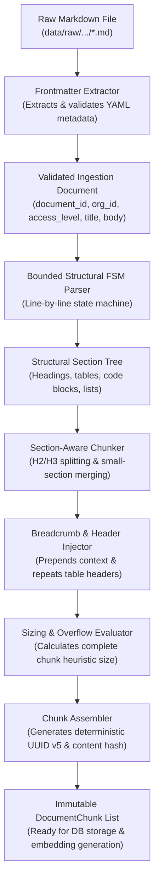
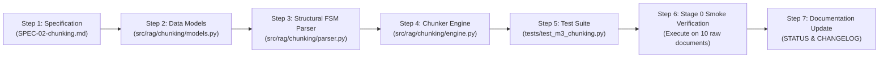

# Milestone M2: Chunking & Ingestion — Plan

**Milestone:** M2 — Chunking and Ingestion Design (Planning Phase)  
**Author:** Akshit Chandel (RAG & Knowledge Base Track)  
**Status:** Approved for Implementation Planning  
**Target Implementation Milestone:** M3 (Chunking Implementation)  
**Date:** 2026-11-24  

---

## 1. Objective and Scope

### 1.1 Objective
The objective of Milestone M2 is to establish the formal engineering architecture and technical specification for document normalization, structural parsing, section-aware chunking, and metadata propagation for the Multi-Tenant B2B Customer Support AI Knowledge Base.

This plan translates the approved architectural recommendations into an actionable implementation blueprint for Milestone M3, ensuring that raw Markdown articles staged in `data/raw/` are transformed into semantically coherent, metadata-preserving chunks optimized for dense vector retrieval and strict database-level tenant isolation.

### 1.2 In-Scope
- Architectural specification of a zero-dependency, bounded structural Markdown Finite State Machine (FSM) parser.
- Specification of section-aware chunking rules based on ATX heading hierarchies (`#`, `##`, `###`).
- Formalization of heading breadcrumb injection directly into chunk content text.
- Definition of structural preservation rules for Markdown tables, numbered procedural steps, and bulleted lists.
- Formulation of a transparent, non-truncating fallback protocol for oversized indivisible content.
- Definition of the chunk data structure, deterministic UUID v5 identification, and metadata propagation schema.
- Definition of tenant isolation and access-tier invariants aligned with the shared database contract.
- Formulation of a comprehensive unit and integration test strategy for Milestone M3.
- Identification of external database integration dependencies and unresolved team questions.

### 1.3 Out-of-Scope (Strict Milestone Boundaries)
- **No Code Implementation in M2:**authoring production code in `src/` is strictly deferred to Milestone M3.
- **No Formal Specification Authoring in M2:** authoring `docs/specs/SPEC-02-chunking.md` occurs after this plan is reviewed and established.
- **No File Mutation or Generation:** No raw data files, scanner scripts, tests, or documentation outside this plan are modified or created.
- **No Third-Party Package Installations:** Zero external packages (e.g. `langchain`, `llama-index`, `markdown-it-py`, `mistune`) installed in M2.
- **No Embedding Model Selection or Dimension Reconciliation:** Embedding models and 1536-d vs. 384-d dimension reconciliation remain deferred to Milestone M5.
- **No Database Operations:** No PostgreSQL table creation, migrations, or connections.
- **No Git State Changes:** No staging, committing, pushing, or branch switching.

---

## 2. Four-Register Project Model

To maintain scientific integrity and prevent conflating verified architecture with assumptions or external dependencies, all project information is strictly partitioned into four explicit registers:

| Register | Definition | Items in this Register |
|---|---|---|
| **Confirmed Facts** | Empirically verified truths in code, repository files, or signed shared team contract. | 1. Working tree is clean on `feature/m1-dataset-recon` at commit `665700e`.<br>2. Exactly 10 Markdown documents reside under `data/raw/` (5 in `org_a/`, 5 in `org_b/`).<br>3. 100% of documents carry valid YAML frontmatter parsed with 0 errors by `m1_recon_scanner.py`.<br>4. Verified tenant UUIDs: Org A (`11111111-1111-4111-8111-111111111111`), Org B (`22222222-2222-4222-8222-222222222222`).<br>5. Corpus contains strictly ATX H1–H3, dash lists, ordered lists, bold text, and 2 Markdown tables.<br>6. Corpus contains 0 fenced code blocks, 0 blockquotes, 0 Setext headings, and 0 nested lists.<br>7. Natural H2 sections average 106.9 estimated tokens (median 94.0; max 314; zero sections $> 450$).<br>8. Target table `knowledge_base_articles` defines 8 fixed conceptual columns: `id`, `org_id`, `document_id`, `chunk_index`, `title`, `content`, `access_level`, `embedding`.<br>9. Mandatory SQL prefilter invariant: `WHERE org_id = $1 AND access_level = ANY($2)`. Target leakage is 0%. |
| **Recommended Decisions** | Approved architectural designs to be implemented in Milestone M3. | 1. Implement a bounded, zero-dependency structural FSM line parser using Python standard library.<br>2. Apply section-aware chunking on ATX H2/H3 boundaries with small section merging.<br>3. Inject contextual heading breadcrumbs (`[Document: Title > Section]`) directly into `content` text.<br>4. Apply a provisional sizing target of 300–380 estimated tokens (heuristic ceiling 400) on the complete constructed chunk.<br>5. Never silently truncate; apply transparent oversize allowances (400–800 tokens) and sentence-boundary sub-splitting only if $> 800$ tokens.<br>6. Re-inject table headers on split tables; preserve procedural list items intact.<br>7. Generate deterministic UUID v5 `chunk_id` from `(document_id, chunk_index)`.<br>8. Adopt atomic document-level replacement (`DELETE WHERE document_id = $1; INSERT ...`) for re-ingestion, tracking file changes via SHA-256 manifests. |
| **Assumptions** | Design hypotheses requiring validation during implementation or future corpus delivery. | 1. Future corpus expansions will follow the structural style of the initial 10 documents.<br>2. Selected embedding model will support an input context window $\ge 512$ tokens.<br>3. Document re-indexing will execute transactionally within backend ingestion jobs. |
| **Unresolved Integration Dependencies** | External team interfaces requiring confirmation from backend/database teammate Tarun Saini. | 1. Primary key data type of `knowledge_base_articles.id` (`UUID` vs `BIGINT`/`BIGSERIAL`), and whether it accepts user-supplied IDs.<br>2. Availability of an optional `metadata JSONB` column for secondary audit attributes.<br>3. Formal team reconciliation of embedding dimensions (1536 vs 384).<br>4. Timeline for staging the remaining 40+ documents to reach the 50+ document target. |

---

## 3. Architecture and Processing Flow

The chunking subsystem is designed as a **pure, functional, decoupled pipeline**. It accepts validated document inputs and produces immutable chunk data structures in memory, without side effects, network calls, or direct database dependencies.



### Processing Pipeline Stages:
1. **Frontmatter Validation:** Extracts YAML frontmatter, validates RFC 4122 UUID v4 formatting for `document_id` and `org_id`, and verifies `access_level \in {'public', 'internal_staff', 'admin_only'}`.
2. **Structural FSM Parsing:** Parses Markdown body text into hierarchical section nodes, tracking line states to prevent heading false-positives inside code blocks.
3. **Section Aggregation & Splitting:** Traverses the section tree, grouping compact sibling subsections up to the target heuristic budget while respecting primary H2 topic boundaries.
4. **Context Injection:** Injects heading hierarchy breadcrumbs at the beginning of each chunk payload and re-injects table headers onto split table chunks.
5. **Sizing & Safeguard Verification:** Evaluates the complete chunk payload against heuristic thresholds, applying the transparent fallback protocol if indivisible content exceeds limits.
6. **Chunk Construction:** Attaches immutable metadata (`org_id`, `access_level`, `document_id`, `chunk_index`), calculates SHA-256 `content_hash`, and generates deterministic UUID v5 `chunk_id`.

---

## 4. Parser Approach and Grammar Boundaries

### 4.1 Bounded Structural Parser Design
The M3 parser (`src/rag/chunking/parser.py`) is explicitly designed as a **bounded structural parser**, not a complete CommonMark engine. It is strictly scoped to the structural constructs necessary for B2B technical support and knowledge base articles.

### 4.2 Supported Markdown Constructs
- **YAML Frontmatter:** Delimited by `---` on Line 1 and closed by `---`.
- **ATX Headings (`#` through `######`):** Recognized strictly at column 0 followed by whitespace (`^#{1,6}\s+(.*)$`). Extracts heading depth and heading text.
- **Fenced Code Blocks:** Opened by three or more backticks (```` ``` ````) or tildes (`~~~`) with optional language identifier. Closes on matching fence character and length.
- **Markdown Tables:** Contiguous lines starting and ending with pipe characters (`^\s*\|.*\|\s*$`) including the column separator row.
- **Unordered Lists:** Items prefixed by hyphen and space (`^-\s+(.*)$`) at column 0.
- **Ordered Lists:** Items prefixed by digits, period, and space (`^\d+\.\s+(.*)$`) at column 0.
- **Paragraphs:** Non-empty text blocks separated by one or more blank lines (`\n\n`).
- **Inline Styling:** Bold (`**text**`), inline code (`` `code` ``), and italics are preserved verbatim within chunk text without altering structural boundaries.

### 4.3 Explicitly Unsupported Constructs (Treated as Plain Body Text)
- **Setext Headings:** Lines underlined with `===` or `---` are not recognized as headings; treated as plain paragraphs or horizontal dividers.
- **Indented Code Blocks:** 4-space or tab indentation is treated as indented body text; code blocks must use fenced syntax.
- **Blockquotes:** Lines starting with `>` are treated as standard body text under the active heading.
- **Raw HTML:** HTML tags (`<div>`, `<span>`) are passed through as raw text without tag parsing.

### 4.4 Heading Disambiguation Inside Code Fences
To prevent lines matching heading syntax (e.g., `# Configuration comment` or `#!/bin/bash`) inside code blocks from triggering false section boundaries, the parser implements a stateful Finite State Machine:
- The parser maintains state: `current_state \in {STATE_FRONTMATTER, STATE_BODY, STATE_CODE_FENCE}`.
- When in `STATE_BODY`, encountering `^(```+|~~~+)` records the opening fence character and length, transitioning the parser to `STATE_CODE_FENCE`.
- When in `STATE_CODE_FENCE`, lines starting with `#` are appended directly to the code buffer. **Heading pattern evaluation is completely bypassed.**
- The parser transitions back to `STATE_BODY` only when a closing fence of matching character and length $\ge$ is encountered.

---

## 5. Chunking Rules and Boundaries

### 5.1 Hierarchical Splitting Logic
1. **Document-Level Boundary:** Chunks are strictly partitioned by document. A chunk never spans across multiple source documents.
2. **H2 Section as Primary Topic Unit:** Major topical sections (`## `) form the primary chunk boundary candidates (e.g. `## Account Setup`, `## Troubleshooting Guidance`).
3. **H3 Subsection as Procedural Unit:** When an H2 section contains multiple discrete procedural workflows (e.g. `### Step 1: Check Status`, `### Step 2: Verify State`), subsections are evaluated as distinct chunk units.
4. **Small Section Merging:** If a section or introductory header contains $< 60$ estimated tokens (e.g., a 2-line intro under an H2 before H3 subsections begin), it is merged forward into its first child subsection rather than emitted as an isolated stub chunk.
5. **Context Breadcrumb Injection:** Every chunk prepends a standardized breadcrumb header:
   ```markdown
   [Document: <Title> > <H2 Section> > <H3 Subsection>]
   
   <Chunk Body Text>
   ```

---

## 6. Chunk Sizing and Estimation Approach

### 6.1 Token Estimation Methodology
- **Heuristic Formula:** Token estimation uses the standard whitespace heuristic:
  $$\text{estimated\_tokens} = \lceil\text{word\_count} \times 1.33\rceil$$
- **Explicit Non-Guarantee Disclaimer:** The word-based heuristic is an approximate engineering proxy for text length. **It does not and cannot guarantee actual model tokenizer token counts.** Subword tokenizers (BPE, WordPiece) break punctuation, code, UUIDs, and tables into multiple tokens per word, creating variable expansion rates.
- **Full-Chunk Overhead Invariant:** The sizing budget is evaluated against the **complete constructed chunk payload** (including injected breadcrumbs, repeated table headers, and procedural notices), never on the raw body slice alone.

### 6.2 Target Sizing Budgets
- **Provisional Target Size:** 300 to 380 estimated tokens.
- **Provisional Heuristic Threshold:** 400 estimated tokens.
- **Empirical Rationale:** In the verified 10-document corpus, natural H2 sections average 106.9 estimated tokens, and only a single H2 section exceeds 300 tokens (314 tokens). Setting the heuristic ceiling to 400 estimated tokens provides an operational buffer of 20% to accommodate subword expansion, keeping typical chunks comfortably below the 512-token context window of candidate embedding models (e.g. BGE-small).
- **Provisional Status:** These budgets remain provisional guideposts until the final embedding model and its tokenizer are benchmarked in Milestone M5.

---

## 7. Handling of Tables, Lists, and Oversized Content

### 7.1 Markdown Table Preservation & Splitting
- **Atomic Principle:** Markdown tables are treated as indivisible structural blocks whenever their complete constructed size is $\le 400$ estimated tokens. Tables are never split across cells or mid-row.
- **Oversized Table Handling ($> 400$ estimated tokens):**
  - Splitting occurs strictly on row boundaries (`\n|...|\n`).
  - The table column header row and divider row:
    ```markdown
    | Column 1 | Column 2 | Column 3 |
    |---|---|---|
    ```
    are **re-injected at the top of every continuation chunk**.
  - Continuation chunks carry an explicit breadcrumb indicator:
    `[Document: Title > Section (Table Part 2)]`

### 7.2 Numbered and Bulleted Lists
- **Item Integrity:** Chunks are never cut inside an individual list item or procedural step.
- **Precondition Binding:** Diagnostic steps (e.g. Steps 1 to 4) remain bound to their preceding section heading and preconditions.
- **Oversized List Handling ($> 400$ estimated tokens):**
  - Splitting occurs strictly between discrete list items (`\n\d+\. ` or `\n- `).
  - Continuation chunks carry heading breadcrumbs with item range indicators:
    `[Document: Title > Procedures (Steps 5-8)]`

### 7.3 Transparent Fallback Protocol for Indivisible Content
When a single table row or single procedural item itself exceeds the 400-token heuristic ceiling:
1. **No Silent Truncation:** Text is never silently truncated, dropped, or clipped to meet a token budget.
2. **Zone 1: Controlled Oversize (400 to 800 estimated tokens):**
   - The engine emits the chunk intact, prioritizing structural coherence over arbitrary splitting.
   - The chunk metadata sets `is_oversized: True`, and a structured warning is emitted during ingestion.
3. **Zone 2: Emergency Sentence-Boundary Split ($> 800$ estimated tokens):**
   - If an indivisible element exceeds 800 estimated tokens (risking vector API rejection):
   - The engine splits on sentence boundaries (`re.split(r'(?<=[.!?])\s+')`).
   - Every continuation chunk carries the primary breadcrumb and an explicit continuation tag: `[Continuation: Row N (Part M)]`.
   - The chunk metadata sets `is_split_item: True`.

---

## 8. Chunk Metadata and Identifiers

### 8.1 Chunk Data Model
Chunks generated in M3 will conform to the following dataclass model:

```python
from dataclasses import dataclass
from typing import Optional, List

@dataclass(frozen=True)
class DocumentChunk:
    # Mandatory Contract Fields (mapped to database columns)
    chunk_id: str          # Deterministic UUID v5
    document_id: str       # UUID v4 of parent document
    org_id: str            # UUID v4 of tenant
    access_level: str      # 'public' | 'internal_staff' | 'admin_only'
    chunk_index: int       # 0-based sequential index within document
    title: str             # Parent document title
    content: str           # Complete chunk payload with breadcrumbs
    
    # Internal Pipeline Metadata (Enrichment, Auditing, Verification)
    heading_path: List[str]      # e.g. ["Account Setup", "Connecting Email"]
    token_count_est: int         # Estimated token length of content
    content_hash: str            # SHA-256 hex digest of content
    chunking_version: str        # e.g. "v1.0-section-aware"
    category: Optional[str]      # Category from frontmatter
    source: Optional[str]        # Source from frontmatter
    is_oversized: bool = False   # Flag if chunk exceeded 400 est. tokens
    is_split_item: bool = False  # Flag if an indivisible item was sentence-split
```

### 8.2 Deterministic Chunk Identification
- **UUID v5 Formulation:** Chunk IDs are generated deterministically:
  $$\text{chunk\_id} = \text{str}(\text{uuid5}(\text{NAMESPACE\_URL}, f\text{"\{document\_id\}\#\{chunk\_index\}"}))$$
- **Database PK Decoupling:** `chunk_id` is an application-level identifier. We **do not assume** the database primary key `knowledge_base_articles.id` accepts UUID strings until confirmed by backend teammate Tarun Saini. If the database uses `BIGSERIAL`, `chunk_id` remains an application-level traceability identifier.

### 8.3 Zero Unapproved Database Schema Impact
- To avoid requiring unapproved database migrations or a `JSONB` column:
  - Heading breadcrumbs are embedded directly into `content` text.
  - Mandatory fields (`org_id`, `document_id`, `chunk_index`, `title`, `content`, `access_level`) map directly to the 8 existing contract columns.
  - Secondary audit fields (`content_hash`, `token_count_est`, `chunking_version`) remain in application-level ingestion manifests and logs.
- **Strict Role Invariant:** No role names (e.g. `End_Customer`, `Support_Agent`, `Org_Admin`) or role UUIDs are attached to chunks.

---

## 9. Security and Tenant-Isolation Invariants

### 9.1 Core Invariants
1. **Metadata Inheritance Immutability:** `org_id` and `access_level` must be cloned directly from verified parent frontmatter into every child chunk. The chunker is strictly prohibited from inferring, modifying, or defaulting tenancy or sensitivity based on text content or directory paths.
2. **Stateless Chunking Engine:** The chunker is implemented as a pure, stateless transformation function:
   `chunk_document(...) -> list[DocumentChunk]`
   No module-level mutable state or cross-document caching may exist, eliminating cross-tenant memory leakage during batch processing.
3. **Database Pre-filtering Readiness:** Every chunk row stored in PostgreSQL will carry non-null, indexed `org_id` and `access_level` attributes, directly supporting the mandatory pre-retrieval SQL filter:
   ```sql
   WHERE org_id = $1 AND access_level = ANY($2)
   ```
4. **Post-Retrieval Filtering Ban:** Filtering unauthorized chunks in Python application code after unrestricted retrieval is strictly prohibited.

---

## 10. Re-Ingestion Considerations

### 10.1 Proposed Re-Ingestion Strategy
- **Atomic Document-Level Replacement:** Ingestion updates are executed transactionally at the document level:
  ```sql
  DELETE FROM knowledge_base_articles WHERE document_id = :doc_uuid;
  INSERT INTO knowledge_base_articles (id, org_id, document_id, chunk_index, ...) VALUES (...);
  ```
- **Rationale:** Content-hash-based row upserts create orphaned "ghost" chunks when documents are edited or sections reordered. Sequential index chunk IDs paired with document-level deletion ensure clean database synchronization.
- **Change Detection Manifest:** An application-level manifest records `sha256(raw_document_content)`. Before re-chunking and re-embedding, unchanged documents are skipped, avoiding unnecessary processing costs.

---

## 11. Testing Strategy for Milestone M3

The Milestone M3 test suite (`tests/test_m3_chunking.py`) will be implemented using isolated test fixtures to validate parsing, chunking, and isolation boundaries:

### 11.1 Test Matrix

| Test Suite Category | Test Case Identifier | Verification Objective |
|---|---|---|
| **Parser Correctness** | `test_atx_heading_extraction` | Validates extraction of H1–H6 ATX headings and line numbers. |
| | `test_code_fence_heading_suppression` | Asserts that `# Comment` inside ` ``` ` is never parsed as a heading. |
| | `test_table_detection` | Asserts that contiguous pipe lines are parsed as atomic tables. |
| | `test_list_detection` | Asserts that ordered and bulleted lists are grouped with active section. |
| **Chunking Mechanics** | `test_empty_document` | Verifies graceful error handling on empty or whitespace-only documents. |
| | `test_single_section_document` | Verifies that a compact document ($< 300$ tokens) produces exactly 1 chunk. |
| | `test_breadcrumb_injection` | Asserts presence and formatting of heading breadcrumbs in chunk content. |
| | `test_table_header_repetition` | Asserts that split tables repeat column header and divider rows. |
| | `test_oversized_transparent_fallback` | Verifies that oversized items emit `is_oversized: True` without silent truncation. |
| | `test_deterministic_output` | Verifies 100% identical chunk IDs and hashes across 50 repeated runs. |
| **Metadata & Isolation** | `test_metadata_propagation` | Verifies 100% inheritance of `org_id`, `access_level`, `title`, and `document_id`. |
| | `test_sequential_indexing` | Asserts that `chunk_index` is strictly contiguous: $0, 1, 2, \dots, N-1$. |
| | `test_deterministic_uuid5` | Verifies valid RFC 4122 UUID v5 generated from `(document_id, chunk_index)`. |
| | `test_tenant_isolation_org_a` | Asserts Org A documents produce strictly Org A chunks. |
| | `test_tenant_isolation_org_b` | Asserts Org B documents produce strictly Org B chunks. |
| | `test_interleaved_batch_isolation` | Alternates Org A and Org B in a single loop; asserts 0% cross-tenant bleed. |

*Explicit Caveat: Passing chunking metadata tests confirms correct data preparation, but does not prove retrieval security. Retrieval isolation will be evaluated in subsequent milestones via database query tests.*

---

## 12. Proposed Implementation Sequence for Milestone M3



1. **Step 1 — Formal Specification:** Author `docs/specs/SPEC-02-chunking.md` formalizing exact function signatures, class interfaces, and regex grammars.
2. **Step 2 — Core Models:** Implement `DocumentChunk` and `ParsedSection` dataclasses in `src/rag/chunking/models.py`.
3. **Step 3 — Structural Parser:** Implement bounded FSM parser and breadcrumb builder in `src/rag/chunking/parser.py`.
4. **Step 4 — Chunker Engine:** Implement section-aware aggregation, table/list preservation, and transparent overflow handling in `src/rag/chunking/engine.py`.
5. **Step 5 — Unit Test Suite:** Implement the 16 automated tests in `tests/test_m3_chunking.py`.
6. **Step 6 — Stage 0 Smoke Verification:** Run the chunker against the 10 raw documents in `data/raw/` and verify that generated chunks conform to all sizing and metadata gates.
7. **Step 7 — Documentation & Tracking:** Update `docs/STATUS.md` and log completed M3 changes in `docs/CHANGELOG.md`.

---

## 13. Risks, Assumptions, and Unresolved Integration Dependencies

### 13.1 Technical & Operational Risks
| Risk | Potential Impact | Mitigation Strategy |
|---|---|---|
| **Subword Tokenizer Expansion** | Tables, code, or UUIDs expanding beyond model context window. | Maintain conservative heuristic ceiling (400 est. tokens); benchmark real tokenizers immediately upon model selection in M5. |
| **Silent Policy Truncation** | Dropping text from customer support policies causes compliance breaches or AI hallucination. | Enforce Zero Silent Truncation Invariant; allow controlled oversize with transparent metadata flags. |
| **Stale Database Chunks** | Modifying documents leaves old chunk rows in PostgreSQL. | Mandate transactional document-level deletion (`DELETE WHERE document_id = $1`) during re-ingestion. |

### 13.2 Unresolved Integration Dependencies (Team Confirmation Required)

> [!NOTE]
> **Post-M2 Resolution Note (Shared Team Contract v3.0 Locked):**
> Items 1–3 were subsequently resolved and locked in Shared Team Contract v3.0 (see `docs/plans/03-chunking-implementation-plan.md`):
> - Database PK `knowledge_base_articles.id` is confirmed as `UUID` accepting user-supplied UUID v5 strings.
> - No `metadata JSONB` column is present; secondary audit attributes are tracked in application manifests.
> - Target embedding dimension is locked at 1536.
> Item 4 (Corpus Expansion Timeline) remains the only active external delivery dependency.

1. **Database Primary Key Data Type (`Backend teammate Tarun Saini`):**
   - *Dependency:* What is the exact PostgreSQL column type of `knowledge_base_articles.id` (`UUID` vs `BIGINT`/`BIGSERIAL`), and does the schema allow user-supplied IDs on `INSERT`?
2. **Metadata JSONB Column Availability (`Backend teammate Tarun Saini`):**
   - *Dependency:* Will `knowledge_base_articles` include a `metadata JSONB` column for secondary attributes (`category`, `source`, `content_hash`), or should supplementary fields remain in application manifests?
3. **Embedding Dimension Reconciliation (`Team / Lead`):**
   - *Dependency:* Formal reconciliation between the 1536-d contract specification and the 384-d brief recommendation (required before M5, non-blocking for M3).
4. **Corpus Expansion Timeline (`Team / Lead`):**
   - *Dependency:* Delivery schedule for the remaining 40+ documents to reach the 50+ document target.

---

## 14. Acceptance Criteria for Milestone M3 Implementation

- [ ] Specification `docs/specs/SPEC-02-chunking.md` authored, reviewed, and approved.
- [ ] Chunking engine implemented using strictly Python standard library (**zero external dependencies**).
- [ ] Bounded structural FSM parser correctly suppresses heading extraction inside fenced code blocks.
- [ ] Chunks strictly enforce the mandatory schema: `chunk_id`, `document_id`, `org_id`, `access_level`, `chunk_index`, `title`, `content`.
- [ ] Contextual heading breadcrumbs (`[Document: Title > Section]`) injected into chunk `content`.
- [ ] Markdown tables remain intact or split on row boundaries with repeated column headers.
- [ ] Numbered procedural steps are preserved without splitting individual items.
- [ ] Transparent fallback protocol enforced for oversized content: zero silent truncation.
- [ ] Deterministic UUID v5 generated for `chunk_id` while remaining decoupled from database PK.
- [ ] 100% metadata inheritance verified: `org_id` and `access_level` match parent frontmatter on all chunks.
- [ ] Zero cross-tenant contamination verified in interleaved multi-tenant test cases.
- [ ] Comprehensive test suite in `tests/test_m3_chunking.py` passes 100% of test cases.
- [ ] Stage 0 smoke verification successfully executed on the 10 raw documents under `data/raw/`.
- [ ] `docs/STATUS.md` and `docs/CHANGELOG.md` updated upon milestone completion.
