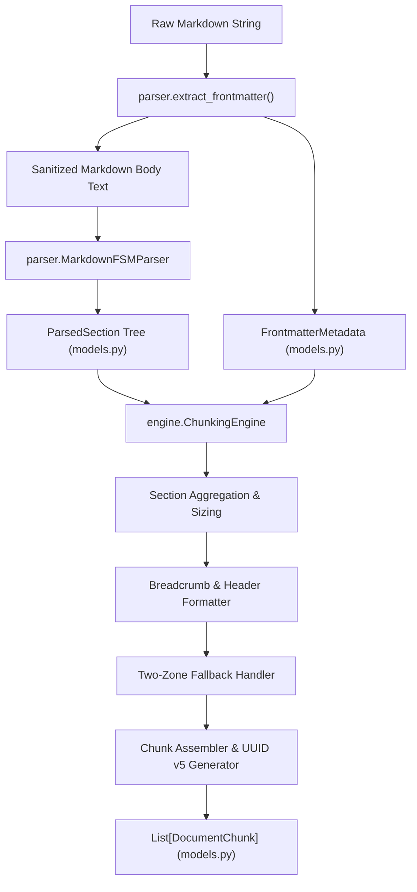
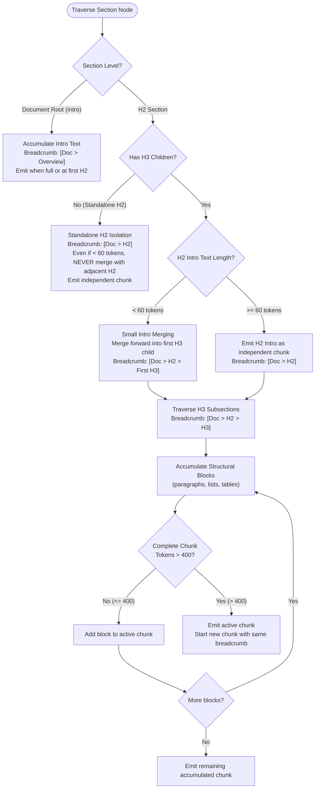
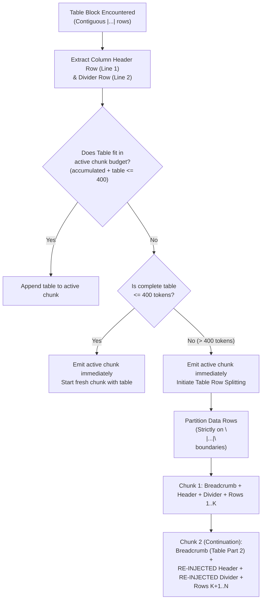
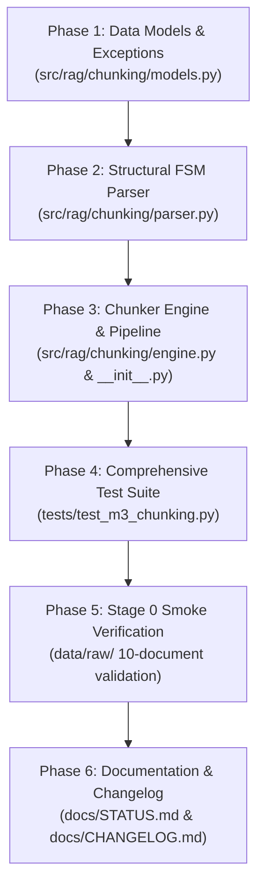

# Milestone M3: Chunking Subsystem — Implementation Plan

**Milestone:** M3 — Chunking Subsystem Implementation  
**Author:** Akshit Chandel (RAG & Knowledge Base Track)  
**Status:** Approved Implementation Plan (Audited & Reconciled with Shared Team Contract v3.0)  
**Governing Specification:** [SPEC-02: Document Chunking and Ingestion Architecture](../specs/SPEC-02-chunking.md)  
**Governing Architecture Plan:** [02-chunking-plan.md](02-chunking-plan.md)  
**Target Subsystem:** `src/rag/chunking/`  
**Target Test Suite:** `tests/test_m3_chunking.py`  
**Date:** 2026-11-24  

---

## 1. Executive Summary and Objectives

### 1.1 Executive Summary
Milestone M2 established the formal architecture and technical specification for document normalization, structural parsing, section-aware chunking, and metadata propagation. Milestone M3 is the transition from specification to production-grade implementation.

This audited implementation plan incorporates the resolutions to all read-only audit findings (F-01 through F-04) and fully reconciles the chunking subsystem with **Shared Team Contract v3.0 Locked**. It defines the precise execution blueprint for authoring the chunking subsystem in `src/rag/chunking/`, building its test harness in `tests/test_m3_chunking.py`, executing an authoritative 21-test suite, and validating the subsystem against the 10 raw knowledge base documents in `data/raw/` (Stage 0 Smoke Verification).

### 1.2 Core Objectives
1. **Pure Standard-Library Implementation:** Build a modular, decoupled chunking pipeline relying strictly on Python 3.10+ standard library (`re`, `pathlib`, `dataclasses`, `uuid`, `hashlib`, `json`, `math`, `logging`, `typing`). Zero external dependencies.
2. **Structural Bounded FSM Parsing:** Implement a line-by-line Finite State Machine that extracts ATX heading hierarchies, isolates Markdown tables, groups lists, and completely suppresses heading detection inside backtick and tilde fenced code blocks.
3. **Section-Aware Semantic Chunking:** Partition documents along H2 topic boundaries and H3 procedural boundaries, applying context-preserving heading breadcrumbs, forward-merging small H2 intro text into H3 children, and guaranteeing standalone H2 topic isolation.
4. **Deterministic and Isolated Chunk Assembly:** Generate immutable `DocumentChunk` instances with deterministic UUID v5 IDs, 100% frontmatter metadata inheritance (`org_id`, `access_level`, `document_id`), and zero cross-tenant contamination.
5. **Zero Silent Truncation via Two-Zone Fallback:** Implement transparent handling for oversized content: Zone 1 (400–800 tokens, intact with flag) and Zone 2 (>800 tokens, sentence-split with whitespace preservation and continuation markers).
6. **Authoritative 21-Test Matrix & Smoke Verification:** Implement all reconciled test methods with 100% passing assertions, followed by empirical validation across the 10 raw corpus documents.
7. **Shared Team Contract v3.0 Compliance:** Directly adopt confirmed UUID primary keys, 1536-dimensional embeddings, and the mandatory SQL prefilter invariant without assuming uncontracted database columns (e.g., no JSONB column).

---

## 2. Four-Register Project Model

To maintain scientific integrity and prevent conflating verified architecture with assumptions or external team dependencies, all project information is strictly partitioned into four explicit registers:

| Register | Definition | Items in this Register |
|---|---|---|
| **Confirmed Facts** | Empirically verified truths in code, repository files, or signed Shared Team Contract v3.0. | 1. Working tree is clean on `feature/m1-dataset-recon`.<br>2. Exactly 10 raw Markdown documents exist under `data/raw/` (5 in `org_a/`, 5 in `org_b/`).<br>3. 100% of raw documents carry valid YAML frontmatter parsed with 0 errors by M1 tooling.<br>4. Verified tenant UUIDs: Org A (`11111111-1111-4111-8111-111111111111`), Org B (`22222222-2222-4222-8222-222222222222`).<br>5. Confirmed KB access levels remain strictly: `public`, `internal_staff`, `admin_only`.<br>6. Target database table `knowledge_base_articles` defines 8 fixed columns: `id`, `org_id`, `document_id`, `chunk_index`, `title`, `content`, `access_level`, `embedding`.<br>7. Primary key `knowledge_base_articles.id` is typed as `UUID` (confirmed by Contract v3.0). User-supplied deterministic UUID v5 strings from `generate_chunk_id` are accepted directly on `INSERT`.<br>8. Target embedding dimension is locked at 1536 (confirmed by Contract v3.0).<br>9. The database schema does **not** include a `metadata JSONB` column. Secondary audit metadata are tracked in application dataclasses/manifests, not persisted in SQL.<br>10. Mandatory SQL prefilter invariant: `WHERE org_id = $1 AND access_level = ANY($2)`. Leakage target is 0.0%.<br>11. M1 scanner test suite in `tests/test_m1_recon_scanner.py` passes 13/13 tests cleanly.<br>12. Specifications `02-chunking-plan.md` and `SPEC-02-chunking.md` are audited and approved. |
| **Recommended Decisions** | Approved architectural designs to be implemented in Milestone M3. | 1. Modularize chunking into three decoupled files: `models.py`, `parser.py`, `engine.py`.<br>2. Rely strictly on Python standard library modules with zero third-party packages.<br>3. Implement a bounded 4-state line parser FSM (`FRONTMATTER`, `BODY`, `CODE_FENCE`, `TABLE`).<br>4. Implement dual code fence suppression (both ```` ``` ```` and `~~~`).<br>5. Apply token estimation heuristic: $\lceil\text{word\_count} \times 1.33\rceil$.<br>6. Calculate sizing budgets against the **full constructed chunk** (including breadcrumbs and repeated headers).<br>7. Standalone H2 sections without H3 children must remain independent chunks (never merge across H2).<br>8. Enforce Two-Zone fallback protocol: Zone 1 (400–800 tokens, intact) and Zone 2 (>800 tokens, sentence-split preserving whitespace).<br>9. Re-inject table headers on multi-part split tables; table continuation markers are presentation-only in breadcrumbs.<br>10. Generate deterministic UUID v5 chunk IDs using `uuid.NAMESPACE_URL` and `f"{document_id}#{chunk_index}"`.<br>11. Enforce strict raw UUID v4 validation operating on raw input strings without whitespace stripping or normalization. |
| **Assumptions** | Design hypotheses requiring validation during implementation or future corpus delivery. | 1. Future corpus expansions will conform to the ATX Markdown conventions present in the initial 10 documents.<br>2. Selected 1536-d embedding model in M5 will support an input context window of at least 512 tokens.<br>3. Database re-ingestion will execute transactionally at the document level (`DELETE` old chunks, `INSERT` new chunks). |
| **Unresolved Integration Dependencies** | External team interfaces requiring confirmation or delivery. | 1. Delivery timeline for staging the remaining 40+ documents to reach the 50+ target corpus.<br>2. Specific pgvector indexing parameters (e.g. HNSW vs IVFFlat build parameters) retained for Milestone M5/M6 database integration. |

---

## 3. Subsystem Architecture and Technical Responsibilities

The chunking subsystem is organized under `src/rag/chunking/` with clear functional boundaries and unidirectional dependencies.



### 3.1 Module Breakdown

```text
src/
└── rag/
    ├── __init__.py                # Package declaration
    └── chunking/
        ├── __init__.py            # Clean public exports (DocumentChunk, chunk_document)
        ├── models.py              # Dataclasses, custom exceptions, raw UUID v4/v5 utilities, token estimation
        ├── parser.py              # Bounded structural FSM parser and frontmatter validator
        └── engine.py              # Chunking engine, breadcrumbs, fallback protocols, table handlers
tests/
└── test_m3_chunking.py            # Authoritative 21-test suite reconciling SPEC-02 & audit safeguards
```

### 3.2 Component Responsibilities

#### 1. `src/rag/chunking/models.py`
- **Role:** Pure data schemas, invariants, custom exceptions, strict raw UUID validation, and deterministic ID utilities.
- **Dependencies:** `dataclasses`, `typing`, `uuid`, `hashlib`, `math`, `re`. Zero internal package imports.
- **Exceptions:**
  - `ChunkingError(Exception)`: Base exception for all chunking pipeline errors.
  - `EmptyDocumentError(ChunkingError)`: Raised when input document is empty or whitespace-only.
  - `MissingFrontmatterError(ChunkingError)`: Raised when opening `---` fence is absent.
  - `MalformedFrontmatterError(ChunkingError)`: Raised when opening `---` fence exists but closing `---` fence is absent before EOF, or frontmatter structure is invalid.
  - `InvalidMetadataError(ChunkingError)`: Raised when `org_id` or `document_id` fails strict UUID v4 validation.
  - `InvalidAccessLevelError(ChunkingError)`: Raised when `access_level` is not in `{'public', 'internal_staff', 'admin_only'}`.
- **Data Models:**
  - `FrontmatterMetadata`: Validated container for document metadata (`document_id: str`, `org_id: str`, `access_level: str`, `title: str`, `category: Optional[str]`, `source: Optional[str]`).
  - `ParsedSection`: Tree node representing an ATX heading and its content lines (`heading_level: int`, `heading_text: str`, `heading_path: list[str]`, `content_lines: list[str]`, `children: list[ParsedSection]`, `start_line: int`).
  - `DocumentChunk`: Immutable (`frozen=True`) final chunk payload adhering strictly to SPEC-02 Section 12.1 and Shared Team Contract v3.0:
    - `chunk_id: str`: Deterministic UUID v5 string (maps directly to database primary key `id` typed as `UUID`).
    - `document_id: str`: UUID v4 string of parent document.
    - `org_id: str`: UUID v4 string of tenant.
    - `access_level: str`: `'public'` | `'internal_staff'` | `'admin_only'`.
    - `chunk_index: int`: 0-based sequential index within document.
    - `title: str`: Parent document title.
    - `content: str`: Complete chunk text payload including breadcrumbs and repeated headers.
    - `heading_path: list[str]`: Canonical ancestor heading list. **Invariant (F-01):** Strictly stores canonical heading titles (e.g. `["Title", "SLA Commitments"]`). Continuation markers such as `(Table Part 2)` are presentation-only in `content` and must **never** be added to `heading_path`.
    - `token_count_est: int`, `content_hash: str`, `chunking_version: str`, `category: Optional[str]`, `source: Optional[str]`, `is_oversized: bool = False`, `is_split_item: bool = False`: Application-level audit metadata.
- **Strict UUID v4 Validation (`validate_uuid_v4`) — Resolved F-04:**
  - **No Whitespace Normalization Invariant:** The validator operates strictly on the **raw input string**. It does not perform `.strip()` or whitespace normalization; any surrounding whitespace causes immediate validation failure.
  - **Strict Validation Specification:**
    ```python
    UUID_V4_PATTERN = re.compile(
        r"^[0-9a-f]{8}-[0-9a-f]{4}-4[0-9a-f]{3}-[89ab][0-9a-f]{3}-[0-9a-f]{12}$",
        re.IGNORECASE
    )

    def validate_uuid_v4(value: str) -> None:
        """Strictly validate that value is a canonical RFC 4122 UUID v4 string.
        
        Operates on raw input without stripping or normalization. Rejects non-string
        types, surrounding whitespace, non-canonical formatting, wrong version bits,
        or normalized inputs by raising InvalidMetadataError.
        """
        if not isinstance(value, str):
            raise InvalidMetadataError(f"UUID must be a string, got {type(value).__name__}")
        if not UUID_V4_PATTERN.match(value):
            raise InvalidMetadataError(f"String '{value}' is not a canonical RFC 4122 UUID v4 format")
        try:
            parsed = uuid.UUID(value)
        except (ValueError, AttributeError) as exc:
            raise InvalidMetadataError(f"Malformed UUID value '{value}': {exc}") from exc
        if parsed.version != 4:
            raise InvalidMetadataError(f"UUID '{value}' is version {parsed.version}, expected version 4")
        if str(parsed).lower() != value.lower():
            raise InvalidMetadataError(f"UUID '{value}' was normalized from non-canonical representation")
    ```
- **Utility Functions:**
  - `generate_chunk_id(document_id: str, chunk_index: int) -> str`: Produces deterministic RFC 4122 UUID v5 from `uuid.NAMESPACE_URL` and `f"{document_id}#{chunk_index}"`.
  - `estimate_tokens(text: str) -> int`: Implements $\lceil\text{word\_count} \times 1.33\rceil$.
  - `compute_content_hash(text: str) -> str`: Returns SHA-256 hex digest of the chunk content.

#### 2. `src/rag/chunking/parser.py`
- **Role:** Line-by-line lexical analysis, frontmatter extraction, and structural section tree generation.
- **Dependencies:** `re`, `logging`, `typing`, `models.py`.
- **Key Classes & Functions:**
  - `extract_frontmatter(raw_text: str) -> tuple[FrontmatterMetadata, str]`:
    - Validates file non-emptiness (raises `EmptyDocumentError`).
    - Validates presence of opening `---` fence on Line 1 (raises `MissingFrontmatterError`).
    - Scans for closing `---` fence (raises `MalformedFrontmatterError` if unclosed before EOF).
    - Parses YAML-style key-values using standard regex.
    - Strictly validates `org_id` and `document_id` via `validate_uuid_v4` on raw values (raises `InvalidMetadataError`).
    - Validates `access_level in {'public', 'internal_staff', 'admin_only'}` (raises `InvalidAccessLevelError`).
    - Returns validated `FrontmatterMetadata` and sanitized body text.
  - `MarkdownFSMParser`:
    - States: `STATE_BODY`, `STATE_CODE_FENCE`, `STATE_TABLE`.
    - Fence tracking: Recognizes both ```` ``` ```` and `~~~` opening fences with arbitrary fence length ($\ge 3$) and optional language tag.
    - **Code Fence Heading Suppression Guarantee:** While in `STATE_CODE_FENCE`, heading evaluation regex is completely disabled. Lines beginning with `#` are preserved as raw code lines. Fence closes only when matching fence character of equal or greater length is encountered.
    - Table grouping: Groups contiguous pipe rows (`|...|`) into atomic table blocks.
    - ATX heading parsing: Recognizes `#` through `######` in `STATE_BODY`, instantiating `ParsedSection` nodes and constructing a clean hierarchical tree.
    - **Graceful EOF Handling & Structured Warning:** If EOF is reached while in `STATE_CODE_FENCE`, the parser closes the code block, emits a structured non-fatal log warning (see Section 3.5), and returns the parsed tree safely.

#### 3. `src/rag/chunking/engine.py`
- **Role:** Section traversal, semantic boundary aggregation, breadcrumb formatting, fallback protocol execution, and immutable chunk generation.
- **Dependencies:** `re`, `logging`, `typing`, `models.py`, `parser.py`.
- **Key Classes & Functions:**
  - `format_breadcrumb(doc_title: str, heading_path: list[str]) -> str`:
    - Top-level intro: `[Document: <Doc Title> > Overview]`.
    - H2 section: `[Document: <Doc Title> > <H2 Title>]`.
    - H3 subsection: `[Document: <Doc Title> > <H2 Title> > <H3 Title>]`.
  - `ChunkingEngine`: Detailed in Sections 3.3 and 3.4 below.
  - `chunk_document(raw_markdown: str) -> list[DocumentChunk]`: Top-level functional entry point coordinating validation, parsing, chunking, and metadata propagation.

---

### 3.3 Step-by-Step Chunk Aggregation Algorithm

The chunking engine traverses the `ParsedSection` hierarchy and constructs discrete chunks. The algorithm guarantees semantic boundary adherence, context preservation, and strict sizing controls:



#### Detailed Execution Steps:

1. **Document-Level Initialization:**
   - Extract document root title $T$ from the top-level H1.
   - Any content lines preceding the first H2 section constitute Document Overview text.
   - Breadcrumb fence: `[Document: <T> > Overview]`.
   - Accumulate overview blocks. Sizing is continuously measured using the **full constructed chunk formula**:
     $$\text{tokens} = \lceil\text{word\_count}(\text{breadcrumb} + "\backslash n\backslash n" + \text{accumulated\_text}) \times 1.33\rceil$$
   - If overview text exceeds 400 tokens, split at paragraph boundaries (`\n\n`). Emit completed overview chunks before proceeding to H2 sections.

2. **Top-Level H2 Traversal & Strict Isolation:**
   - Iterate sequentially through each H2 section node in the `ParsedSection` tree.
   - **Strict H2 Topic Isolation Invariant:** Content from an H2 section is **never merged across H2 boundaries** into an adjacent H2 section, regardless of how small either section is. Merging unrelated top-level topics (e.g. blending `## Preconditions` into `## Procedures`, or `## Expected Outcomes` into `## Troubleshooting`) introduces unacceptable semantic blurring during vector retrieval.

3. **H2 Section Evaluation:**
   - **Case A: Standalone H2 (No H3 Children):**
     - Breadcrumb fence: `[Document: <T> > <H2_Title>]`.
     - **Standalone H2 Isolation Rule:** Even if the section contains fewer than 60 estimated tokens (e.g. a brief 2-sentence section like `## Expected Outcomes`), it **must remain an independent chunk**. It is never merged backward or forward into neighboring H2s.
     - Group content lines into blocks (paragraphs, lists, tables).
     - Sizing & Emission:
       - Accumulate blocks while `estimate_tokens(breadcrumb + "\n\n" + accumulated) <= 400`.
       - When adding the next block would cause estimated tokens to exceed 400: emit the currently accumulated text as a completed chunk, start a new chunk with the identical breadcrumb header, and continue accumulating.
       - If an individual block itself exceeds 400 tokens, route it immediately to the Two-Zone Fallback Protocol.
   - **Case B: H2 with Child H3 Subsections:**
     - Check introductory content lines directly belonging to H2 (lines before the first child H3):
       - **Small Intro Merging Rule ($< 60$ estimated tokens):** The intro text **merges forward into the first child H3 subsection**. It is placed immediately before the H3 heading within the first H3 chunk, using the full H3 breadcrumb:
         ```markdown
         [Document: <T> > <H2_Title> > <First_H3_Title>]

         <H2 Intro Text>

         ### <First_H3_Title>
         <First H3 Content>
         ```
       - **Substantial Intro ($\ge 60$ estimated tokens):** The intro text is emitted as an independent chunk under `[Document: <T> > <H2_Title>]` prior to evaluating child H3 subsections.
     - Iterate sequentially through each child H3 subsection:
       - Breadcrumb fence: `[Document: <T> > <H2_Title> > <H3_Title>]`.
       - Accumulate structural blocks (paragraphs, lists, tables).
       - Evaluate complete constructed chunk sizing: `estimate_tokens(breadcrumb + "\n\n" + accumulated + "\n\n" + next_block)`.
       - Target budget: 300–380 estimated tokens. When adding `next_block` exceeds 400 tokens, emit the active chunk and start a new chunk with the same H3 breadcrumb.

4. **Post-Aggregation Oversized Handling & Whitespace Retention — Resolved F-03:**
   - Sizing checks are applied *during* aggregation at structural boundaries (paragraphs, list items, table rows).
   - If a single indivisible structural block cannot be subdivided further and exceeds the 400-token heuristic ceiling:
     - **Zone 1 (400–800 tokens):** The block is emitted intact as a single chunk. `is_oversized = True`, `is_split_item = False`. A structured log warning is emitted.
     - **Zone 2 (>800 tokens):** Emergency sentence-boundary split.  
       **Whitespace Retention Invariant (F-03):** The sentence splitter must preserve inter-sentence whitespace without silent discarding (e.g., using capturing delimiters `re.split(r'((?<=[.!?])\s+)', item_text)` or attaching trailing whitespace to each sentence). Each sub-chunk receives the active breadcrumb header, repeated table headers (if tabular), and an explicit continuation marker: `[Continuation: <Heading> (Part M)]`. `is_oversized = True`, `is_split_item = True`. After stripping injected breadcrumbs and continuation markers, `"".join(sub_chunks)` must reconstruct the original unchunked source text character-for-character.

---

### 3.4 Table Handling Operational Flow

Markdown tables represent highly concentrated structured data. Cutting tables indiscriminately destroys column alignment and invalidates vector representations. The engine implements the following operational flow:



1. **Table Parsing & Header Isolation:**
   - Contiguous pipe-delimited lines are grouped into an atomic table block.
   - Row 1 is identified as the **Column Header Row** (e.g. `| Severity | First reply | Status cadence |`).
   - Row 2 is identified as the **Divider Row** (e.g. `|---|---|---|`).
   - Rows 3 through $N$ are identified as **Data Rows**.

2. **Normal Table Within Budget ($\le 400$ tokens total):**
   - If adding the entire table to the currently accumulated chunk text satisfies:
     $$\text{estimate\_tokens}(\text{breadcrumb} + "\backslash n\backslash n" + \text{accumulated} + "\backslash n\backslash n" + \text{table\_text}) \le 400$$
     the table is appended directly to the active chunk.

3. **Normal Table Exceeding Active Budget:**
   - If the table itself is $\le 400$ tokens, but adding it to `accumulated` exceeds 400 tokens:
     - The active chunk is emitted immediately.
     - A new chunk is started with the active breadcrumb, and the entire table is placed as the first block of the new chunk.

4. **Oversized Table Splitting ($> 400$ tokens total) — Resolved F-01:**
   - When a table's complete representation exceeds 400 tokens:
     - The active chunk is flushed and emitted first.
     - The table is partitioned **strictly on data row boundaries**. Tables are **never** cut mid-row or across individual cells.
     - **Header Re-injection & Breadcrumb Formatting:** The Column Header Row and Divider Row are re-injected at the top of **every continuation chunk**:
       ```markdown
       [Document: Title > SLA Commitments (Table Part 2)]

       | Severity | First reply | Status cadence |
       |---|---|---|
       | P3 - Moderate | 4 business hours | Daily update |
       | P4 - Low | 8 business hours | Weekly update |
       ```
     - **Canonical Metadata Invariant (F-01):** The continuation marker `(Table Part 2)` is strictly a presentation artifact inserted into the formatted breadcrumb content string. `DocumentChunk.heading_path` must retain the canonical ancestor heading list `["Title", "SLA Commitments"]`. Continuation markers must **never** be appended to or alter canonical heading metadata.
     - Sizing for each table chunk accounts for: breadcrumb + re-injected header + re-injected divider + data rows.
     - If an individual single data row itself exceeds 400 tokens (e.g., an enormous JSON payload in a single cell), that single row is routed to the Two-Zone Fallback Protocol.

---

### 3.5 Warning and Logging Behavior

The chunking subsystem utilizes the Python standard-library `logging` module (`logging.getLogger("rag.chunking")`) for non-fatal runtime events.

#### Strict Security & Privacy Invariants:
- **Zero Content Leakage Invariant:** Log messages must **never** include raw document markdown, customer content, policy snippets, or code body lines.
- **Minimum Useful Context:** Logs provide only structured operational metadata necessary for system monitoring and debugging: `document_id`, `chunk_index`, `category`, and numerical metrics.

#### Monitored Event Types:

| Event Category | Log Level | Trigger Condition | Structured Log Payload Context |
|---|---|---|---|
| `oversized_chunk_zone1` | `WARNING` | Indivisible element (400–800 tokens) emitted intact. | `category="oversized_chunk_zone1"`, `document_id=<UUID>`, `chunk_index=<int>`, `estimated_tokens=<int>`, `threshold=400` |
| `oversized_chunk_zone2_split` | `WARNING` | Indivisible element (>800 tokens) split at sentence boundaries. | `category="oversized_chunk_zone2_split"`, `document_id=<UUID>`, `chunk_index=<int>`, `estimated_tokens=<int>`, `split_parts_count=<int>` |
| `unclosed_code_fence` | `WARNING` | End-of-file reached while in `STATE_CODE_FENCE`. | `category="unclosed_code_fence"`, `document_id=<UUID>`, `start_line=<int>`, `fence_char=<str>` |

Example log invocation:
```python
logger.warning(
    "Chunk exceeds heuristic ceiling; emitted intact under Zone 1 fallback. "
    "[category=oversized_chunk_zone1, document_id=%s, chunk_index=%d, estimated_tokens=%d, threshold=400]",
    doc_id, chunk_idx, est_tokens
)
```

---

## 4. Step-by-Step Implementation Sequence

Milestone M3 will be executed in five distinct, strictly ordered phases. Each phase must be verified before the next begins.



### Phase 1: Models, Exceptions, and Utilities (`src/rag/chunking/models.py`)
1. Create `src/rag/__init__.py` and `src/rag/chunking/__init__.py`.
2. Implement custom exception hierarchy (`ChunkingError` and its 5 specialized subclasses, including `MalformedFrontmatterError`).
3. Implement `validate_uuid_v4` strictly enforcing canonical RFC 4122 formatting, version 4 bits, and zero raw whitespace normalization.
4. Implement `FrontmatterMetadata`, `ParsedSection`, and immutable `DocumentChunk` dataclasses ensuring `heading_path` is decoupled from continuation presentation markers.
5. Implement `generate_chunk_id`, `estimate_tokens`, and `compute_content_hash`.
6. Verify zero external dependencies and 100% type annotations.

### Phase 2: Structural FSM Parser (`src/rag/chunking/parser.py`)
1. Implement `extract_frontmatter` with strict regex parsing, `validate_uuid_v4`, and access level validation.
2. Ensure unclosed frontmatter before EOF raises `MalformedFrontmatterError` detailing line location.
3. Implement `MarkdownFSMParser` with state machine transitions:
   - Handle ATX headings (`#` through `######`).
   - Implement dual code fence suppression (both ```` ``` ```` and `~~~`) with fence character and length matching.
   - Aggregate pipe-delimited table rows into atomic blocks.
   - Preserve lists, paragraphs, and blockquotes safely.
   - Emit structured warning on unclosed fence at EOF without exposing code lines.
4. Implement section tree builder attaching child sections hierarchically.

### Phase 3: Chunker Engine and Public API (`src/rag/chunking/engine.py`)
1. Implement breadcrumb formatting function (`format_breadcrumb`).
2. Implement `ChunkingEngine` tree traversal adhering to the step-by-step algorithm:
   - Enforce H2 boundary isolation.
   - Implement small H2 intro forward-merging into first H3 child.
   - Implement standalone H2 isolation (<60 tokens kept intact).
3. Implement table handling: normal table accumulation, budget overflow flushing, and row-split continuation with header re-injection (leaving canonical `heading_path` untouched).
4. Implement the Two-Zone fallback protocol with whitespace-preserving sentence splitting for Zone 2.
5. Implement `chunk_document` orchestrator and export public symbols in `src/rag/chunking/__init__.py`.

### Phase 4: Authoritative 21-Test Suite (`tests/test_m3_chunking.py`)
1. Construct pure synthetic in-memory fixtures (no disk/network dependency).
2. Implement the 21 reconciled unit test methods detailed in Section 5.
3. Execute `python3 -m unittest tests/test_m3_chunking.py` and achieve 100% pass rate.

### Phase 5: Stage 0 Smoke Verification
1. Author a lightweight, standard-library verification script to process all 10 raw documents under `data/raw/org_a/` and `data/raw/org_b/`.
2. Inspect total chunk counts, token size distributions, metadata propagation, UUID v5 validity, and zero tenant crossover.
3. Log summary statistics to document empirical baseline.

### Phase 6: Documentation and Audit Readiness
1. Update `docs/STATUS.md` reflecting M3 implementation completion.
2. Add concise, verified entries to `docs/CHANGELOG.md` following project standards.
3. Update `docs/README.md` to link M3 implementation artifacts.

---

## 5. Comprehensive Testing Strategy & Authoritative Test Matrix

The test suite will reside in `tests/test_m3_chunking.py` using Python's standard `unittest` framework. All tests use synthetic in-memory string fixtures to guarantee total reproducibility and zero file-system coupling.

### 5.1 Reconciliation of SPEC-02 Tests, Safeguards, and Audit Findings

The authoritative 21-test matrix resolves all audit findings while preserving the exact 17-test baseline from SPEC-02 Section 17.1:

1. **Frontmatter Errors (T-01) — Resolved F-02:** `T-01` (`test_frontmatter_errors`) explicitly tests both:
   - Missing opening frontmatter raises `MissingFrontmatterError`.
   - Unclosed frontmatter (opening `---` without closing `---` before EOF) raises `MalformedFrontmatterError`.
2. **Strict UUID Validation (T-02) — Resolved F-04:** `T-02` (`test_invalid_org_uuid`) tests that raw whitespace padding (e.g. `" 11111111-..."`), non-canonical formats, wrong version bits, or non-string inputs raise `InvalidMetadataError`.
3. **Canonical Heading Path (T-13) — Resolved F-01:** `T-13` (`test_table_header_repetition`) asserts that while the breadcrumb text contains `(Table Part 2)`, `chunk.heading_path` strictly contains the canonical ancestor list `["Document Title", "Table Section"]`.
4. **Zone 2 Exact Reassembly (T-16) — Resolved F-03:** `T-16` (`test_zone2_exact_reassembly`) asserts that sentence splitting retains whitespace, so that removing injected breadcrumbs/continuation markers and executing `"".join(...)` character-for-character reconstructs the original unchunked source text.
5. **Dual Code Fences (T-06):** Verifies heading suppression for both backtick (```) and tilde (~~~) code blocks.
6. **Separate Zone 1 & Zone 2 Tests (T-14, T-15):** Directly verifies 500-token intact emission vs. 900-token sentence splitting.

### 5.2 Authoritative 21-Test Matrix

| Test ID | Method Name | Source / Derivation | Safeguard Mapping | Assertions & Invariants |
|---|---|---|---|---|
| **T-01** | `test_frontmatter_errors` | SPEC-02 §16 | **Safeguard 1 & F-02** | Asserts `MissingFrontmatterError` on omitted opening fence, and `MalformedFrontmatterError` on unclosed frontmatter before EOF. |
| **T-02** | `test_invalid_org_uuid` | SPEC-02 §16 | **Safeguard 2 & F-04** | Asserts `InvalidMetadataError` on raw whitespace-padded, non-string, malformed, non-v4, or normalized UUIDs. |
| **T-03** | `test_invalid_access_level` | SPEC-02 §16 | **Safeguard 3** | Asserts `InvalidAccessLevelError` is raised when `access_level` is not in `{'public', 'internal_staff', 'admin_only'}`. |
| **T-04** | `test_empty_document` | SPEC-02 §17.1 (T5) | Error Handling | Asserts `EmptyDocumentError` is raised on empty string or whitespace-only input. |
| **T-05** | `test_atx_heading_extraction` | SPEC-02 §17.1 (T1) | Parser Grammar | Asserts correct extraction of H1 through H6, levels, titles, and source line numbers. |
| **T-06** | `test_code_fence_heading_suppression` | SPEC-02 §17.1 (T2) | **Safeguard 5** | Tests both backtick (```) and tilde (~~~) fences; asserts `# Header` inside either fence is treated as raw text with **zero** emitted sections. |
| **T-07** | `test_table_detection` | SPEC-02 §17.1 (T3) | Parser Grammar | Asserts Markdown pipe table is parsed as an indivisible structural block. |
| **T-08** | `test_list_detection` | SPEC-02 §17.1 (T4) | Parser Grammar | Asserts bullet and numbered list items are preserved under active section without mid-item cutting. |
| **T-09** | `test_single_section_document` | SPEC-02 §17.1 (T6) | Sizing / Boundary | Asserts compact document produces exactly 1 chunk with `chunk_index == 0`. |
| **T-10** | `test_breadcrumb_injection` | SPEC-02 §17.1 (T7) | Breadcrumbs | Asserts chunk text begins with `[Document: Title > Section]\n\n`. |
| **T-11** | `test_h2_with_h3_small_intro_merging` | SPEC-02 §17.1 (T9) | Sizing / Boundary | Asserts H2 introductory text ($< 60$ tokens) is merged forward into first H3 child chunk. |
| **T-12** | `test_h2_standalone_isolation_small` | SPEC-02 §17.1 (T10) | Topic Isolation | Asserts standalone H2 ($< 60$ tokens, 0 H3 children) remains an **independent chunk**; **zero** merging into sibling H2. |
| **T-13** | `test_table_header_repetition` | SPEC-02 §17.1 (T8) | **Table / F-01** | Multi-chunk split table re-injects headers at line 1 of continuation chunk; asserts `heading_path` remains canonical without `(Table Part 2)`. |
| **T-14** | `test_oversized_zone1_intact` | SPEC-02 §17.1 (T11) | **Safeguard 6a** | Fixture: 500 estimated tokens indivisible block.<br>Asserts chunk emitted intact; `is_oversized == True`; `is_split_item == False`. |
| **T-15** | `test_oversized_zone2_sentence_split` | SPEC-02 §17.1 (T12) | **Safeguard 6b** | Fixture: 900 estimated tokens indivisible block.<br>Asserts chunk is split at sentence boundaries; `is_split_item == True`; `is_oversized == True`. |
| **T-16** | `test_zone2_exact_reassembly` | SPEC-02 §11.2 | **Safeguard 4 & F-03** | Strips breadcrumbs and continuation markers; asserts `"".join(...)` character-for-character exactly matches original unchunked source text (zero whitespace loss). |
| **T-17** | `test_metadata_propagation` | SPEC-02 §17.1 (T13) | Security / Contract | Asserts `org_id`, `access_level`, `title`, and `document_id` match parent frontmatter on 100% of chunks. |
| **T-18** | `test_sequential_indexing` | SPEC-02 §17.1 (T14) | Contract | Asserts `chunk_index` values are strictly sequential: $0, 1, \dots, N-1$. |
| **T-19** | `test_deterministic_uuid5` | SPEC-02 §17.1 (T15) | Contract | Asserts `chunk_id` is valid RFC 4122 UUID v5 matching `uuid5(NAMESPACE_URL, f"{doc_id}#{idx}")` across repeated runs. |
| **T-20** | `test_tenant_isolation_org_a` | SPEC-02 §17.1 (T16) | Tenant Security | Asserts all generated chunks for Org A carry strictly `11111111-1111-4111-8111-111111111111`. |
| **T-21** | `test_interleaved_batch_isolation` | SPEC-02 §17.1 (T17) | Tenant Security | Processes alternating Org A and Org B documents in a single loop; asserts 0% cross-tenant contamination or state leakage. |

---

## 6. Stage 0 Smoke Verification Plan

Following unit test completion, the chunking pipeline will be empirically validated against the 10 raw Markdown documents in `data/raw/`.

### 6.1 Verification Protocol
A dedicated, standard-library smoke verification runner will load each document from `data/raw/` and execute `chunk_document()`, asserting the following acceptance boundaries:

1. **Ingestion Success Rate:** 10/10 documents parse with zero unhandled exceptions.
2. **Sequential Integrity:** Every document's chunks have strictly sequential `chunk_index` ($0 \dots N-1$).
3. **Metadata Fidelity:** 100% of chunks inherit the exact `org_id`, `document_id`, and `access_level` from their parent frontmatter.
4. **Tenant Segregation:**
   - Org A chunks contain strictly `org_id == 11111111-1111-4111-8111-111111111111`.
   - Org B chunks contain strictly `org_id == 22222222-2222-4222-8222-222222222222`.
   - Zero chunks cross tenant boundaries.
5. **Deterministic Chunk IDs:** Re-running the smoke verification produces identical UUID v5 `chunk_id` strings and identical SHA-256 `content_hash` values for all chunks.
6. **Sizing Distribution Audit:**
   - Measure minimum, maximum, mean, and median chunk token lengths.
   - Verify that all natural chunks satisfy the $\le 400$ token heuristic target.
   - Record if any Zone 1 or Zone 2 fallback thresholds were triggered.

---

## 7. Documentation, Changelog & Audit Lifecycle

To maintain project transparency and follow the operating rules in `AGENTS.md`:

1. **Changelog Maintenance (`docs/CHANGELOG.md`):**
   - Add concise, factual entries under `[Unreleased]` or a dedicated `## Milestone M3` section only after implementation and unit tests pass.
   - Maintain existing format: record date, author, component, and exact verified changes.
   - Never log unverified work.
2. **Status Tracking (`docs/STATUS.md`):**
   - Update `Current milestone` to reflect M3 implementation status.
   - Record completed deliverables (`models.py`, `parser.py`, `engine.py`, `test_m3_chunking.py`, Stage 0 smoke verification).
   - Document any new findings or blocker resolutions.
3. **Documentation Index (`docs/README.md`):**
   - Register `docs/plans/03-chunking-implementation-plan.md` in the documentation table.

---

## 8. Technical Risks, Mitigations, and Limitations

| Risk / Limitation | Impact | Severity | Mitigation Strategy |
|---|---|---|---|
| **Subword Tokenizer Expansion** | Code snippets, UUIDs, or tables expand unpredictably in subword BPE tokenizers, exceeding 512-token context windows. | Medium | 400-token heuristic ceiling leaves a 20% safety buffer before the 512-token model limit. |
| **Silent Policy Truncation** | Dropping customer support policies or diagnostic steps introduces severe legal and hallucination risks. | Critical | Strict Zero Silent Truncation Invariant enforced by Two-Zone fallback and verified by Safeguard 4 (exact reassembly test T-16 with whitespace retention). |
| **Malformed Markdown Edge Cases** | Unclosed code fences or broken table delimiters could crash batch ingestion. | Low | Bounded FSM closes unclosed blocks at EOF with structured warnings; non-table lines gracefully reset table state. |
| **Database Contract Alignment** | Misalignment with target PostgreSQL schema. | Low | **Resolved by Contract v3.0:** `knowledge_base_articles.id` confirmed as `UUID` accepting user-supplied UUID v5 strings; embedding dimension confirmed as 1536; no JSONB column assumed. |
| **Small Initial Corpus** | 10 documents provide sufficient smoke verification but cannot evaluate comprehensive retrieval recall. | Informational | Clear distinction maintained between Stage 0 Smoke Verification (M3) and full retrieval evaluation (M5). |

---

## 9. Testable Acceptance Criteria

Before Milestone M3 can be marked complete and audited, all of the following criteria must be satisfied:

- [ ] `src/rag/chunking/models.py` authored with complete dataclasses, custom exception hierarchy (`ChunkingError` and 5 subclasses including `MalformedFrontmatterError`), strict raw `validate_uuid_v4` enforcement, and deterministic UUID v5 generation using standard library only.
- [ ] Strict raw UUID v4 validation operates on raw input strings without `.strip()` or whitespace normalization, rejecting surrounding whitespace, non-canonical formats, and wrong version bits.
- [ ] `src/rag/chunking/parser.py` authored with bounded FSM parser, dual code fence suppression (``` and ~~~), and frontmatter validation raising `MissingFrontmatterError` on missing opening fence and `MalformedFrontmatterError` on unclosed fence.
- [ ] `src/rag/chunking/engine.py` authored with section-aware chunking, breadcrumb injection, standalone H2 isolation, small intro merging, table header repetition, and Two-Zone fallback with whitespace retention.
- [ ] Table continuation markers like `(Table Part 2)` are injected strictly into formatted breadcrumb content; `DocumentChunk.heading_path` remains canonical without display markers.
- [ ] Standard library logging emits non-fatal warnings with structured metadata and **zero raw content/PII leakage**.
- [ ] `src/rag/chunking/__init__.py` clean exports configured.
- [ ] `tests/test_m3_chunking.py` implemented with the authoritative 21 unit tests (T-01 through T-21).
- [ ] All 21 tests pass cleanly with `python3 -m unittest tests/test_m3_chunking.py`.
- [ ] `T-01` verifies both `MissingFrontmatterError` and `MalformedFrontmatterError`.
- [ ] Exact reassembly test (`T-16`) passes character-for-character with zero whitespace loss in Zone 2 fallback operations.
- [ ] Dual code fence suppression (`T-06`) verified for both backtick and tilde fences.
- [ ] Stage 0 smoke verification passes on all 10 raw documents under `data/raw/` with 0 unhandled exceptions.
- [ ] 100% tenant isolation verified with zero cross-tenant contamination.
- [ ] `docs/STATUS.md` and `docs/CHANGELOG.md` updated with verified results.
- [ ] No third-party packages installed; no database queries executed; no Git commits or branch modifications made without authorization.
