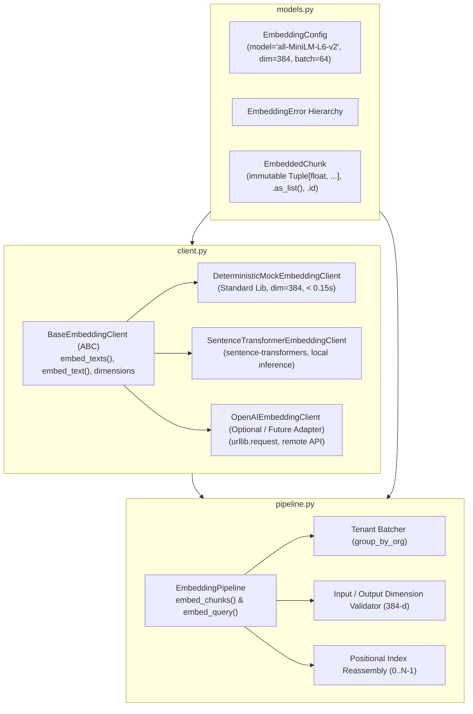

# Milestone M4: Embeddings Subsystem — Detailed Implementation Plan
## Local Inference Architecture (`sentence-transformers/all-MiniLM-L6-v2`)

**Milestone:** M4 — Embeddings Subsystem Implementation  
**Author:** Akshit Chandel (RAG & Knowledge Base Track)  
**Status:** Proposed Implementation Plan (Adapted for Local Embedding Model)  
**Governing Specification:** [SPEC-02: Document Chunking and Ingestion Architecture](../specs/SPEC-02-chunking.md)  
**Governing Architecture Plan:** [04-embeddings-plan.md](04-embeddings-plan.md) (Audited & Approved)  
**Shared Contract Reference:** Shared Team Contract v3.0 Locked (`docs/PROJECT_CONTEXT.md`, `docs/plans/03-chunking-implementation-plan.md`)  
**Proposed Model:** `sentence-transformers/all-MiniLM-L6-v2` (384 dimensions, local inference)  
**Target Subsystem:** `src/rag/embeddings/`  
**Target Test Suite:** `tests/test_m4_embeddings.py`  
**Date:** 2026-11-26  

---

## 1. Executive Summary and Architectural Principles

### 1.1 Executive Summary
This implementation plan defines the execution blueprint for authoring, testing, and verifying the **Embeddings Subsystem** for Milestone M4. 

Per updated architectural directives, the primary embedding model is transitioned from a remote paid API (`text-embedding-3-small`) to a **local, self-hosted open-weights embedding model**:
- **Model:** `sentence-transformers/all-MiniLM-L6-v2`
- **Output Dimensionality:** **384 dimensions** (normalized $L_2$ unit vectors)
- **Execution Environment:** Local CPU / GPU inference via `sentence_transformers`
- **API Keys & Ingestion Charges:** **None** (zero cloud API dependencies, zero credit consumption)
- **Primary Design Requirement:** **Model-Agnostic Interface**. The embedding pipeline and data models must remain decoupled from the underlying model so that alternative models (e.g., remote 1536-d models or alternative local models) can be plugged in without refactoring the chunking or storage layers.

### 1.2 Shared Team Contract v3.0 Discrepancy & Reconciliation Pathway

> [!WARNING]
> **CRITICAL ARCHITECTURAL CONTRACT CONFLICT**
> 
> **Current Shared Team Contract v3.0 Locked:**
> - Target Table: `knowledge_base_articles`
> - Column Specification: `embedding vector(1536)`
> - Specified Model: `text-embedding-3-small` (1536 dimensions)
> 
> **Proposed Local Embedding Model:**
> - Target Model: `sentence-transformers/all-MiniLM-L6-v2`
> - Output Dimensions: **384 dimensions**
> 
> **Downstream Impact on Milestone M5 (Database Storage):**
> Attempting to insert a 384-dimensional vector into a PostgreSQL `vector(1536)` column will trigger a hard database schema constraint failure: `ERROR: different vector dimensions 384 and 1536`.
> 
> **Resolution Protocol (Non-Silent Contract Governance):**
> 1. In accordance with `AGENTS.md` ("Do not change shared contract behavior without documenting the discrepancy and asking the user"), this implementation plan **documents the discrepancy formally** and does not silently mutate shared contracts.
> 2. The embedding subsystem architecture is designed **model-agnostic** via dynamic configuration (`expected_dimensions: int = 384`).
> 3. An RFC / Contract Amendment Proposal (v3.1) has been drafted ([RFC-01](../contracts/RFC-01-embedding-dimension-amendment.md)) and team consensus communicated accepting `embedding VECTOR(384), -- all-MiniLM-L6-v2`. Formal commit to shared contract files remains pending contract-owner action.

### 1.3 Core Architectural Principles
1. **Model-Agnostic Interface:** `BaseEmbeddingClient` defines universal `embed_texts` (batch) and `embed_text` (query) methods. Concrete adapters (`SentenceTransformerEmbeddingClient`, `DeterministicMockEmbeddingClient`, and `OpenAIEmbeddingClient`) implement this contract without pipeline coupling.
2. **Offline-First Incremental Delivery:** Phases 1 through 3 and Phase 5 use the zero-dependency standard-library mock client (`DeterministicMockEmbeddingClient`) configured for 384 dimensions. All batching, tenant boundary isolation, and positional reassembly are fully verified before installing heavy PyTorch/Transformer dependencies.
3. **Strict 1:1 Positional Order Preservation:** Indexed reassembly (`(original_index, chunk)`) ensures that batch processing grouped by tenant never alters caller input ordering.
4. **Unified Ingestion & Query Vectorization:** `embed_chunks` handles batch chunk ingestion; `embed_query` provides runtime search query vectorization with matching normalization.
5. **Context Window Safety Buffer:** `all-MiniLM-L6-v2` has a maximum sequence length of **256 word pieces**. Empirical analysis of our 113 raw corpus chunks confirms a mean chunk size of 90.2 tokens and a maximum chunk size of 169 tokens (100% $\le 169$ tokens). All chunks comfortably fit within the 256 context window.

---

## 2. Four-Register Project Model

| Register | Definition | Items in this Register |
|---|---|---|
| **Confirmed Facts** | Empirically verified truths in code, repository files, or signed Shared Team Contract v3.0. | 1. Working tree is clean on `feature/m1-dataset-recon`.<br>2. 10 raw Markdown documents exist under `data/raw/` (5 in `org_a/`, 5 in `org_b/`).<br>3. M3 chunking pipeline (`src/rag/chunking/`) generates 113 valid chunks (56 Org A, 57 Org B) passing 23/23 tests in 0.020s.<br>4. 100% of corpus chunks are $\le 169$ estimated tokens, within `all-MiniLM-L6-v2`'s 256-token context window.<br>5. Upstream `DocumentChunk.content` already embeds breadcrumbs formatted as `[Document: <title> > <headings>]\n\n<body_text>`.<br>6. Target database table `knowledge_base_articles` defines 8 fixed columns: `id` (UUID PK), `org_id` (UUID), `document_id` (UUID), `chunk_index` (int), `title` (text), `content` (text), `access_level` (text), `embedding`.<br>7. Shared Team Contract v3.0 specifies `embedding vector(1536)` and `text-embedding-3-small`.<br>8. Database schema does **not** include a `metadata JSONB` column.<br>9. Mandatory SQL prefilter invariant: `WHERE org_id = $1 AND access_level = ANY($2)`. Leakage target is 0.0%. |
| **Recommended Decisions** | Approved architectural designs adopted for M4 implementation. | 1. Implement `sentence-transformers/all-MiniLM-L6-v2` as the primary local embedding model producing 384-dimensional unit vectors.<br>2. Decouple pipeline from model via `BaseEmbeddingClient` protocol exposing `embed_texts`, `embed_text`, `dimensions`, and `model_name`.<br>3. Store vectors as deeply immutable `Tuple[float, ...]` in `EmbeddedChunk`, with `.as_list()` for database adapters and `@property def id` mapping to `knowledge_base_articles.id`.<br>4. Implement original input positional index tracking (`(original_index, chunk)`) to guarantee strict 1:1 output order preservation across multi-tenant batch partitions.<br>5. Support dual-mode vectorization: batch chunk embedding (`embed_chunks`) and single-string query embedding (`embed_query`).<br>6. Embed `chunk.content` directly as canonical chunk text; context is already incorporated via breadcrumbs.<br>7. Build `DeterministicMockEmbeddingClient(dimensions=384)` using Gaussian PRNG (`random.Random(seed).gauss(0, 1)`) with $L_2$ normalization for zero-dependency offline testing.<br>8. Gate `sentence-transformers` dependency installation and local model download behind an explicit user approval gate. |
| **Assumptions** | Design hypotheses requiring validation during implementation. | 1. Local CPU inference will vectorize 113 chunks in $< 5.0\text{s}$ without hardware acceleration.<br>2. Shared team will accept Contract Amendment RFC v3.1 modifying `knowledge_base_articles.embedding` from `vector(1536)` to `vector(384)`.<br>3. Token estimation heuristic ($\lceil\text{word\_count} \times 1.33\rceil$) is sufficient for pre-request token ceiling checks against the 256-token limit. |
| **Unresolved Integration Dependencies** | External team interfaces requiring confirmation or delivery. | 1. Formal team approval of Contract Amendment v3.1 for 384-d pgvector column modification in Milestone M5.<br>2. User approval to install `sentence-transformers` in virtual environment (Approval Gate 4). |

---

## 3. Subsystem Architecture and File Structure

The embeddings subsystem is organized under `src/rag/embeddings/`:

```text
src/
└── rag/
    ├── __init__.py                # Root package declaration
    ├── chunking/                  # Upstream M3 chunking subsystem (untouched)
    │   ├── models.py
    │   ├── parser.py
    │   └── engine.py
    └── embeddings/                # M4 Embeddings Subsystem
        ├── __init__.py            # Clean public exports
        ├── models.py              # Data structures, exceptions, immutable container, config
        ├── client.py              # BaseEmbeddingClient, MockClient, SentenceTransformerClient
        └── pipeline.py            # Batching, tenant grouping, indexed reassembly, validation
tests/
└── test_m4_embeddings.py          # Authoritative test suite and 113-chunk smoke test
```

### Module Responsibilities:



---

## 4. Detailed Incremental Implementation Phases

The implementation is broken down into **seven discrete, reviewable phases**. Phases 1 through 3 and Phase 5 require zero external dependencies, allowing complete offline development and verification prior to installing heavy deep-learning frameworks.

---

### Phase 1: Foundation Models, Exceptions, and Configuration
* **Tier:** Tier 1 (Offline — Standard Library Only)
* **Objective:** Establish the foundational data structures, custom exception hierarchy, configuration dataclass, and deeply immutable `EmbeddedChunk` container adapted for 384 dimensions.
* **Exact Files to Create:**
  - `src/rag/embeddings/__init__.py`
  - `src/rag/embeddings/models.py`
* **Implementation Responsibilities:**
  1. Define custom exception hierarchy:
     - `EmbeddingError(Exception)`: Subsystem base exception.
     - `EmbeddingConfigError(EmbeddingError)`: Configuration errors (e.g. invalid dimensions or missing model).
     - `EmbeddingValidationError(EmbeddingError)`: Text/vector schema, length, or dimensional validation failures.
     - `EmbeddingInferenceError(EmbeddingError)`: Local model inference failures or runtime errors.
     - `EmbeddingRateLimitError(EmbeddingError)`: Rate limit placeholder for remote clients.
  2. Implement `EmbeddingConfig` dataclass:
     - `model_name: str = "sentence-transformers/all-MiniLM-L6-v2"`
     - `expected_dimensions: int = 384`
     - `batch_size: int = 64`
     - `max_seq_length: int = 256`
     - `device: str = "cpu"` (overridable to "cuda" if GPU available)
     - `normalize_embeddings: bool = True`
  3. Implement `EmbeddedChunk` frozen dataclass:
     - Fields: `chunk: DocumentChunk`, `embedding: Tuple[float, ...]`, `model: str = "sentence-transformers/all-MiniLM-L6-v2"`.
     - In `__post_init__`: enforce conversion of list inputs to `tuple` using `object.__setattr__` to guarantee deep immutability.
     - Add property aliases: `@property def id(self) -> str: return self.chunk.chunk_id` (maps directly to `knowledge_base_articles.id`), `chunk_id`, `document_id`, `org_id`, `access_level`, `chunk_index`, `title`, `content`, `dimensions`.
     - Add `.as_list() -> List[float]` helper for downstream database serialization.
* **Dependencies:** Upstream `src/rag/chunking/models.py` (`DocumentChunk`). Standard library only.
* **Tests to Author (`tests/test_m4_embeddings.py`):**
  - `T4-01`: `test_embedded_chunk_creation`: Verifies construction, property delegation (`.id`, `.chunk_id`, `.org_id`), and dimension calculation.
  - `T4-02`: `test_embedded_chunk_deep_immutability`: Verifies vector is stored as tuple, cannot be mutated in place, and attribute writes raise `FrozenInstanceError`.
  - `T4-03`: `test_embedded_chunk_as_list`: Verifies `.as_list()` returns a standard mutable list matching tuple values.
  - `T4-04`: `test_embedding_config_defaults`: Verifies default configuration parameters (model `all-MiniLM-L6-v2`, 384 dimensions, batch size 64).
* **Acceptance Criteria:**
  - `EmbeddedChunk` enforces tuple immutability and exposes all 8 target database contract properties.
  - All 4 initial unit tests pass cleanly via `python3 -m unittest`.
* **Approval Gate 1:** Review code in `models.py` and test results before beginning Phase 2.

---

### Phase 2: Client Interface and Offline 384-d Deterministic Mock Client
* **Tier:** Tier 1 (Offline — Standard Library Only)
* **Objective:** Define the abstract client protocol (`BaseEmbeddingClient`) supporting both batch and single-string operations, and implement the fast, deterministic 384-dimensional standard-library mock client.
* **Exact Files to Create/Modify:**
  - `src/rag/embeddings/client.py` (New: Abstract protocol and mock client)
* **Implementation Responsibilities:**
  1. Define `BaseEmbeddingClient(ABC)`:
     - `@abstractmethod def embed_texts(self, texts: List[str]) -> List[Tuple[float, ...]]`: Batch embedding.
     - `def embed_text(self, text: str) -> Tuple[float, ...]`: Validates non-empty string and calls `self.embed_texts([text])[0]`.
     - `@property @abstractmethod def dimensions(self) -> int`: Returns expected vector length.
     - `@property @abstractmethod def model_name(self) -> str`: Returns model identifier string.
  2. Implement `DeterministicMockEmbeddingClient(BaseEmbeddingClient)`:
     - Configurable dimensions: `dimensions: int = 384`.
     - Uses standard library `random.Random`, `hashlib`, `math`.
     - Validates that every string in `texts` is non-empty and non-whitespace (raises `EmbeddingValidationError`).
     - Extracts 64-bit integer seed from `hashlib.sha256(text.encode("utf-8")).digest()[:8]`.
     - Samples 384 values from standard normal distribution $\mathcal{N}(0, 1)$ via `rng.gauss(0.0, 1.0)`.
     - Normalizes to unit length ($L_2 = 1.0$) and returns immutable tuple of floats.
     - Guarantees: identical input produces bitwise identical vector; different inputs produce distinct vectors.
* **Dependencies:** Phase 1 (`models.py`). Standard library only.
* **Tests to Author (`tests/test_m4_embeddings.py`):**
  - `T4-05`: `test_mock_client_dimensions`: Asserts output vector has exactly 384 dimensions.
  - `T4-06`: `test_mock_client_unit_norm`: Asserts vector $L_2$ norm equals $1.0 \pm 10^{-5}$.
  - `T4-07`: `test_mock_client_determinism`: Asserts identical input strings produce identical vectors across separate client instances.
  - `T4-08`: `test_mock_client_distinct_texts`: Asserts distinct strings produce distinct vectors.
  - `T4-09`: `test_single_text_embedding_interface`: Asserts `embed_text` dispatches a single string and returns a 384-d tuple; asserts rejection of empty/whitespace strings.
* **Acceptance Criteria:**
  - Mock client generates 384-d unit vectors in $< 0.10\text{s}$ for 113 items.
  - All 5 Phase 2 unit tests pass cleanly (cumulative: 9/9 passing).
* **Approval Gate 2:** Review code in `client.py` and test results before beginning Phase 3.

---

### Phase 3: Pipeline Orchestrator — Tenant Batching, Index Reassembly & Query Vectorization
* **Tier:** Tier 1 (Offline — Standard Library Only)
* **Objective:** Implement `EmbeddingPipeline` supporting dual-mode vectorization, strict input/output validation, tenant boundary enforcement at batch edges, and guaranteed 1:1 original positional order reassembly.
* **Exact Files to Create/Modify:**
  - `src/rag/embeddings/pipeline.py` (New: Orchestration engine)
  - `src/rag/embeddings/__init__.py` (Export public API)
* **Implementation Responsibilities:**
  1. Implement `EmbeddingPipeline.__init__(self, client: BaseEmbeddingClient, config: Optional[EmbeddingConfig] = None)`:
     - Sets client and config (defaults to `EmbeddingConfig()`).
  2. Implement `embed_query(self, query: str) -> Tuple[float, ...]`:
     - Validates `isinstance(query, str)` and `query.strip()`.
     - Validates token ceiling ($\le 256$ word pieces nominal for MiniLM).
     - Calls `self.client.embed_text(query.strip())`.
     - Validates output dimensionality (`== client.dimensions == 384`) and finite floats.
  3. Implement `embed_chunks(self, chunks: List[DocumentChunk]) -> List[EmbeddedChunk]`:
     - Empty list guard: returns `[]` immediately.
     - **Step 1 (Index Tagging):** `indexed_chunks = list(enumerate(chunks))`.
     - **Step 2 (Tenant Partitioning):** Group indexed items by `chunk.org_id` into `defaultdict(list)`.
     - **Step 3 (Batch Slicing):** For each tenant queue, slice items into batches of size $\le \text{config.batch\_size}$ (64).
     - **Step 4 (Vector Generation & Validation):**
       - Extract text: `[chunk.content for _, chunk in batch_items]`.
       - Dispatch batch to `self.client.embed_texts(batch_texts)`.
       - Validate returned vectors: check length matches batch size, each vector has length 384, and all values are finite (`math.isfinite`).
       - Package into `(orig_idx, EmbeddedChunk(chunk=chunk, embedding=vec, model=self.client.model_name))`.
     - **Step 5 (Strict Positional Reassembly):** Sort assembled results by `orig_idx` from $0$ to $N-1$ and return `[chunk for _, chunk in assembled_results]`.
* **Dependencies:** Phase 1 (`models.py`), Phase 2 (`client.py`), upstream `src/rag/chunking/models.py`. Standard library only.
* **Tests to Author (`tests/test_m4_embeddings.py`):**
  - `T4-10`: `test_query_embedding_pipeline`: Verifies `embed_query` validates input, calls client, and returns 384-d tuple.
  - `T4-11`: `test_input_validation_empty_string`: Verifies empty/whitespace chunks or queries raise `EmbeddingValidationError`.
  - `T4-12`: `test_output_validation_wrong_dim`: Injects mock client returning $\ne 384$ dimensions; asserts `EmbeddingValidationError`.
  - `T4-13`: `test_output_validation_nan_inf`: Injects vector containing `float('nan')` or `float('inf')`; asserts `EmbeddingValidationError`.
  - `T4-14`: `test_batching_exact_multiple`: Tests 128 chunks with batch size 64; asserts exactly 2 client calls.
  - `T4-15`: `test_batching_partial_remainder`: Tests 70 chunks with batch size 64; asserts 2 client calls (64 + 6).
  - `T4-16`: `test_strict_order_preservation_interleaved`: Passes interleaved `[A1, B1, A2, B2]`; asserts output order matches input order 100% strictly.
  - `T4-17`: `test_tenant_isolation_batching`: Inspects client call history; asserts 0 batches contain mixed Org A and Org B texts.
* **Acceptance Criteria:**
  - `embed_query` successfully vectorizes queries and rejects malformed inputs.
  - `embed_chunks` guarantees 100% strict 1:1 positional order preservation across interleaved multi-tenant inputs.
  - All 8 Phase 3 unit tests pass cleanly (cumulative: 17/17 passing).
* **Approval Gate 3:** Review code in `pipeline.py` and test results before beginning Phase 4.

---

### Phase 4: Local `SentenceTransformerEmbeddingClient` Implementation (Gated)
* **Tier:** Tier 2 (Local Dependency & Model Loading — Gated)
* **Objective:** Implement `SentenceTransformerEmbeddingClient` using `sentence-transformers` for local inference. This phase requires explicit user approval before installing dependencies.
* **Exact Files to Modify:**
  - `src/rag/embeddings/client.py` (Add `SentenceTransformerEmbeddingClient`)
  - `src/rag/embeddings/__init__.py` (Export client)
* **Implementation Responsibilities:**
  1. **User Approval Gate 4:** Prompt user for explicit permission to run:
     `pip install sentence-transformers`
  2. Implement `SentenceTransformerEmbeddingClient(BaseEmbeddingClient)`:
     - Accepts `EmbeddingConfig`.
     - Lazy model loading: instantiates `SentenceTransformer(model_name_or_path=config.model_name, device=config.device)` on first use or explicit `load_model()` call.
     - Sets `model.max_seq_length = config.max_seq_length` (256).
     - Custom `__repr__`: returns `SentenceTransformerEmbeddingClient(model=..., device=..., loaded=...)`.
  3. Implement `embed_texts(self, texts: List[str]) -> List[Tuple[float, ...]]`:
     - Validates non-empty strings.
     - Calls `model.encode(texts, batch_size=config.batch_size, normalize_embeddings=True, convert_to_numpy=True)`.
     - Validates output shapes and finite values.
     - Converts numpy float arrays to immutable float tuples.
  4. Privacy-Safe Logging:
     - Log model load event, batch size, token estimate, and inference latency in ms.
     - Zero raw document or query text in logs.
* **Dependencies:** `sentence-transformers` (PyTorch, transformers, huggingface_hub).
* **Tests to Author (`tests/test_m4_embeddings.py`):**
  - `T4-18`: `test_sentence_transformer_lazy_loading`: Asserts model is not loaded until needed or configured.
  - `T4-19`: `test_sentence_transformer_dimensions`: Verifies local inference outputs 384-dimensional vectors.
  - `T4-20`: `test_sentence_transformer_unit_norm`: Verifies local inference produces normalized unit vectors ($L_2 = 1.0 \pm 10^{-4}$).
  - `T4-21`: `test_sentence_transformer_query_embedding`: Verifies single-query vectorization matches batch vectorization for identical text.
  - `T4-22`: `test_logging_privacy_local_inference`: Asserts no chunk content appears in logs during local model execution.
* **Acceptance Criteria:**
  - Local client vectorizes text on CPU without internet connection (once weights are cached).
  - Produces valid 384-dimensional unit vectors.
  - All 5 Phase 4 tests pass cleanly (cumulative: 22/22 passing).
* **Approval Gate 4 (Dependency Gate):** User must approve package installation before executing this phase.

---

### Phase 5: Authoritative Test Harness & Full-Corpus Smoke Verification
* **Tier:** Tier 1 / Tier 2 Integration
* **Objective:** Assemble the authoritative test harness in `tests/test_m4_embeddings.py`, execute the full test suite, and run full-corpus smoke verification across all 113 chunks from the 10 raw documents under `data/raw/`.
* **Exact Files to Create/Modify:**
  - `tests/test_m4_embeddings.py` (Complete authoritative test suite)
* **Implementation Responsibilities:**
  1. Author `test_stage0_raw_corpus_smoke_verification` in `tests/test_m4_embeddings.py`:
     - Load all 10 raw documents from `data/raw/org_a/` and `data/raw/org_b/`.
     - Run `chunk_document` from M3 chunking pipeline (yielding 113 chunks).
     - Instantiate `EmbeddingPipeline` with `DeterministicMockEmbeddingClient(dimensions=384)`.
     - Execute `embed_chunks(chunks)`.
     - Assertions:
       - Total generated `EmbeddedChunk` count is exactly 113 (56 Org A, 57 Org B).
       - Every vector has `len(embedding) == 384`.
       - Every vector has $L_2$ unit norm ($1.0 \pm 10^{-5}$).
       - 100% metadata fidelity (`id`, `chunk_id`, `document_id`, `org_id`, `access_level`, `title`, `content`).
       - Strict tenant boundary: Org A chunks carry strictly Org A UUID, Org B carry strictly Org B UUID.
       - Re-running embedding produces identical vectors and hashes (100% determinism).
       - Execution duration for all 113 chunks is $< 0.5\text{s}$.
  2. Execute empirical local model verification (if Phase 4 dependencies installed):
     - Run smoke test with `SentenceTransformerEmbeddingClient`.
     - Measure local CPU inference duration and memory usage.
  3. Execute authoritative test runner:
     `python3 -m unittest tests/test_m4_embeddings.py -v`
* **Dependencies:** M3 chunking subsystem (`src/rag/chunking/`), raw data files (`data/raw/`).
* **Tests to Execute:** All 23 test cases (`T4-01` through `T4-23`).
* **Acceptance Criteria:**
  - 100% unit tests passing cleanly.
  - Full-corpus smoke verification succeeds with zero errors across all 113 chunks.
* **Approval Gate 5:** Review complete test suite and smoke test metrics before proceeding to documentation.

---

### Phase 6: Contract Amendment RFC & Team Alignment
* **Tier:** Tier 3 (Governance & Cross-Team Contract Alignment)
* **Objective:** Formally draft and stage the **Shared Team Contract Amendment RFC (v3.1)** documenting the transition from 1536-d to 384-d embeddings, enabling the Backend track to adapt the `knowledge_base_articles` SQL table for Milestone M5.
* **Exact Files to Create:**
  - `docs/contracts/RFC-01-embedding-dimension-amendment.md` (Formal proposal for backend team)
* **Implementation Responsibilities:**
  1. Document technical rationale for adopting `sentence-transformers/all-MiniLM-L6-v2`:
     - Zero recurring cloud API cost ($0.00 vs per-token billing).
     - Offline execution, zero network latency, zero data egress.
     - Compact vector storage (384 floats = 1.5 KB/chunk vs 1536 floats = 6.0 KB/chunk; 75% storage & RAM reduction in pgvector indexes).
  2. Document required SQL migration for Milestone M5:
     ```sql
     -- Contract Amendment v3.1 Migration:
     ALTER TABLE knowledge_base_articles 
     ALTER COLUMN embedding TYPE vector(384);
     ```
  3. Document LangGraph query vectorizer interface requirements for Shashank Pathania.
* **Acceptance Criteria:**
  - RFC clearly articulates the change, schema impact, and backward compatibility.
* **Approval Gate 6:** Review RFC document with user.

---

### Phase 7: Documentation, Status & Milestone Closeout
* **Tier:** Tier 3 (Milestone Closeout)
* **Objective:** Update project documentation, milestone status in `docs/STATUS.md`, and changelog in `docs/CHANGELOG.md` to formally document M4 completion and transition to Milestone M5.
* **Exact Files to Modify:**
  - `docs/STATUS.md`
  - `docs/CHANGELOG.md`
  - `docs/README.md`
* **Implementation Responsibilities:**
  1. Update `docs/STATUS.md`:
     - Mark Milestone M4 (Embeddings Subsystem) as COMPLETE.
     - Document passing test suite results (23 unit tests, 113-chunk smoke verification).
     - Set next milestone action to Milestone M5 (Database Storage & pgvector).
  2. Update `docs/CHANGELOG.md`:
     - Add detailed entries for M4 deliverables (`src/rag/embeddings/`, `tests/test_m4_embeddings.py`, local model decision).
  3. Update `docs/README.md`:
     - Add references to M4 plans and embedding documentation.
* **Acceptance Criteria:**
  - All documentation updated accurately, reflecting empirical results with zero inventions.
* **Approval Gate 7:** Final review of documentation and git status prior to milestone completion.

---

## 5. Summary of Authoritative Test Matrix

The authoritative test matrix in `tests/test_m4_embeddings.py` covers 23 test methods:

| Test ID | Test Method | Test Tier | Primary Assertion |
|---|---|---|---|
| **T4-01** | `test_embedded_chunk_creation` | Offline | Validates construction, property delegation (`.id`, `.chunk_id`, `.org_id`), and dimension calculation (384). |
| **T4-02** | `test_embedded_chunk_deep_immutability` | Offline | Asserts vector is stored as tuple, cannot be mutated in place, and attribute writes raise `FrozenInstanceError`. |
| **T4-03** | `test_embedded_chunk_as_list` | Offline | Asserts `.as_list()` returns a standard mutable list matching tuple values for database adapters. |
| **T4-04** | `test_embedding_config_defaults` | Offline | Asserts default configuration parameters, model name `all-MiniLM-L6-v2`, and 384 dimensions. |
| **T4-05** | `test_mock_client_dimensions` | Offline | Asserts output vectors have exactly 384 dimensions. |
| **T4-06** | `test_mock_client_unit_norm` | Offline | Asserts vector $L_2$ norm equals $1.0 \pm 10^{-5}$. |
| **T4-07** | `test_mock_client_determinism` | Offline | Asserts identical input strings produce bitwise identical embedding vectors. |
| **T4-08** | `test_mock_client_distinct_texts` | Offline | Asserts different text strings produce non-identical embedding vectors. |
| **T4-09** | `test_single_text_embedding_interface` | Offline | Asserts `embed_text` dispatches a single string and returns a single 384-d vector; rejects empty strings. |
| **T4-10** | `test_query_embedding_pipeline` | Offline | Asserts `embed_query` validates input, calls client, and returns a 384-d tuple; rejects empty query. |
| **T4-11** | `test_input_validation_empty_string` | Offline | Asserts whitespace-only or empty strings raise `EmbeddingValidationError`. |
| **T4-12** | `test_output_validation_wrong_dim` | Offline | Asserts mock/client returning $\ne 384$ dimensions raises `EmbeddingValidationError`. |
| **T4-13** | `test_output_validation_nan_inf` | Offline | Asserts vector containing `float('nan')` or `float('inf')` is rejected. |
| **T4-14** | `test_batching_exact_multiple` | Offline | Asserts batching 128 chunks with `batch_size=64` produces exactly 2 client calls. |
| **T4-15** | `test_batching_partial_remainder` | Offline | Asserts batching 70 chunks with `batch_size=64` produces 2 calls (64 + 6). |
| **T4-16** | `test_strict_order_preservation_interleaved` | Offline | Asserts mixed input of `[A1, B1, A2, B2]` returns exact sequence `[A1, B1, A2, B2]` despite tenant batch grouping. |
| **T4-17** | `test_tenant_isolation_batching` | Offline | Asserts mock client call history confirms 0 batches contain mixed Org A and Org B texts. |
| **T4-18** | `test_sentence_transformer_lazy_loading` | Gated (Local) | Asserts model weights are not loaded into memory until explicitly requested. |
| **T4-19** | `test_sentence_transformer_dimensions` | Gated (Local) | Asserts local inference outputs exactly 384-dimensional float tuples. |
| **T4-20** | `test_sentence_transformer_unit_norm` | Gated (Local) | Asserts local inference produces normalized unit vectors ($L_2 = 1.0 \pm 10^{-4}$). |
| **T4-21** | `test_sentence_transformer_query_embedding` | Gated (Local) | Asserts single-query vectorization matches batch vectorization for identical text. |
| **T4-22** | `test_logging_privacy_local_inference` | Offline | Asserts no chunk content appears in log streams during local model execution. |
| **T4-23** | `test_stage0_raw_corpus_smoke_verification` | Offline | Runs chunking on all 10 raw documents and embeds all 113 chunks; asserts 113 valid `EmbeddedChunk` instances. |

---

## 6. Risk Register and Mitigation Strategy

| Risk Category | Technical Risk | Impact | Severity | Mitigation Strategy |
|---|---|---|---|---|
| **Contract Discrepancy** | Shared Contract v3.0 specifies `vector(1536)` while MiniLM outputs `vector(384)`. | Database schema error on insertion in M5. | Critical | **Formal RFC & Non-Silent Tracking:** Plan explicitly highlights conflict in Section 1.2; Phase 6 creates Contract Amendment RFC v3.1 for backend team alignment. |
| **Context Window Ceiling** | MiniLM has 256 word-piece context window, smaller than M3's 400 nominal ceiling. | Truncation of oversized chunks. | Medium | **Empirical Safety Buffer:** In M3 smoke verification, max chunk size was 169 tokens ($100\% \le 169$); defensive check in `pipeline.py` warns if estimated tokens $> 256$. |
| **Positional Order Drift** | Tenant batch partitioning reorders chunks, breaking sequential continuity. | Corrupted chunk indexing, downstream database confusion. | High | **Indexed Reassembly:** Pipeline tags incoming chunks with `(original_index, chunk)`, groups by tenant, and re-sorts results by `original_index` before returning. |
| **Heavy Dependencies** | `sentence-transformers` requires PyTorch and transformers (~500MB download). | Slower CI, setup friction. | Low | **Decoupled Mock First:** Phases 1–3 and core smoke test run 100% offline with zero dependencies via `DeterministicMockEmbeddingClient`. Dependency installation is gated behind Gate 4. |
| **Vector Mutability** | Mutating vector float lists in place after creation, corrupting state. | Data corruption across concurrent tasks. | Medium | **Deep Immutability:** `EmbeddedChunk.embedding` is stored as `Tuple[float, ...]`. Lists are converted to tuples in `__post_init__`. |

---

## 7. Explicit Review and Approval Gates

| Gate | Timing | Condition for Clearance |
|---|---|---|
| **Gate 1** | Pre-Implementation | Formal user approval of this revised implementation plan (`docs/plans/04-embeddings-implementation-plan.md`). |
| **Gate 2** | End of Phase 1 | Review `src/rag/embeddings/models.py` and passing tests T4-01 through T4-04. |
| **Gate 3** | End of Phase 2 | Review mock client in `src/rag/embeddings/client.py` and passing tests T4-05 through T4-09. |
| **Gate 4** | End of Phase 3 | Review pipeline orchestrator in `src/rag/embeddings/pipeline.py` and passing tests T4-10 through T4-17. |
| **Gate 5 (Dependency Gate)** | Pre-Phase 4 | **Explicit user sign-off required** before running `pip install sentence-transformers` and downloading local model weights. |
| **Gate 6** | End of Phase 5 | Review full 23-test suite pass rate and Stage 0 113-chunk smoke verification baseline. |
| **Gate 7** | End of Phase 6 | Review Contract Amendment RFC v3.1 proposal before submission to backend track. |
| **Gate 8** | End of Phase 7 | Final review of updated documentation (`STATUS.md`, `CHANGELOG.md`) prior to milestone sign-off. |
