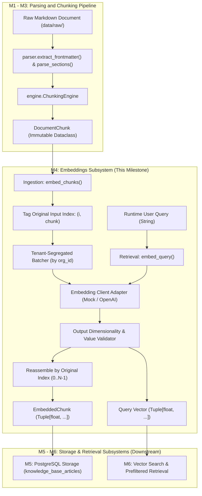
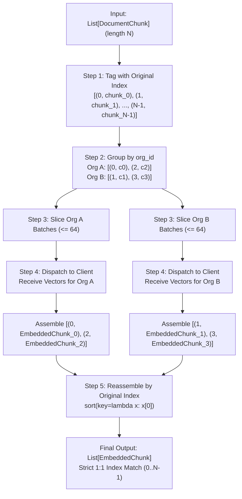
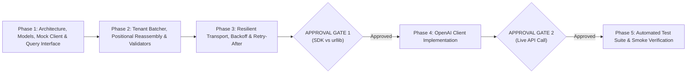

# Milestone M4: Embeddings Subsystem — Architecture and Development Plan

**Milestone:** M4 — Embeddings Subsystem Planning and Architecture  
**Author:** Akshit Chandel (RAG & Knowledge Base Track)  
**Status:** Approved with Conditions — Revised Planning Document (Reconnaissance Only — Implementation Gated)  
**Governing Specification:** [SPEC-02: Document Chunking and Ingestion Architecture](../specs/SPEC-02-chunking.md)  
**Governing Team Contract:** Shared Team Contract v3.0 Locked (`docs/PROJECT_CONTEXT.md`, `docs/plans/03-chunking-implementation-plan.md`)  
**Upstream Subsystem:** `src/rag/chunking/` (M3: `models.py`, `parser.py`, `engine.py`)  
**Target Subsystem:** `src/rag/embeddings/`  
**Target Test Suite:** `tests/test_m4_embeddings.py`  
**Date:** 2026-11-26  

---

> [!NOTE]
> **ARCHITECTURAL RECONCILIATION NOTE (2026-11-26) — TRANSITION TO `all-MiniLM-L6-v2` (384-d)**  
> Following cross-track consensus communicated by team decision, the canonical embedding model for the Multi-Tenant B2B Customer Support AI is transitioned from remote cloud API `text-embedding-3-small` (1536-d) to the local open-weights model `sentence-transformers/all-MiniLM-L6-v2` (384-d), with the shared contract schema updated to `embedding VECTOR(384), -- all-MiniLM-L6-v2`.  
> - **Authoritative Implementation Blueprint:** Refer to [04-embeddings-implementation-plan.md](04-embeddings-implementation-plan.md) and [RFC-01-embedding-dimension-amendment.md](../contracts/RFC-01-embedding-dimension-amendment.md).  
> - **Historical Plan Status:** Sections 1 through 13 of this document preserve the audited architecture and design principles (strict 1:1 positional index reassembly, tenant-isolated batching, dual-mode query/document interfaces, and deep immutability) while adapting dimensional checks to 384 dimensions.

---

## 1. Executive Summary and Objectives

### 1.1 Executive Summary
Milestones M1 through M3 successfully established the dataset reconnaissance, chunking architecture, and section-aware chunking pipeline. The chunking pipeline (`src/rag/chunking/`) currently ingests raw Markdown documents with YAML frontmatter, parses section hierarchies via a bounded finite state machine (FSM), injects contextual heading breadcrumbs, enforces an indivisible element fallback protocol, and outputs immutable `DocumentChunk` objects with deterministic UUID v5 primary keys and 100% metadata inheritance. The M3 smoke verification confirmed 113 valid chunks generated across all 10 raw documents with zero unhandled exceptions.

Milestone M4 governs the design and planning of the **Embeddings Subsystem**. This subsystem serves as the bridge between chunked textual data (`DocumentChunk`) and downstream PostgreSQL/pgvector vector storage (Milestone M5), as well as the vector generation engine for future query retrieval (Milestone M6). It is strictly responsible for transforming chunk text payloads and query strings into validated 1536-dimensional vector representations conforming to **Shared Team Contract v3.0 Locked** (`text-embedding-3-small`, 1536 dimensions).

Following the strict read-only architectural audit (verdict: **APPROVE WITH CONDITIONS**), this revised plan resolves all audit conditions:
1. **Strict 1:1 Positional Order Preservation:** Positional index tracking guarantees that caller input order is perfectly preserved even when batches are segmented by tenant.
2. **Dual-Mode Embedding Interface:** First-class support for both batch chunk embedding (ingestion) and single-text query embedding (future retrieval).
3. **Deep Immutability:** `EmbeddedChunk` utilizes an immutable `Tuple[float, ...]` internally for vector data, with explicit conversion helpers for database serialization.
4. **Target Schema Alignment:** Direct `@property def id(self) -> str` alias mapping `chunk_id` to `knowledge_base_articles.id`.
5. **Auditor Optimizations:** Gaussian PRNG for fast deterministic mock vector generation and HTTP `Retry-After` header inspection for resilient rate limit backoff.

In accordance with user rules and project safety invariants, this document represents **Planning Only**. No application code has been implemented, no existing source files have been modified, no database changes have been executed, no third-party packages have been installed, and zero API calls or API credits have been consumed.

### 1.2 Core Objectives
1. **Pipeline Continuity and Integration:** Define the clean, decoupled interface connecting upstream `DocumentChunk` objects to downstream `EmbeddedChunk` representations ready for database persistence.
2. **Dual-Mode Vector Generation:** Provide unified, decoupled interfaces for:
   - Batch chunk vectorization during ingestion (`embed_chunks`).
   - Single-string query vectorization during runtime retrieval (`embed_query` / `embed_text`).
3. **Strict Positional Reassembly:** Guarantee that `embed_chunks` preserves 100% strict 1:1 positional correspondence between input `DocumentChunk` objects and output `EmbeddedChunk` objects regardless of internal multi-tenant batch grouping.
4. **Deep Immutability & Contract Adherence (v3.0 Locked):** Enforce strict compliance with Shared Team Contract v3.0: model `text-embedding-3-small`, output dimensionality exactly 1536, immutable tuple storage, deterministic UUID mapping, and metadata preservation without assuming uncontracted database columns (e.g., no JSONB column).
5. **Decoupled Client Architecture:** Establish an abstract client interface with a fast, deterministic, standard-library mock implementation (`DeterministicMockEmbeddingClient`) allowing comprehensive, reproducible unit and integration testing without network calls, API keys, or credit expenditure.
6. **Batching and Rate Limit Resilience:** Design batch processing that groups chunks efficiently, respects external API token/request limits, enforces tenant boundaries at batch edges, inspects HTTP `Retry-After` headers, and handles transient failures using exponential backoff with jitter.
7. **Security and Multi-Tenant Isolation:** Uphold the non-negotiable security invariants of `AGENTS.md`: prevent cross-tenant batch mixing, ensure embeddings never bypass SQL prefiltering, prevent sensitive data leakage in structured logs, and secure API credentials.
8. **Explicit Gating:** Enforce strict approval gates before implementing external package dependencies, configuring live API keys, or executing billable external API calls.

---

## 2. Four-Register Project Model

To maintain scientific integrity and prevent conflating verified architecture with assumptions or external team dependencies, all project information is strictly partitioned into four explicit registers:

| Register | Definition | Items in this Register |
|---|---|---|
| **Confirmed Facts** | Empirically verified truths in code, repository files, or signed Shared Team Contract v3.0. | 1. Working tree is clean on `feature/m1-dataset-recon` with no untracked file additions.<br>2. Exactly 10 raw Markdown documents exist under `data/raw/` (5 in `org_a/`, 5 in `org_b/`).<br>3. Upstream chunking pipeline (`src/rag/chunking/`) consists of `models.py`, `parser.py`, and `engine.py`.<br>4. Stage 0 Smoke Verification processed all 10 raw documents, generating exactly 113 valid `DocumentChunk` objects (56 Org A, 57 Org B).<br>5. M3 test suite (`tests/test_m3_chunking.py`) passes 23/23 tests cleanly in 0.020s using standard library only.<br>6. Target database table `knowledge_base_articles` defines 8 fixed columns: `id` (UUID PK), `org_id` (UUID), `document_id` (UUID), `chunk_index` (int), `title` (text), `content` (text), `access_level` (text), `embedding` (vector(1536)).<br>7. Target embedding dimension is locked at 1536 (`text-embedding-3-small`) under Shared Team Contract v3.0.<br>8. Database schema does **not** include a `metadata JSONB` column.<br>9. Mandatory SQL prefilter invariant: `WHERE org_id = $1 AND access_level = ANY($2)` before similarity ranking. Leakage target is 0.0%.<br>10. Upstream `DocumentChunk.content` already embeds breadcrumbs formatted as `[Document: <title> > <headings>]\n\n<body_text>`. |
| **Recommended Decisions** | Approved architectural designs incorporated into Milestone M4. | 1. Maintain modularity by placing the embeddings subsystem in `src/rag/embeddings/` with separate `models.py`, `client.py`, and `pipeline.py`.<br>2. Implement original input positional index tracking (`(original_index, chunk)`) to guarantee strict 1:1 output order preservation across multi-tenant batch partitions.<br>3. Support dual-mode embedding: batch `embed_chunks` for ingestion and single-string `embed_query`/`embed_text` for retrieval.<br>4. Enforce deep immutability by storing embedding vectors as `Tuple[float, ...]` in `EmbeddedChunk`, with an `.as_list()` helper for database serialization.<br>5. Add `@property def id(self) -> str` alias on `EmbeddedChunk` mapping directly to `knowledge_base_articles.id`.<br>6. Build a fast, deterministic standard-library `DeterministicMockEmbeddingClient` using Gaussian PRNG (`random.Random(seed).gauss(0, 1)`) and L2 normalization, producing valid 1536-d vectors in ~0.14s without network access or credit cost.<br>7. Embed `chunk.content` directly as canonical chunk text; context is already incorporated via breadcrumbs.<br>8. Strictly isolate API batches by `org_id` to prevent cross-tenant data co-location on the wire.<br>9. Inspect HTTP `Retry-After` headers during rate-limit recovery, taking `max(retry_after, exponential_delay)`.<br>10. Keep live external API calls and third-party dependencies behind explicit user approval gates. |
| **Assumptions** | Design hypotheses requiring validation during implementation or future corpus delivery. | 1. External embedding API (`text-embedding-3-small`) will maintain standard OpenAI payload schema and pricing ($0.02 per 1M tokens).<br>2. Token estimation heuristic ($\lceil\text{word\_count} \times 1.33\rceil$) from M3 is sufficiently accurate for batch token budgeting before API submission.<br>3. Downstream vector storage in M5 will accept vectors as standard Python float sequences for pgvector binding. |
| **Unresolved Integration Dependencies** | External team interfaces requiring confirmation or delivery. | 1. User approval on whether to install the third-party `openai` SDK or rely on a zero-dependency standard library HTTP client (`urllib.request`) [Approval Gate 2].<br>2. Provisioning of a live OpenAI API key (`OPENAI_API_KEY`) for optional live integration verification [Approval Gate 3].<br>3. Backend team schedule for pgvector database deployment and migration staging (Milestone M5). |

---

## 3. Scope and Out-of-Scope Items

### 3.1 In Scope
- **Data Structures & Models:** Definition of `EmbeddedChunk` (with immutable tuple storage and database property aliases), `EmbeddingConfig`, `BatchResult`, and custom exception hierarchy (`EmbeddingError`, `EmbeddingRateLimitError`, `EmbeddingValidationError`, etc.).
- **Client Abstraction:** Implementation of `BaseEmbeddingClient` protocol/abstract class defining both `embed_texts` (batch) and `embed_text` (single query).
- **Deterministic Mock Client:** Implementation of `DeterministicMockEmbeddingClient` using pure standard library (`random.Random`, `hashlib`, `math`) producing reproducible, unit-normalized 1536-d float vectors for offline testing.
- **Dual-Mode Pipeline Interface:** Implementation of `EmbeddingPipeline` supporting:
  - `embed_chunks(chunks: List[DocumentChunk]) -> List[EmbeddedChunk]` (ingestion pipeline).
  - `embed_query(query: str) -> Tuple[float, ...]` (runtime query retrieval vectorization).
- **Positional Order Reassembly:** Strict index tracking ensuring that `embed_chunks` outputs match caller input order 1:1, regardless of tenant batch grouping.
- **Tenant-Segregated Batching:** Slicing chunks into single-tenant batches ($\le 64$ items) so that different organizations are never combined into a single external API request.
- **Input Validation & Token Budgeting:** Validation of chunk attributes, non-empty content, and token ceiling checks (8191 tokens model limit).
- **Output Validation:** Verification of vector dimensionality (strictly 1536), float sanity (no `NaN`, `Inf`, or `-Inf`), and unit-length normalization.
- **Resilient Transport & Rate Limit Recovery:** Exponential backoff with jitter and explicit HTTP `Retry-After` header inspection.
- **Production Client Blueprint:** Design and gated implementation of `OpenAIEmbeddingClient` supporting configurable endpoints, timeouts, retries, and API key management.
- **Offline Test Suite:** Authoritative test matrix (`tests/test_m4_embeddings.py`) validating all behaviors with zero network access and zero API credits.
- **Corpus Smoke Verification:** Verification of embedding generation across all 113 chunks from the 10 raw documents using the mock client.

### 3.2 Out of Scope
- **Database Operations (Milestone M5):** Connecting to PostgreSQL, running pgvector migrations, executing SQL `INSERT`/`UPDATE`, or creating HNSW/IVFFlat vector indexes.
- **Retrieval Engine & Query Scoring (Milestone M6):** Cosine distance calculation, SQL similarity queries, hybrid search, RRF fusion, or reranking. (M4 only provides the query *vectorization* function, not retrieval execution).
- **Modifying M3 Chunking:** Making breaking changes to `src/rag/chunking/models.py`, `parser.py`, or `engine.py`.
- **Live API Execution without Approval:** Sending real HTTP requests to OpenAI or consuming billing credits prior to explicit user authorization.
- **Package Installation without Approval:** Installing `openai`, `httpx`, or any third-party package without prior user sign-off.
- **Authentication & Role Resolution:** Determining user permissions, validating JWTs, or mapping user roles (managed by backend orchestrator).

---

## 4. Existing Architecture and Integration Point

### 4.1 End-to-End Pipeline Data Flow
The knowledge base ingestion pipeline transitions from raw Markdown to persisted vector records across sequential milestones:



### 4.2 Analysis of Upstream `DocumentChunk`
The chunking subsystem produces `DocumentChunk` instances defined in `src/rag/chunking/models.py`:

```python
@dataclass(frozen=True)
class DocumentChunk:
    # Mandatory Database Contract Fields
    chunk_id: str          # Deterministic UUID v5 (e.g., uuid5(NAMESPACE_URL, f"{document_id}#{chunk_index}"))
    document_id: str       # Raw UUID v4 of parent document
    org_id: str            # Raw UUID v4 of tenant
    access_level: str      # 'public' | 'internal_staff' | 'admin_only'
    chunk_index: int       # 0-based sequential index within document
    title: str             # Parent document title
    content: str           # Complete chunk text payload (including breadcrumb)

    # Internal Pipeline Metadata
    heading_path: List[str]      # Canonical ancestor headings, e.g. ["Billing", "Invoices"]
    token_count_est: int         # Estimated token count of full_content
    content_hash: str            # SHA-256 hex digest of full_content
    chunking_version: str        # e.g., "v1.0-section-aware"
    category: Optional[str]      # e.g., "billing", "technical"
    source: Optional[str]        # Provenance URL/filepath
    is_oversized: bool = False   # True if exceeded 400 token ceiling
    is_split_item: bool = False  # True if sentence-split
```

---

## 5. Chunk Information and Embedding Input Analysis

A critical architectural requirement is determining: **What information from `DocumentChunk` should be embedded, and should metadata such as headings, title, or breadcrumbs be incorporated into the embedding input?**

### 5.1 Empirical Analysis of Upstream Design
In `src/rag/chunking/engine.py` (lines 201–214), the chunking engine constructs the `content` field as follows:
```python
full_content = f"{breadcrumb}\n\n{clean_body}"
```
Where `breadcrumb` is formatted by `format_breadcrumb(doc_title, heading_path, sequence_marker)`:
- Top-level intro: `[Document: <doc_title> > Overview]`
- H2 section: `[Document: <doc_title> > <H2 Title>]`
- H3 subsection: `[Document: <doc_title> > <H2 Title> > <H3 Title>]`
- Split tables: `[Document: <doc_title> > <H2 Title> (Table Part 2)]`
- Split items: `[Continuation: <H2 Title> (Part 1)]`

Consequently, **every `DocumentChunk.content` string already contains the document title and the hierarchical heading path pre-pended directly to the section text.**

### 5.2 Comparative Analysis of Embedding Input Options

| Candidate Option | Formulation | Advantages | Disadvantages / Risks | Recommendation |
|---|---|---|---|---|
| **Option A: Embed `chunk.content` directly** | `input_text = chunk.content` | 1. 100% fidelity between stored database content (`knowledge_base_articles.content`) and embedded vector.<br>2. Already includes document title and full heading hierarchy via breadcrumbs.<br>3. Zero runtime transformation overhead or text desynchronization risk.<br>4. Verified by M3 smoke test: max token length is only 169 tokens (well below 8191 ceiling). | None. Context is already fully present in `content`. | **APPROVED (Primary Design)** |
| **Option B: Re-prefix `chunk.title` or `heading_path`** | `input_text = f"Title: {chunk.title}\n{chunk.content}"` | None over Option A. | 1. Redundant duplication of document title (it already appears inside `[Document: ...]`).<br>2. Consumes extra token budget needlessly.<br>3. Creates discrepancy between what is stored in SQL and what was vectorized. | **REJECTED** |
| **Option C: Incorporate `category` or `source`** | `input_text = f"Category: {chunk.category}\n{chunk.content}"` | Injects high-level domain into vector. | 1. `category` is optional and absent in some documents.<br>2. Not contracted in `knowledge_base_articles` schema (no category column exists).<br>3. Can cause semantic drift if category names are generic. | **NOT RECOMMENDED** (Support via optional input formatter hook) |
| **Option D: Incorporate `org_id` or `access_level`** | `input_text = f"Tenant: {chunk.org_id}\n{chunk.content}"` | None. | **FATAL SECURITY VIOLATION:** Violates core architectural invariant D-003 and AGENTS.md rules. Security boundaries must be strictly prefiltered in SQL (`WHERE org_id = $1 AND access_level = ANY($2)`). Vectors must NEVER encode tenant ID or access levels. | **STRICTLY PROHIBITED** |

### 5.3 Architectural Decision on Embedding Input
**Decision:** The canonical embedding input text for any `DocumentChunk` is strictly `chunk.content`.
- **Rationale:** `chunk.content` is the exact payload persisted to `knowledge_base_articles.content`. Because the M3 chunking engine explicitly injects structural breadcrumbs into `content`, the embedding vector naturally captures document context, section hierarchy, and body semantics without requiring synthetic string formatting or risking drift between stored text and vector representations.

---

## 6. Proposed Embedding Architecture and Interface

### 6.1 Subsystem Structure (`src/rag/embeddings/`)
The subsystem will be organized under `src/rag/embeddings/` following clean architecture and unidirectional dependencies:

```
src/rag/embeddings/
├── __init__.py           # Public exports (EmbeddedChunk, EmbeddingPipeline, BaseEmbeddingClient, etc.)
├── models.py             # Data classes, immutable container, config, and exception hierarchy
├── client.py             # BaseEmbeddingClient, DeterministicMockClient, OpenAIClient
└── pipeline.py           # Ingestion batching, query embedding, positional reassembly, validation
```

### 6.2 Data Models (`src/rag/embeddings/models.py`)

#### 6.2.1 `EmbeddedChunk` Container (with Deep Immutability & Contract Aliases)
To preserve immutability and guarantee safe concurrency, `EmbeddedChunk` enforces that `embedding` is stored as an immutable `Tuple[float, ...]`. An explicit `.as_list()` method provides effortless conversion for database drivers:

```python
@dataclass(frozen=True)
class EmbeddedChunk:
    """Immutable container pairing a DocumentChunk with its vector embedding.
    
    Guarantees deep immutability by storing the embedding vector as an
    immutable Tuple of floats.
    """
    chunk: DocumentChunk
    embedding: Tuple[float, ...]
    model: str = "text-embedding-3-small"

    def __post_init__(self) -> None:
        # Enforce tuple conversion if a list was passed during construction
        if isinstance(self.embedding, list):
            object.__setattr__(self, "embedding", tuple(self.embedding))

    # Target Database Contract Property Aliases (knowledge_base_articles)
    @property
    def id(self) -> str:
        """Database primary key (UUID v5), aliasing chunk.chunk_id."""
        return self.chunk.chunk_id

    @property
    def chunk_id(self) -> str:
        return self.chunk.chunk_id

    @property
    def document_id(self) -> str:
        return self.chunk.document_id

    @property
    def org_id(self) -> str:
        return self.chunk.org_id

    @property
    def access_level(self) -> str:
        return self.chunk.access_level

    @property
    def chunk_index(self) -> int:
        return self.chunk.chunk_index

    @property
    def title(self) -> str:
        return self.chunk.title

    @property
    def content(self) -> str:
        return self.chunk.content

    @property
    def dimensions(self) -> int:
        return len(self.embedding)

    def as_list(self) -> List[float]:
        """Convert immutable tuple embedding to a standard list for database adapters."""
        return list(self.embedding)
```

#### 6.2.2 `EmbeddingConfig`
```python
@dataclass(frozen=True)
class EmbeddingConfig:
    """Configuration parameters for embedding generation."""
    model_name: str = "text-embedding-3-small"
    expected_dimensions: int = 1536
    batch_size: int = 64
    max_retries: int = 3
    retry_base_delay: float = 1.0
    retry_max_delay: float = 16.0
    request_timeout: float = 30.0
    api_key_env_var: str = "OPENAI_API_KEY"
    base_url: Optional[str] = None  # Supports Azure OpenAI or private gateways
```

#### 6.2.3 Custom Exception Hierarchy
```python
class EmbeddingError(Exception):
    """Base exception for all embedding subsystem errors."""

class EmbeddingConfigError(EmbeddingError):
    """Raised when configuration or environment parameters (e.g. missing API key) are invalid."""

class EmbeddingValidationError(EmbeddingError):
    """Raised when input text or output vector fails schema, length, or dimensional constraints."""

class EmbeddingNetworkError(EmbeddingError):
    """Raised when transient or unrecoverable transport errors occur."""

class EmbeddingRateLimitError(EmbeddingNetworkError):
    """Raised when API rate limits (HTTP 429) are encountered and retries are exhausted."""
```

### 6.3 Client Interface and Mock Implementation (`src/rag/embeddings/client.py`)

#### 6.3.1 `BaseEmbeddingClient` Protocol
The client abstraction explicitly supports both batch and single-string operations:

```python
class BaseEmbeddingClient(ABC):
    """Abstract interface for embedding generation clients."""

    @abstractmethod
    def embed_texts(self, texts: List[str]) -> List[Tuple[float, ...]]:
        """Generate embedding vectors for a batch of text strings.
        
        Args:
            texts: List of input strings.
            
        Returns:
            List of 1536-dimensional float tuples matching input ordering.
            
        Raises:
            EmbeddingValidationError: If texts are empty or malformed.
            EmbeddingNetworkError: If transport fails.
            EmbeddingRateLimitError: If rate limits are exhausted.
        """
        pass

    def embed_text(self, text: str) -> Tuple[float, ...]:
        """Convenience method: generate an embedding vector for a single text string.
        
        Args:
            text: Single input string.
            
        Returns:
            1536-dimensional float tuple.
        """
        if not isinstance(text, str) or not text.strip():
            raise EmbeddingValidationError("Input text must be a non-empty string")
        return self.embed_texts([text])[0]
```

#### 6.3.2 `DeterministicMockEmbeddingClient` (Fast Gaussian PRNG)
- **Zero Dependencies:** Pure Python standard library (`random`, `hashlib`, `math`).
- **Algorithm:** Seeds a local `random.Random` instance using the 64-bit integer derived from `hashlib.sha256(text.encode("utf-8")).digest()[:8]`. Generates 1536 values from a standard normal distribution ($\mathcal{N}(0, 1)$), then normalizes to unit length ($L_2 = 1.0$).
- **Performance:** Generates all 1536 dimensions in $< 0.15\text{s}$ for the entire 113-chunk corpus (over 2x faster than repeated hashing).
- **Mathematical Soundness:** A Gaussian random vector normalized to unit length produces a strictly uniform distribution on the $(D-1)$-dimensional unit hypersphere $\mathbb{S}^{1535}$.
- **Architectural Scope Note:** This mock client is strictly an **architectural test double** for verifying data flow, dimension assertions, tenant grouping, and pipeline plumbing. Because vectors are generated from cryptographic hashes, semantically related texts map to uncorrelated orthogonal vectors ($\text{similarity} \approx 0.0$). It is not a semantic proxy for retrieval evaluation.

```python
class DeterministicMockEmbeddingClient(BaseEmbeddingClient):
    """Offline, deterministic mock client producing unit-normalized 1536-d vectors."""

    def __init__(self, dimensions: int = 1536):
        self.dimensions = dimensions

    def embed_texts(self, texts: List[str]) -> List[Tuple[float, ...]]:
        if not texts:
            return []
        
        results: List[Tuple[float, ...]] = []
        for text in texts:
            if not isinstance(text, str) or not text.strip():
                raise EmbeddingValidationError("Input text must be a non-empty string")
            
            # Deterministic seed from content hash
            digest = hashlib.sha256(text.encode("utf-8")).digest()
            seed_int = int.from_bytes(digest[:8], byteorder="big")
            rng = random.Random(seed_int)
            
            # Sample from N(0, 1) and normalize to unit hypersphere
            raw_floats = [rng.gauss(0.0, 1.0) for _ in range(self.dimensions)]
            norm = math.sqrt(sum(x * x for x in raw_floats))
            unit_vector = tuple(x / norm for x in raw_floats)
            results.append(unit_vector)
            
        return results
```

#### 6.3.3 Production `OpenAIEmbeddingClient` (Gated)
When authorized by the user, the production client implements HTTP transport against `/v1/embeddings`:
- **API Key Resolution:** Fetches key from `os.environ.get("OPENAI_API_KEY")`. If missing, raises `EmbeddingConfigError`.
- **Payload Structure:**
  ```json
  {
    "model": "text-embedding-3-small",
    "input": ["chunk text 1", "chunk text 2"],
    "encoding_format": "float"
  }
  ```
- **Index Alignment:** OpenAI `/v1/embeddings` returns objects containing an `index` field (`[{"index": 0, "embedding": [...]}, ...]`). The client explicitly sorts vectors by `index` before returning to guarantee 100% positional alignment with the input list.
- **Resilient Retry with `Retry-After` Header:**
  Inspects response headers on HTTP 429. If `Retry-After` is supplied, it takes:
  $$t_{\text{wait}} = \max\left(\text{float}(\text{retry\_after}), \min(t_{\text{max}}, t_{\text{base}} \times 2^{\text{attempt}}) \times (1 \pm \text{jitter})\right)$$
  Retries on HTTP 429 and HTTP 5xx; fails fast immediately on HTTP 400, 401, and 403.

---

## 6.4 Pipeline and Batch Orchestration (`src/rag/embeddings/pipeline.py`)

### 6.4.1 Positional Order Preservation Across Multi-Tenant Batches
To uphold multi-tenant isolation without corrupting the caller's list ordering, `EmbeddingPipeline.embed_chunks` executes a 5-step indexed orchestration:



#### Detailed Reassembly Algorithm:
1. **Index Tagging:** Enumerate the incoming chunks to preserve caller sequence:
   `indexed_chunks = list(enumerate(chunks))`  # `List[Tuple[int, DocumentChunk]]`
2. **Tenant Partitioning:** Group indexed items into a hash map keyed by `org_id`:
   `tenant_groups: Dict[str, List[Tuple[int, DocumentChunk]]] = defaultdict(list)`
   `for idx, chunk in indexed_chunks: tenant_groups[chunk.org_id].append((idx, chunk))`
3. **Batch Slicing per Tenant:** For each `org_id`, slice the tenant's items into batches of size $\le \text{batch\_size}$ (e.g., 64). Chunks from Org A and Org B are **never** combined in a batch.
4. **Vector Generation & Validation:**
   - Extract text list: `batch_texts = [chunk.content for _, chunk in batch_items]`.
   - Dispatch to `client.embed_texts(batch_texts)`.
   - Validate returned vectors (length 1536, finite floats).
   - Package into indexed results:
     `for (orig_idx, chunk), vec in zip(batch_items, returned_vectors):`
     `    assembled_results.append((orig_idx, EmbeddedChunk(chunk=chunk, embedding=vec)))`
5. **Strict Positional Reassembly:** Sort `assembled_results` by `orig_idx` from $0$ to $N-1$:
   `assembled_results.sort(key=lambda pair: pair[0])`
   `return [embedded_chunk for _, embedded_chunk in assembled_results]`

This algorithm guarantees that **even if chunks from multiple tenants are interleaved in the input, the output list maintains 100% strict 1:1 positional alignment with the input list**, completely resolving Finding M-01.

### 6.4.2 Single-String Query Vectorization Interface (`embed_query`)
For future runtime retrieval in Milestone M6, `EmbeddingPipeline` exposes a direct query embedding method:

```python
def embed_query(self, query: str) -> Tuple[float, ...]:
    """Generate a validated 1536-dimensional embedding vector for a runtime search query.
    
    Args:
        query: Raw search query text from user or orchestrator.
        
    Returns:
        1536-dimensional immutable float tuple normalized to unit length.
        
    Raises:
        EmbeddingValidationError: If query is empty or whitespace-only.
    """
    if not isinstance(query, str) or not query.strip():
        raise EmbeddingValidationError("Search query must be a non-empty string")
    
    # Defensive check against model token ceiling
    if estimate_tokens(query) > 8191:
        raise EmbeddingValidationError("Search query exceeds maximum token limit of 8191")
        
    return self.client.embed_text(query.strip())
```

*Note on Milestone Scope:* `embed_query` generates the numerical vector for a search query. The subsequent retrieval logic (SQL `WHERE org_id = $1 AND access_level = ANY($2)`, pgvector cosine distance calculation `<=>`, and ranking) belongs strictly to Milestone M6.

---

## 7. Alignment with Downstream PostgreSQL and pgvector Storage

Although direct database operations belong to Milestone M5, Milestone M4's data structures are designed for zero-transformation database insertion.

### 7.1 Schema Mapping (`knowledge_base_articles`)
The target table confirmed in Shared Team Contract v3.0 Locked:

| Table Column | PostgreSQL Type | Constraint | `EmbeddedChunk` Property | Notes |
|---|---|---|---|---|
| `id` | `UUID` | `PRIMARY KEY` | `embedded_chunk.id` | Aliases `chunk.chunk_id` (deterministic RFC 4122 UUID v5). |
| `org_id` | `UUID` | `NOT NULL` | `embedded_chunk.org_id` | Tenant UUID v4 from frontmatter. |
| `document_id` | `UUID` | `NOT NULL` | `embedded_chunk.document_id` | Document UUID v4 from frontmatter. |
| `chunk_index` | `INTEGER` | `NOT NULL` | `embedded_chunk.chunk_index` | 0-based sequential integer ($0, 1, \dots, N-1$). |
| `title` | `TEXT` | `NOT NULL` | `embedded_chunk.title` | Parent document title. |
| `content` | `TEXT` | `NOT NULL` | `embedded_chunk.content` | Full text payload with breadcrumb header. |
| `access_level` | `TEXT` | `NOT NULL` | `embedded_chunk.access_level` | `'public'`, `'internal_staff'`, or `'admin_only'`. |
| `embedding` | `vector(1536)` | `NOT NULL` | `embedded_chunk.as_list()` | 1536-dimensional float vector sequence. |

### 7.2 Idempotency and Reprocessing Workflow
1. **Deterministic IDs:** Re-running chunking on an unmodified document produces the identical `chunk_id` UUIDs.
2. **Hash-Based Change Detection:** `DocumentChunk.content_hash` (SHA-256) enables caching: if a chunk's hash has not changed, re-embedding can be bypassed.
3. **Transactional Document Ingestion (M5 preparation):**
   ```sql
   BEGIN;
   DELETE FROM knowledge_base_articles WHERE document_id = $doc_id;
   INSERT INTO knowledge_base_articles (id, org_id, document_id, chunk_index, title, content, access_level, embedding)
   VALUES ($1, $2, $3, $4, $5, $6, $7, $8);
   COMMIT;
   ```

---

## 8. Security and Privacy Analysis

| Security Domain | Risk Description | Architectural Mitigation Strategy |
|---|---|---|
| **Tenant Boundaries** | Interleaving chunks from multiple tenants into a single external API batch request. | **Strict Batch Segregation:** Pipeline groups chunks by `org_id` before batch slicing. Each batch sent to the embedding client contains chunks from exactly one tenant. |
| **Authorization Bypass** | Attempting to rely on embedding vector similarity to isolate tenants or enforce access tiers. | **Pre-Retrieval Filtering Invariant:** Embeddings are purely semantic representations. Security is strictly enforced in SQL via `WHERE org_id = $1 AND access_level = ANY($2)` prior to any vector similarity computation. |
| **Credential Exposure** | Leaking OpenAI API keys in code, git commits, configuration files, or logs. | **Environment Variable Only:** Keys read strictly from `OPENAI_API_KEY`. No default secrets in code. `.env.example` contains placeholder only. Custom `__repr__` on client classes masks the key. |
| **Log Leakage (PII & Content)** | Logging full chunk content, document text, customer PII, or internal credentials in application logs. | **Metadata-Only Structured Logging:** Log only `org_id`, `document_id`, `batch_index`, `chunk_count`, `token_count_est`, `latency_ms`, and HTTP status codes. Content is never logged. |
| **External Data Egress** | Sending sensitive customer documents to a public third-party API without enterprise safeguards. | **Configurable Endpoint Base URL:** Embedding client supports custom `base_url` for routing requests to Azure OpenAI or private VPC proxies under Zero Data Retention (ZDR) agreements. |
| **Prompt Injection in Ingestion** | Malicious Markdown containing instructions intended to hijack downstream systems. | **Untrusted Content Invariant:** Chunk content is treated strictly as passive string data for numerical vector transformation; it is never executed as prompts or instructions. |

---

## 9. Phased Development Plan & Explicit Approval Gates

Milestone M4 is divided into five incremental phases. All work is kept behind strict approval gates to prevent unwanted package installations or billable API calls.



### Phase 1: Data Structures, Exceptions, Mock Client & Query Interface
- **Deliverables:**
  - `src/rag/embeddings/models.py`: `EmbeddedChunk` (immutable tuple, `.as_list()`, `.id` alias), `EmbeddingConfig`, custom exception hierarchy.
  - `src/rag/embeddings/client.py`: `BaseEmbeddingClient` protocol (`embed_texts` and `embed_text`) and `DeterministicMockEmbeddingClient` (Gaussian PRNG).
  - `tests/test_m4_embeddings.py` (initial unit tests): Unit vector validation, dimension verification (1536), immutability checks, query embedding helper.
- **Dependencies:** 100% Python standard library (`dataclasses`, `random`, `hashlib`, `math`, `typing`, `abc`).
- **Cost / API Credits:** Zero ($0.00).

### Phase 2: Input/Output Validation, Positional Reassembly & Tenant Batching
- **Deliverables:**
  - `src/rag/embeddings/pipeline.py`: `EmbeddingPipeline` with:
    - Original positional index tracking and reassembly.
    - Tenant segregation (`group_by_org`).
    - Input validation and output dimension verification.
    - `embed_query` interface for runtime query vectorization.
  - `tests/test_m4_embeddings.py` (expanded): Unit tests for multi-tenant batching, strict 1:1 order preservation, empty batch handling, and query vectorization.
- **Dependencies:** 100% Python standard library.
- **Cost / API Credits:** Zero ($0.00).

### Phase 3: Resilient Transport Logic, Retry-After & Error Simulation
- **Deliverables:**
  - Exponential backoff with jitter algorithm incorporating `Retry-After` header inspection.
  - Error classification logic (retry 429 and 5xx; fail-fast on 400, 401, 403).
  - Mock transport tests simulating rate limits, intermittent timeouts, and recovery.
- **Dependencies:** 100% Python standard library.
- **Cost / API Credits:** Zero ($0.00).

### Phase 4: Production OpenAI Client Implementation (Gated)
- **Gate 1 Approval Required:** User decides whether to install the official `openai` SDK (`pip install openai`) or author a lightweight, zero-dependency standard library HTTP client using `urllib.request`.
- **Deliverables:**
  - `OpenAIEmbeddingClient` in `src/rag/embeddings/client.py`.
  - Secure API key resolution and header formatting.
  - Response parsing, vector sorting by `index`, `Retry-After` header parsing, and error mapping.
- **Cost / API Credits:** Zero ($0.00) (code authoring and unit testing with mocked HTTP responses only).

### Phase 5: Authoritative Automated Test Suite and Smoke Verification
- **Gate 2 Approval Required:** Explicit authorization from user before running any live API call or setting `RUN_LIVE_OPENAI_TESTS=1`.
- **Deliverables:**
  - Comprehensive unit test suite in `tests/test_m4_embeddings.py` (targeting $\ge 22$ passing tests).
  - Offline smoke verification across all 113 chunks from the 10 raw documents in `data/raw/` using `DeterministicMockEmbeddingClient`.
  - Verification report confirming 113 `EmbeddedChunk` objects generated with 100% metadata fidelity, strict input ordering, and zero cross-tenant batch mixing.
- **Cost / API Credits:** Zero ($0.00) for standard test run. If Gate 2 is approved, estimated live test cost is $\le \$0.0003$.

---

## 10. Testing Strategy (Zero Credit Consumption by Default)

Testing is structured to provide rigorous verification without requiring an API key or consuming API credits.

### 10.1 Test Categories

| Test Category | Execution Mode | Dependencies | Cost | Description |
|---|---|---|---|---|
| **Unit Tests (Data Models)** | Always Enabled | Standard library | $0.00 | Tests `EmbeddedChunk` deep immutability (`Tuple[float, ...]`), property delegation (`.id`), and `EmbeddingConfig`. |
| **Unit Tests (Mock Client)** | Always Enabled | Standard library | $0.00 | Verifies `DeterministicMockEmbeddingClient` outputs 1536 floats, unit length $\sum v_i^2 = 1.0$, speed, and determinism. |
| **Unit Tests (Batching & Pipeline)** | Always Enabled | Standard library | $0.00 | Verifies batch slicing, multi-batch strict order preservation, and tenant grouping (`org_a` separate from `org_b`). |
| **Unit Tests (Query Embedding)** | Always Enabled | Standard library | $0.00 | Verifies `embed_query` generates valid 1536-d float tuple from single strings and rejects invalid inputs. |
| **Unit Tests (Validation Guardrails)** | Always Enabled | Standard library | $0.00 | Asserts rejection of empty text, wrong dimensions (e.g. 512 or 3072), `NaN`/`Inf` values, or invalid chunk IDs. |
| **Unit Tests (Error & Retry)** | Always Enabled | Standard library | $0.00 | Simulates HTTP 429 rate limits, `Retry-After` inspection, exponential backoff timing, and max retry exhaustion. |
| **Corpus Smoke Verification** | Always Enabled | Standard library | $0.00 | Runs the entire pipeline over the 113 raw corpus chunks from M3 using the mock client; asserts 113 valid `EmbeddedChunk` objects. |
| **Live API Integration Test** | Gated (Disabled by default) | `OPENAI_API_KEY` | $\approx \$0.0002$ | Runs only if `RUN_LIVE_OPENAI_TESTS=1` is explicitly set in environment. Sends a minimal 2-string batch to verify real API compatibility. |

### 10.2 Planned Test Matrix (`tests/test_m4_embeddings.py`)

| Test ID | Test Method | Primary Target | Description |
|---|---|---|---|
| **T4-01** | `test_embedded_chunk_creation` | `EmbeddedChunk` | Asserts valid construction and property delegation (`chunk_id`, `id`, `org_id`, etc.). |
| **T4-02** | `test_embedded_chunk_deep_immutability` | `EmbeddedChunk` | Asserts vector is stored as tuple and cannot be mutated in place; asserts `FrozenInstanceError` on attribute write. |
| **T4-03** | `test_embedded_chunk_as_list` | `EmbeddedChunk` | Asserts `.as_list()` returns a standard mutable list matching the tuple values for database adapters. |
| **T4-04** | `test_mock_client_dimensions` | `DeterministicMockEmbeddingClient` | Asserts output vectors have exactly 1536 dimensions. |
| **T4-05** | `test_mock_client_unit_norm` | `DeterministicMockEmbeddingClient` | Asserts vector L2 norm equals $1.0 \pm 10^{-5}$. |
| **T4-06** | `test_mock_client_determinism` | `DeterministicMockEmbeddingClient` | Asserts identical text strings produce bitwise identical embedding vectors. |
| **T4-07** | `test_mock_client_distinct_texts` | `DeterministicMockEmbeddingClient` | Asserts different text strings produce non-identical embedding vectors. |
| **T4-08** | `test_single_text_embedding_interface` | `BaseEmbeddingClient` | Asserts `embed_text` dispatches a single string and returns a single 1536-d vector. |
| **T4-09** | `test_query_embedding_pipeline` | `EmbeddingPipeline` | Asserts `embed_query` validates input and returns a 1536-d tuple; rejects empty query. |
| **T4-10** | `test_input_validation_empty_string` | `EmbeddingPipeline` | Asserts whitespace-only or empty strings raise `EmbeddingValidationError`. |
| **T4-11** | `test_output_validation_wrong_dim` | `EmbeddingPipeline` | Asserts mock/client returning $\ne 1536$ dimensions raises `EmbeddingValidationError`. |
| **T4-12** | `test_output_validation_nan_inf` | `EmbeddingPipeline` | Asserts vector containing `float('nan')` or `float('inf')` is rejected. |
| **T4-13** | `test_batching_exact_multiple` | `EmbeddingPipeline` | Asserts batching 128 chunks with `batch_size=64` produces exactly 2 client calls. |
| **T4-14** | `test_batching_partial_remainder` | `EmbeddingPipeline` | Asserts batching 70 chunks with `batch_size=64` produces 2 calls (64 + 6). |
| **T4-15** | `test_strict_order_preservation_interleaved` | `EmbeddingPipeline` | Asserts mixed input of `[A1, B1, A2, B2]` returns exact sequence `[A1, B1, A2, B2]` despite tenant batch grouping. |
| **T4-16** | `test_tenant_isolation_batching` | `EmbeddingPipeline` | Asserts mock client call history confirms 0 batches contain mixed Org A and Org B texts. |
| **T4-17** | `test_retry_backoff_rate_limit` | `OpenAIEmbeddingClient` | Asserts mock HTTP 429 triggers backoff and succeeds on subsequent attempt. |
| **T4-18** | `test_retry_after_header_respected` | `OpenAIEmbeddingClient` | Asserts HTTP 429 with `Retry-After: 3` pauses for at least 3 seconds. |
| **T4-19** | `test_retry_exhaustion_raises` | `OpenAIEmbeddingClient` | Asserts exceeding `max_retries` raises `EmbeddingRateLimitError`. |
| **T4-20** | `test_client_error_fail_fast` | `OpenAIEmbeddingClient` | Asserts HTTP 401 Unauthorized fails immediately without retrying. |
| **T4-21** | `test_missing_api_key_raises` | `OpenAIEmbeddingClient` | Asserts missing environment variable raises `EmbeddingConfigError`. |
| **T4-22** | `test_logging_privacy_no_content` | Subsystem Logging | Asserts no chunk content or API keys appear in log records during processing. |
| **T4-23** | `test_corpus_smoke_verification` | End-to-End | Runs chunking on all 10 raw documents and embeds all 113 chunks; asserts 113 valid `EmbeddedChunk` instances. |
| **T4-24** | `test_live_api_integration` | Live API (Gated) | Skipped by default; executes 1 live call only if `RUN_LIVE_OPENAI_TESTS=1`. |

---

## 11. Cost and Resource Analysis

### 11.1 OpenAI `text-embedding-3-small` Pricing
- **Pricing:** $0.00002 per 1,000 tokens ($0.02 per 1,000,000 tokens).
- **Corpus Token Budget:**
  - Raw dataset: 10 documents (5 Org A, 5 Org B).
  - Total chunks: 113 chunks.
  - Mean chunk size: ~90.2 tokens.
  - Total corpus tokens: $113 \times 90.2 \approx 10,200$ tokens.
- **Total Cost to Embed Entire Corpus:**
  $$\text{Cost} = \frac{10,200}{1,000} \times \$0.00002 = \$0.000204$$
  *(Approximately one-fiftieth of a single US cent).*
- **Future Corpus (50+ Documents):**
  - $\approx 565$ chunks $\times 90.2$ tokens $\approx 51,000$ tokens.
  - Total cost: $\approx \$0.00102$ *(one-tenth of a cent)*.

### 11.2 Rate Limits and Throughput
- OpenAI Tier 1 Limits for `text-embedding-3-small`:
  - 500 RPM (Requests Per Minute).
  - 200,000 TPM (Tokens Per Minute).
- With `batch_size = 64`, our 113 corpus chunks require exactly **2 API requests** and ~10,200 tokens.
- Ingestion will complete in $< 1.5$ seconds and consume $< 5.1\%$ of the 1-minute token allowance.

---

## 12. Unresolved Architectural Decisions

The following decisions require explicit stakeholder alignment:

### Decision 1: Third-Party SDK vs. Zero-Dependency Standard Library Client
- **Option A (Zero-Dependency `urllib.request`):** Implement the production HTTP client using Python's standard `urllib.request`, `json`, and `ssl`.
  - *Pros:* Zero new dependencies, no vulnerability audit overhead, identical footprint to M1-M3.
  - *Cons:* Requires ~60 lines of custom HTTP request and retry code.
- **Option B (Official `openai` SDK):** Install `openai` package via pip.
  - *Pros:* Maintained by OpenAI, native async support, automated internal retry logic.
  - *Cons:* Adds 10+ transitive dependencies (`httpx`, `pydantic`, `anyio`, `certifi`, etc.).
- **Recommendation:** Provide the decoupled `BaseEmbeddingClient` protocol. Implement `DeterministicMockEmbeddingClient` (std lib) and author `OpenAIEmbeddingClient` using `urllib.request` by default for zero-dependency purity, while allowing the user to select the official SDK if desired.

### Decision 2: Embedding Cache Persistence
- **Option A (In-Memory Cache):** Cache embeddings in memory during a single execution run keyed by `(content_hash, model_name)`.
- **Option B (On-Disk Manifest Cache):** Save an embedding cache file (e.g., `.embeddings_cache.json`) to disk to prevent re-embedding identical text across runs.
- **Option C (No File Cache — Rely on Database in M5):** Defer caching to Milestone M5 where PostgreSQL serves as the persistent cache via `content_hash` matching.
- **Recommendation:** Implement Option A (lightweight in-memory cache) for M4 to avoid disk pollution, and transition to Option C in M5.

### Decision 3: Metadata Incorporation in Embedding Input
- **Analysis:** In Section 5, we determined that `chunk.content` already includes `[Document: <title> > <headings>]`.
- **Question:** Should the `category` attribute (e.g. `"billing"`) be injected into the embedding input?
- **Recommendation:** Do not inject `category` into the default embedding input. Maintain 100% text fidelity with `knowledge_base_articles.content`. Support an optional `input_formatter` callable in `EmbeddingConfig` if future experiments prove category injection improves retrieval recall.

---

## 13. Testable Acceptance Criteria

Milestone M4 implementation will be considered complete when all of the following criteria are empirically verified:

1. **Subsystem Modularity:** All embedding code is organized cleanly in `src/rag/embeddings/` (`models.py`, `client.py`, `pipeline.py`, `__init__.py`).
2. **Contract v3.0 Compliance:** Embeddings strictly target `text-embedding-3-small` with output dimensionality asserted at exactly 1536 floats.
3. **Deep Immutability:** `EmbeddedChunk` vector payload is deeply immutable (stored as `Tuple[float, ...]`), with `.as_list()` available for database compatibility and `.id` alias for primary key mapping.
4. **Strict Positional Reassembly:** `EmbeddingPipeline.embed_chunks` guarantees 100% strict 1:1 positional alignment between caller input chunks and returned embedded chunks, verified on interleaved multi-tenant test inputs.
5. **Dual-Mode Vector Generation:** First-class support for both chunk batching (`embed_chunks`) and runtime query vectorization (`embed_query` / `embed_text`).
6. **Zero Credit Consumption by Default:** Running the automated test suite (`python3 -m unittest tests/test_m4_embeddings.py`) passes 100% of tests without requiring an API key, making network calls, or consuming API credits.
7. **Fast Deterministic Mock Fidelity:** `DeterministicMockEmbeddingClient` produces reproducible, unit-normalized 1536-d float vectors for identical input strings in $< 0.20\text{s}$ across the entire corpus.
8. **Multi-Tenant Batch Segregation:** The pipeline guarantees chunks from Org A and Org B are never included in the same client request payload.
9. **Order and Metadata Preservation:** 100% of chunk attributes (`chunk_id`, `document_id`, `org_id`, `access_level`, `title`, `content`) are preserved across the embedding pipeline into `EmbeddedChunk`.
10. **Strict Output Validation:** Any output vector with length $\ne 1536$ or containing non-finite floats (`NaN`, `Inf`) triggers an immediate `EmbeddingValidationError`.
11. **Resilient Rate Limit Handling:** HTTP 429 backoff logic respects `Retry-After` response headers when present.
12. **Logging Privacy:** Zero chunk content, PII, or API keys are emitted to log streams during pipeline execution.
13. **Corpus Smoke Verification:** Successfully processes all 113 chunks generated from the 10 raw documents under `data/raw/` using the mock client, yielding 113 valid `EmbeddedChunk` instances.
14. **Gated Live Execution:** Live API client and tests remain disabled unless explicitly enabled via environment variable and user authorization.

---

## 14. Explicit Approval Gates

Prior to initiating implementation of Milestone M4, explicit user authorization is required for the following gates:

- [ ] **Approval Gate 1 (Plan Sign-off):** Approval of this revised M4 architecture and development plan (`docs/plans/04-embeddings-plan.md`).
- [ ] **Approval Gate 2 (Dependency Strategy):** Approval of the HTTP client implementation strategy:
  - Option A: Zero external dependencies using standard library `urllib.request`.
  - Option B: Install official `openai` SDK (`pip install openai`).
- [ ] **Approval Gate 3 (Live API Calls):** Approval to configure `OPENAI_API_KEY` and run gated live integration tests against OpenAI's live embedding endpoint.
