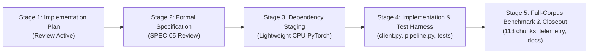
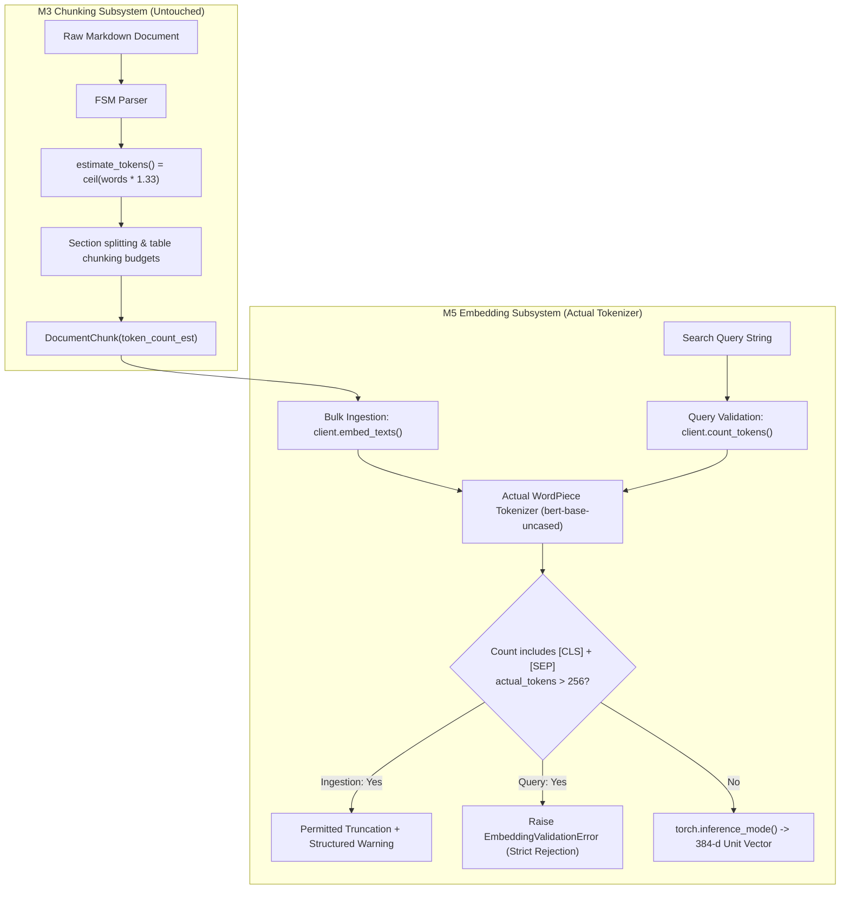

# Milestone M5: Real Embedding Inference — Architecture and Implementation Plan

**Milestone:** M5 — Real Embedding Inference  
**Author:** Akshit Chandel (RAG & Knowledge Base Track)  
**Status:** Approved Implementation Plan (Under Final Technical Review)  
**Governing Team Contract:** Shared Team Contract v3.0 Locked ([CONTRACTS.md](../CONTRACTS.md) §5) & RFC-01 ([RFC-01-embedding-dimension-amendment.md](../contracts/RFC-01-embedding-dimension-amendment.md))  
**Target Specification:** [SPEC-05: Real Embedding Inference Architecture](../specs/SPEC-05-real-embedding-inference.md)  
**Target Model:** `sentence-transformers/all-MiniLM-L6-v2`  
**Target Dimensions:** 384 dimensions ($L_2$ unit normalized)  
**Target Module:** `src/rag/embeddings/`  
**Target Test Suite:** `tests/test_m5_real_inference.py`  
**Date:** 2026-11-27  

---

## 1. Executive Summary & Architectural Principles

### 1.1 Executive Summary
Milestones M1 through M4 successfully delivered dataset reconnaissance, section-aware Markdown chunking, and the foundational embeddings subsystem architecture. Milestone M4 established model-agnostic interfaces (`BaseEmbeddingClient`), immutable containers (`EmbeddedChunk`), pipeline orchestration with tenant batch isolation and 1:1 positional reassembly (`EmbeddingPipeline`), and a fast, deterministic standard-library mock client (`DeterministicMockEmbeddingClient`) generating synthetic 384-dimensional projections for zero-dependency structural verification.

Milestone M5 transitions the embeddings subsystem from synthetic mock projections to **actual in-process neural embedding inference** using the open-weights model `sentence-transformers/all-MiniLM-L6-v2`. This plan formalizes the concrete client implementation (`SentenceTransformerEmbeddingClient`), CPU-only inference execution, model lifecycle and offline caching protocols, tokenizer ground-truth token counting and truncation detection, bounded dependency specifications, relative-ranking semantic validation, and observational full-corpus benchmark telemetry.

### 1.2 Core Architectural Principles
1. **Model-Agnostic Interface Continuity:** `SentenceTransformerEmbeddingClient` directly implements `BaseEmbeddingClient` without breaking upstream or downstream contracts. `EmbeddingPipeline` remains decoupled from model-specific deep learning libraries.
2. **CPU-Only Efficiency & Zero Cloud Egress:** All model inference runs strictly in-process on CPU using local weights. No customer support documents or search queries are transmitted to external cloud APIs, ensuring zero recurring token costs and total data residency.
3. **Decoupled Heuristic vs Tokenizer Responsibilities:**
   - **M3 Chunking Heuristic Preserved:** M3's `estimate_tokens` (`ceil(word_count * 1.33)`) in `src/rag/chunking/models.py` remains strictly an upstream text-budgeting heuristic for structural chunking. It is not modified or coupled to deep-learning tokenizers.
   - **M5 Ground-Truth Tokenizer Integration:** M5 introduces the actual BERT WordPiece tokenizer associated with `all-MiniLM-L6-v2` via `SentenceTransformerEmbeddingClient`. The tokenizer is used exclusively for:
     1. Exact token counting accounting for special tokens (`[CLS]` and `[SEP]`).
     2. Ground-truth truncation detection during bulk document ingestion.
     3. Strict sequence limit enforcement on runtime search queries.
4. **Strict Separation of Truncation Policies:**
   - **Bulk Ingestion:** Tokenizer truncation is safely permitted (`truncation=True`) to prevent anomalous or oversized documents from crashing ingestion. Actual token lengths are inspected via `self._model.tokenizer`, emitting structured, content-free warnings when inputs exceed `max_seq_length = 256`.
   - **Interactive Retrieval:** Search queries exceeding the model's actual sequence capacity (256 tokens including `[CLS]` and `[SEP]`) strictly raise `EmbeddingValidationError` in `EmbeddingPipeline.embed_query()`, preventing silent truncation of customer queries.
5. **Test Network Isolation & Offline Reproducibility:** Automated test execution (`unittest` / `pytest`) must **never automatically trigger network downloads**. Real-model integration tests inspect local cache availability and skip gracefully when offline or when weights are not pre-staged. The existing 70 unit tests remain permanently 100% offline.
6. **Relative-Ranking Semantic Testing:** Semantic retrieval capability is verified through relative ranking ($\text{sim}_{\text{related}} > \text{sim}_{\text{unrelated}}$) rather than brittle, hardcoded numerical thresholds, capturing similarity margins as observational telemetry.
7. **Observational Benchmark Performance Telemetry:** The 113-chunk full-corpus verification harness gates pass/fail strictly on mathematical and data correctness invariants (count, ordering, metadata fidelity, tenant isolation, 384 dimensions, unit norm). Latency, throughput, and memory are captured as observational telemetry without machine-dependent cutoff thresholds.
8. **Database Contract Alignment:** Vectors conform to `VECTOR(384)` with $L_2$ unit normalization ($\|v\|_2 = 1.0 \pm 10^{-4}$), ensuring inner product (`<#>`) in PostgreSQL pgvector directly computes cosine similarity.

---

## 2. Four-Register Project Model

| Register | Definition | Items in this Register |
|---|---|---|
| **Confirmed Facts** | Empirically verified truths in code, repository files, or signed Shared Team Contract. | 1. Working tree is clean on `feature/m5-real-embedding-inference`.<br>2. Exactly 10 raw Markdown documents exist under `data/raw/` (5 in `org_a/`, 5 in `org_b/`).<br>3. M3 chunker generates 113 valid `DocumentChunk` objects (56 Org A, 57 Org B).<br>4. All 113 chunks are $\le 169$ estimated tokens, well within the 256 context window of MiniLM-L6.<br>5. Upstream `DocumentChunk.content` embeds contextual breadcrumbs (`[Document: <title> > <headings>]\n\n<body_text>`).<br>6. Target database table `knowledge_base_articles` defines column `embedding VECTOR(384)` under Shared Team Contract v3.0 Locked ([CONTRACTS.md](../CONTRACTS.md) §5).<br>7. All 70 existing automated tests across M1–M4 pass cleanly in 0.67s using Python standard library only.<br>8. Active Python environment is Python 3.10.12 in `.venv` with only `pip` and `setuptools` installed. |
| **Approved Decisions** | Formally reviewed and accepted architectural designs. | 1. Implement `SentenceTransformerEmbeddingClient` as concrete `BaseEmbeddingClient` subclass in `src/rag/embeddings/client.py`.<br>2. Target CPU-only PyTorch execution (`device="cpu"`) under `torch.inference_mode()` with `model.eval()`.<br>3. Support lazy model initialization and explicit unloading (`unload_model()`).<br>4. Provide exact token counting (`count_tokens`) via `self._model.tokenizer` accounting for `[CLS]` and `[SEP]`.<br>5. Detect truncation in bulk batches and emit structured content-free warnings (`category="token_truncation_warning"`).<br>6. Enforce strict query rejection on queries exceeding 256 actual tokens.<br>7. Restrict test suite from initiating network downloads via local cache pre-flight checks.<br>8. Validate semantic capability via relative ranking ($\text{sim}_{\text{rel}} > \text{sim}_{\text{unrel}}$).<br>9. Record performance metrics (latency, throughput, RSS) as observational telemetry.<br>10. Use bounded dependency ranges with CPU-specific wheel index for PyTorch. |
| **Assumptions** | Operational hypotheses requiring empirical validation. | 1. `all-MiniLM-L6-v2` fp32 model weights (~90MB) will vectorize 113 chunks in ~1.0–2.5s on standard multi-core CPU.<br>2. Peak RSS memory increase during 64-item batch inference will not exceed 350MB.<br>3. Hugging Face hub cache directory `$HF_HOME` is writable and persistent across local sessions. |
| **Unresolved External Dependencies** | External team interfaces or approvals. | 1. Formal database migration staging by Backend/Database track (Tarun Saini) for Milestone M5 pgvector storage.<br>2. User approval of this implementation plan and subsequent specification `SPEC-05` before executing dependency installation (Stage 3) and coding (Stage 4). |

---

## 3. Subsystem Architecture and File Structure

```text
src/
└── rag/
    ├── __init__.py                # Package root
    ├── chunking/                  # Upstream M3 chunking subsystem (untouched)
    │   ├── models.py              # Contains estimate_tokens() heuristic (untouched)
    │   ├── parser.py
    │   └── engine.py
    └── embeddings/                # Embeddings Subsystem
        ├── __init__.py            # Export SentenceTransformerEmbeddingClient
        ├── models.py              # Unchanged: EmbeddingConfig, EmbeddedChunk, exceptions
        ├── client.py              # Add BaseEmbeddingClient.count_tokens() and SentenceTransformerEmbeddingClient
        └── pipeline.py            # Adapt embed_query to use client.count_tokens() for exact validation
tests/
├── test_m1_recon_scanner.py       # M1 test suite (13 tests, untouched)
├── test_m3_chunking.py            # M3 test suite (23 tests, untouched)
├── test_m4_embeddings.py          # M4 test suite (34 offline mock tests, untouched)
└── test_m5_real_inference.py      # M5 real-model integration test suite (T5-01 through T5-09)
docs/
├── plans/
│   └── 05-real-embedding-inference-plan.md  # This document
├── specs/
│   └── SPEC-05-real-embedding-inference.md # Formal technical specification
└── design/
    └── 05-real-embedding-inference.md      # Benchmark report and telemetry record
```

---

## 4. Formal Milestone Lifecycle Workflow

Milestone M5 follows a strict five-stage governance model:



1. **Stage 1: Implementation Plan Review & Approval (Current):** High-level architecture, design decisions, safeguards, and risk mitigations formulated and reviewed.
2. **Stage 2: Formal Technical Specification Review:** Review and alignment of [SPEC-05: Real Embedding Inference Architecture](../specs/SPEC-05-real-embedding-inference.md) against this approved plan. No coding or package installation occurs until SPEC-05 is approved.
3. **Stage 3: Gated Dependency Staging:** Installation of bounded runtime dependencies (`requirements.txt`) targeting CPU-only PyTorch wheels into `.venv` upon user approval.
4. **Stage 4: Implementation & Authoritative Test Construction:** Implementation of `SentenceTransformerEmbeddingClient` in `src/rag/embeddings/client.py`, adaptation of exact query validation in `pipeline.py`, and authoring of tests `T5-01` through `T5-08` in `tests/test_m5_real_inference.py`.
5. **Stage 5: Full-Corpus Verification, Telemetry & Milestone Closeout:** Execution of 113-chunk corpus benchmark (`T5-09`), generation of design record `docs/design/05-real-embedding-inference.md`, and updating `docs/STATUS.md` and `docs/CHANGELOG.md`.

---

## 5. Tokenizer Integration: Heuristic vs Actual Tokenizer Architecture

A critical architectural distinction exists between chunking text estimation and embedding model tokenization:



### 5.1 Clear Separation of Responsibilities
- **M3 Chunking Subsystem:** Uses `estimate_tokens(text: str) -> int` (`ceil(len(text.split()) * 1.33)`) as a fast, dependency-free text length approximation. This heuristic is tailored for document budgeting and section splitting. It does **not** know about BERT vocabularies, subword splits, or model-specific special tokens. M3 chunking code is untouched.
- **M5 Embedding Subsystem:** Integrates the **actual WordPiece tokenizer** bundled with `sentence-transformers/all-MiniLM-L6-v2` (vocabulary size: 30,522). The tokenizer directly governs tensor formation, subword tokenization (e.g. splitting technical IDs and UUIDs into multiple word pieces), and special token injection (`[CLS]` at index 0 and `[SEP]` at index $N-1$).

### 5.2 Special Token Accounting & Model Input Limits
- `all-MiniLM-L6-v2` has an architectural maximum sequence length of **256 tokens**.
- For every sequence passed to the model, the tokenizer automatically injects 2 special tokens: `[CLS]` (token ID 101) and `[SEP]` (token ID 102).
- Consequently, the maximum text token capacity is:
  $$\text{Capacity}_{\text{text}} = \text{max\_seq\_length} - 2 = 256 - 2 = 254 \text{ WordPiece tokens}$$
- Any token counting or sequence validation must account for special tokens (`add_special_tokens=True`) to accurately reflect model input tensor bounds.

### 5.3 Client Token-Counting Interface (`count_tokens`)
To provide model-accurate token measurements without violating client abstraction or breaking existing test doubles:
1. `BaseEmbeddingClient` introduces a standard concrete method with backward-compatible fallback:
   ```python
   def count_tokens(self, text: str) -> int:
       """Count tokens for sequence validation. Subclasses with actual tokenizers override this.
       
       Concrete default implementation prevents breaking existing test doubles and mock clients.
       """
       return math.ceil(len(text.split()) * 1.33)
   ```
2. `SentenceTransformerEmbeddingClient` overrides `count_tokens`:
   ```python
   def count_tokens(self, text: str) -> int:
       """Return exact WordPiece token count including [CLS] and [SEP] special tokens."""
       self.load_model()
       encoded = self._model.tokenizer(text, truncation=False, add_special_tokens=True)
       return len(encoded["input_ids"])
   ```

### 5.4 Bulk Ingestion Truncation Protocol
- **Permitted Truncation:** To protect automated ingestion pipelines from fatal batch failures caused by outlier documents, `model.encode(texts, truncation=True)` is enabled.
- **Ground-Truth Tokenizer Count:** Prior to encoding, `SentenceTransformerEmbeddingClient` tokenizes text batches using `self._model.tokenizer(texts, truncation=False, add_special_tokens=True)` to inspect exact WordPiece token counts.
- **Structured Content-Free Warnings:**
  ```python
  tokenized_batch = self._model.tokenizer(texts, truncation=False, add_special_tokens=True)
  for idx, input_ids in enumerate(tokenized_batch["input_ids"]):
      actual_tokens = len(input_ids)
      if actual_tokens > self._config.max_seq_length:
          logger.warning(
              "Input sequence exceeded model maximum sequence length; truncated by tokenizer.",
              extra={
                  "category": "token_truncation_warning",
                  "actual_tokens": int(actual_tokens),
                  "max_seq_length": self._config.max_seq_length,
                  "batch_index": idx,
              }
          )
  ```
  **Security & Privacy Invariant:** No raw chunk text, document titles, or query tokens are emitted into logs.

### 5.5 Strict Runtime Query Validation Protocol
- End-user search queries are concise by definition; interactive queries must never be silently truncated.
- In `EmbeddingPipeline.embed_query(query: str)`:
  1. The query string is validated (must be non-empty string).
  2. The pipeline checks exact token length via `self._client.count_tokens(stripped)`.
  3. If `actual_tokens > self._config.max_seq_length` (256):
     ```python
     raise EmbeddingValidationError(
         f"Search query exceeds maximum sequence token limit of {self._config.max_seq_length} "
         f"(actual tokenizer count: {actual_tokens} tokens, including special tokens)"
     )
     ```
  4. In `SentenceTransformerEmbeddingClient.embed_text(text: str)`, the same check is enforced, ensuring queries cannot be silently truncated even if invoked directly on the client.

---

## 6. Dependency Specification & CPU-Only Packaging

### 6.1 Bounded Dependency Manifest (`requirements.txt`)
Create `requirements.txt` with bounded version ranges:
```text
# Milestone M5 Real Embedding Inference — Bounded Runtime Dependencies
sentence-transformers>=3.0.0,<3.4.0
transformers>=4.40.0,<4.48.0
torch>=2.2.0,<2.6.0
```
- **Rationale for Bounds:**
  - `sentence-transformers`: Versions $\ge 3.0.0$ use modern Hugging Face API standards; capping $< 3.4.0$ prevents unexpected breaking changes.
  - `torch`: PyTorch 2.x provides stable `torch.inference_mode()` on CPU.
  - `transformers`: Provides standard BERT WordPiece tokenization matching `all-MiniLM-L6-v2`.
  - Excludes all non-essential packages (`torchvision`, `torchaudio`, `accelerate`, `fastapi`, `datasets`).

### 6.2 CPU-Only Installation Command Protocol
To prevent downloading ~1.2GB of unused NVIDIA CUDA runtime libraries on Linux x86_64:
```bash
# Step 1: Install lightweight CPU-only PyTorch wheel (~180MB) from official PyTorch repository
.venv/bin/pip install "torch>=2.2.0,<2.6.0" --index-url https://download.pytorch.org/whl/cpu

# Step 2: Install bounded sentence-transformers from PyPI
.venv/bin/pip install -r requirements.txt
```

---

## 7. Model Lifecycle, Caching & Test Network Isolation

### 7.1 Model Lifecycle and Offline Execution
- **Lazy Loading:** `SentenceTransformerEmbeddingClient` defers model loading until first inference call, first `count_tokens()` call, or explicit `client.load_model()`.
- **First-Run Acquisition:** In an environment with internet access, model weights (~90MB) are downloaded once from Hugging Face Hub into `$HF_HOME` (default: `~/.cache/huggingface/hub`).
- **Offline Mode:** When `local_files_only=True` or `HF_HUB_OFFLINE=1` is configured, `SentenceTransformer` loads strictly from local cache with zero network connection attempts.
- **Missing Weights Handling:** If weights are missing in offline mode, the client catches `(OSError, ValueError)` during `load_model()` and raises `EmbeddingInferenceError`:
  ```python
  raise EmbeddingInferenceError(
      f"Model weights for '{self._config.model_name}' are not available locally. "
      "Pre-stage weights in Hugging Face cache or run with network access to initialize."
  )
  ```

### 7.2 Zero-Download Test Isolation Guarantee
- **Invariant:** Automated test runs (`unittest` / `pytest`) must **never automatically download model weights from the internet**.
- In `tests/test_m5_real_inference.py`, a helper checks whether model weights exist in local cache:
  ```python
  def _is_model_cached(model_name: str) -> bool:
      try:
          from sentence_transformers import SentenceTransformer
          SentenceTransformer(model_name, local_files_only=True)
          return True
      except Exception:
          return False
  ```
- If weights are absent or `sentence-transformers` is not installed, the real-model test suite skips gracefully:
  ```python
  @unittest.skipUnless(
      HAS_SENTENCE_TRANSFORMERS and IS_MODEL_CACHED,
      "sentence-transformers not installed or model weights not cached locally; "
      "skipping real-model integration tests to prevent automatic network downloads."
  )
  class TestM5RealInference(unittest.TestCase):
      ...
  ```
- The existing 34 tests in `tests/test_m4_embeddings.py` run 100% offline at all times using `DeterministicMockEmbeddingClient`.

---

## 8. Authoritative Test Matrix & Benchmark Protocol

### 8.1 Real-Model Integration Test Suite (`tests/test_m5_real_inference.py`)

| Test ID | Test Method | Target Component | Verification Protocol & Assertions |
|---|---|---|---|
| **T5-01** | `test_real_client_lazy_loading` | Lifecycle | Asserts `client.is_loaded is False` on init; `True` after inference/load; `False` after `unload_model()`. |
| **T5-02** | `test_real_client_dimensions` | Vector Geometry | Asserts output vectors have `len(vec) == 384` and `client.dimensions == 384`. |
| **T5-03** | `test_real_client_unit_normalization` | Math Validation | Asserts $L_2$ norm $\sqrt{\sum x_i^2} == 1.0 \pm 10^{-4}$ across multiple distinct texts. |
| **T5-04** | `test_real_semantic_relative_ranking` | Semantic Validity | **Relative-Ranking Assertion:** Asserts $\text{sim}(\text{query}, \text{related}) > \text{sim}(\text{query}, \text{unrelated})$. Records similarity values and margin as observational telemetry. |
| **T5-05** | `test_real_query_document_consistency` | Pipeline Alignment | Asserts `client.embed_text(query)` and `pipeline.embed_query(query)` produce bitwise identical vectors. |
| **T5-06** | `test_real_batching_consistency` | Inference Consistency | Asserts batch encoding of 5 texts simultaneously produces bitwise identical vectors to encoding individually. |
| **T5-07** | `test_tokenizer_truncation_warning_and_privacy` | Truncation & Privacy | Feeds oversized string (>256 actual tokens); asserts `logger.warning` with `category="token_truncation_warning"`; asserts 0 raw text/tokens in logs. |
| **T5-08** | `test_real_model_error_handling` | Robustness | Asserts empty string, whitespace string, non-string, and oversized query inputs raise `EmbeddingValidationError`. |
| **T5-09** | `test_stage0_corpus_real_inference_benchmark` | Full-Corpus Benchmark | Runs real inference across all 113 raw corpus chunks from `data/raw/`. Enforces correctness gates and records observational telemetry. |

### 8.2 Relative-Ranking Semantic Evaluation Details (`T5-04`)
- **Evaluation Triplet:**
  - Query: `"How do I request a refund for an invoice?"`
  - Related Target: `"Customer refund and reimbursement policy guide and submission steps"`
  - Unrelated Target: `"PostgreSQL database write-ahead log archiving and checkpoint configuration"`
- **Assertion:**
  $$\text{sim}(\text{query}, \text{target}_{\text{related}}) > \text{sim}(\text{query}, \text{target}_{\text{unrelated}})$$
- **Observational Telemetry:**
  Test computes $\text{margin} = \text{sim}_{\text{related}} - \text{sim}_{\text{unrelated}}$ and logs `{"sim_related": float, "sim_unrelated": float, "margin": float}`.
  No arbitrary numerical cutoff (e.g. 0.35) is asserted, avoiding test fragility across CPU architectures or library revisions.

### 8.3 Full-Corpus Correctness Gates vs Observational Telemetry (`T5-09`)
- **Corpus Input:** All 10 documents from `data/raw/` (56 Org A, 57 Org B = 113 chunks).
- **Hard Correctness Invariant Gates (Pass/Fail):**
  1. Output count exactly matches input count (113 `EmbeddedChunk` instances).
  2. 100% strict positional order preservation ($0 \dots 112$).
  3. 100% metadata fidelity (`id`, `chunk_id`, `document_id`, `org_id`, `access_level`, `title`, `content`).
  4. 100% tenant batch isolation (0 batches combine Org A and Org B texts).
  5. Strictly 384 dimensions for all 113 vectors.
  6. All vector elements are finite floats.
  7. Mathematical $L_2$ unit norm ($1.0 \pm 10^{-4}$).
- **Observational Telemetry (Logged, Non-Failing):**
  - Total elapsed wall-clock time (seconds).
  - Average per-chunk latency (ms/chunk).
  - Effective throughput (chunks/second).
  - Peak resident memory (RSS MB).
  - Recorded in `docs/design/05-real-embedding-inference.md` for historical comparison.

---

## 9. Risk Register & Mitigations

| Risk ID | Technical Risk | Severity | Mitigation Strategy |
|---|---|---|---|
| **R-01** | Test runner attempts network downloads in offline CI or sandboxes | Critical | Enforce strict test isolation gate checking local weight presence with `local_files_only=True`; skip gracefully if absent. |
| **R-02** | Dependency drift causes environment incompatibility | Medium | Specify bounded version ranges in `requirements.txt` (`sentence-transformers>=3.0.0,<3.4.0`, etc.). |
| **R-03** | Tokenizer truncates long chunks silently | Medium | Client explicitly inspects `self._model.tokenizer` output lengths and logs structured content-free warnings on overflow. |
| **R-04** | Discrepancy between heuristic and actual tokenizer token counts | Medium | Decouple M3 chunking heuristic (`estimate_tokens`) from M5 actual tokenizer; use actual tokenizer (`count_tokens`) for model bounds and query validation. |
| **R-05** | Semantic similarity tests fail due to brittle numerical thresholds | Medium | Evaluate relative ranking ($\text{sim}_{\text{rel}} > \text{sim}_{\text{unrel}}$) and treat margins strictly as observational telemetry. |
| **R-06** | Variable CPU hardware causes flaky benchmark test failures | Low | Remove machine-dependent latency cutoffs from test assertions; gate pass/fail solely on mathematical and data correctness invariants. |
| **R-07** | Sensitive customer text or query leaked to log streams | High | Structured logging logs only counts, token lengths, latency, and error types. Content strings are never passed to loggers. |

---

## 10. Crisp Acceptance Criteria

1. **Clean Baseline Preserved:** All 70 existing unit tests pass cleanly without regression.
2. **Contract Adherence:** `SentenceTransformerEmbeddingClient` implements `BaseEmbeddingClient` with `dimensions == 384`, `model_name == "sentence-transformers/all-MiniLM-L6-v2"`, and `count_tokens()`.
3. **Pluggable Architecture:** `EmbeddingPipeline` functions identically with both `DeterministicMockEmbeddingClient` and `SentenceTransformerEmbeddingClient`.
4. **Tokenizer Truncation Protocol:** Permitted truncation for bulk ingestion; structured content-free warning emitted on overflow; strict rejection of oversized queries using exact tokenizer counts.
5. **Numerical Integrity:** Output vectors are 384-dimensional finite float tuples with $\|v\|_2 = 1.0 \pm 10^{-4}$.
6. **Relative Semantic Ranking:** Related query–target pairs rank strictly higher than unrelated pairs; margin is recorded as telemetry.
7. **Full-Corpus Correctness:** All 113 raw corpus chunks processed with 100% metadata fidelity, strict tenant batch isolation, and observational throughput logged.
8. **Test Network Isolation:** Automated test suite runs safely without initiating network downloads when offline.
9. **Documentation Delivered:** `docs/design/05-real-embedding-inference.md`, `docs/STATUS.md`, and `docs/CHANGELOG.md` updated with empirical telemetry and milestone closeout.

---

## 11. File Change Matrix

| Action | File Path | Scope & Purpose |
|---|---|---|
| **Create** | `docs/plans/05-real-embedding-inference-plan.md` | Formal milestone implementation plan (This document). |
| **Create** | `requirements.txt` | Bounded runtime dependency manifest. |
| **Modify** | `src/rag/embeddings/client.py` | Implement `SentenceTransformerEmbeddingClient` with lazy loading, `count_tokens()`, and tokenizer truncation checks. |
| **Modify** | `src/rag/embeddings/__init__.py` | Export `SentenceTransformerEmbeddingClient`. |
| **Modify** | `src/rag/embeddings/pipeline.py` | Update `embed_query` to use `client.count_tokens()` for exact tokenizer sequence validation. |
| **Create** | `tests/test_m5_real_inference.py` | Real-model integration test suite (`T5-01` through `T5-09`). |
| **Create** | `docs/design/05-real-embedding-inference.md` | Design record and benchmark telemetry report. |
| **Modify** | `docs/STATUS.md` | Record M5 progress and empirical metrics. |
| **Modify** | `docs/CHANGELOG.md` | Record M5 deliverable entries. |
| **Modify** | `docs/README.md` | Update documentation index links. |
