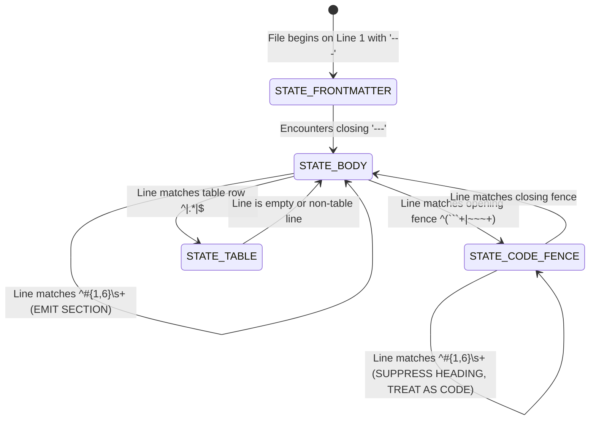
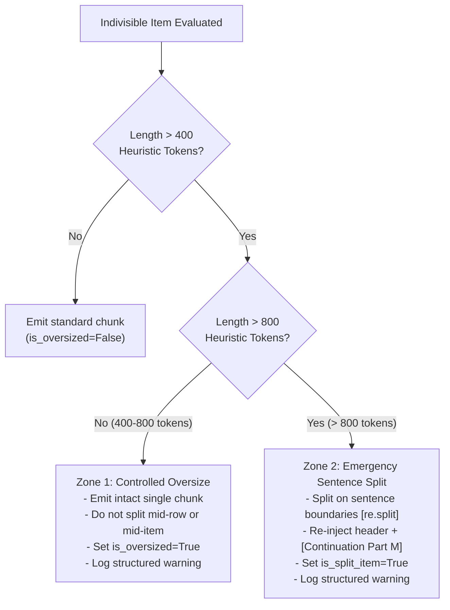

# Specification SPEC-02: Document Chunking and Ingestion Architecture

**Milestone:** M2 — Chunking and Ingestion Design  
**Author:** Akshit Chandel (RAG & Knowledge Base Track)  
**Status:** Approved for Implementation (Target Milestone: M3)  
**Governing Plan:** [02-chunking-plan.md](../plans/02-chunking-plan.md)  
**Target Module:** `src/rag/chunking/`  
**Date:** 2026-11-24  

---

## 1. Purpose and Scope

### 1.1 Purpose
This technical specification formalizes the engineering requirements, data structures, parsing grammars, chunking algorithms, fallback protocols, and verification tests for the chunking subsystem of the Multi-Tenant B2B Customer Support AI Knowledge Base.

It translates the approved milestone plan ([02-chunking-plan.md](../plans/02-chunking-plan.md)) into an unambiguous implementation specification for Milestone M3. The chunking pipeline transforms raw Markdown knowledge-base articles into discrete, metadata-preserving, contextualized chunks optimized for dense vector retrieval and strict database-level tenant isolation.

### 1.2 In-Scope
- Exact class schemas, dataclasses, and method signatures for the `src/rag/chunking/` module.
- Specification of a zero-dependency, bounded structural Finite State Machine (FSM) line parser in Python standard library.
- Grammar definitions for ATX headings (`#` through `######`), fenced code blocks (```` ``` ```` and `~~~`), Markdown tables, and lists.
- Complete suppression of heading extraction inside code blocks.
- Section-aware chunking algorithms based on H2 topic boundaries and H3 procedural boundaries.
- Contextual heading breadcrumb injection directly into chunk content text.
- Mandatory small-section merging rules, including the edge case of standalone H2 sections without H3 subsections.
- Sizing heuristics, token approximation boundaries, and full-chunk overhead accounting.
- Atomic table preservation and continuation header re-injection rules.
- Transparent, non-truncating two-zone fallback protocol for oversized indivisible content.
- Deterministic UUID v5 chunk identification decoupled from database primary-key data types.
- Strict metadata inheritance (`org_id`, `access_level`, `document_id`) enforcing zero cross-tenant leakage.
- Detailed unit test suite specifications for Milestone M3, including explicit Zone 1 and Zone 2 oversized tests.

### 1.3 Out-of-Scope (Strict Execution Boundaries)
- **No Implementation in M2:** Authoring production Python files in `src/` is deferred to Milestone M3.
- **No Package Installation:** Zero third-party dependencies (e.g. `langchain`, `llama-index`, `markdown-it-py`, `mistune`) installed.
- **No Embedding Model Selection or Dimension Reconciliation:** Embedding models and vector dimensions (1536 vs 384) remain deferred to Milestone M5.
- **No Database Operations:** No table definitions, migrations, connections, or queries.
- **No Git State Changes:** No staging, committing, pushing, or branch switching.

---

## 2. Implementation Requirements & Module Architecture

### 2.1 Technical Constraints
1. **Zero External Dependencies:** The chunking subsystem must rely strictly on the Python 3.10+ standard library (`re`, `pathlib`, `dataclasses`, `uuid`, `hashlib`, `json`, `typing`).
2. **Stateless Transformation:** The engine must be pure and stateless. No module-level mutable variables or cross-document memory caches are permitted.
3. **Decoupled Architecture:** The chunking module must have zero imports from database drivers (`psycopg`, `asyncpg`, `sqlalchemy`), embedding libraries, or network frameworks. It accepts validated strings and metadata dictionaries, and returns in-memory dataclass instances.

### 2.2 Proposed Module Directory Structure (Milestone M3)
```text
src/
└── rag/
    ├── __init__.py
    └── chunking/
        ├── __init__.py
        ├── models.py      # Dataclasses: DocumentChunk, ParsedSection, FrontmatterMetadata
        ├── parser.py      # Bounded structural FSM Markdown parser
        └── engine.py      # Section aggregation, breadcrumb injection, and fallback chunker
tests/
└── test_m3_chunking.py    # Comprehensive test suite covering parser, chunking, and isolation
```

---

## 3. Supported Markdown Grammar and Parser States

### 3.1 Bounded Finite State Machine (FSM) States
The parser operates as a stateful, line-by-line scanner. It transitions between four distinct states:



1. `STATE_FRONTMATTER`: Active from Line 1 until the closing frontmatter delimiter. Lines are buffered for metadata extraction.
2. `STATE_BODY`: Standard text parsing state. Evaluates ATX headings, paragraph boundaries, lists, and table starts.
3. `STATE_CODE_FENCE`: Active inside triple-backtick or tilde code blocks. Heading pattern recognition is **completely disabled**.
4. `STATE_TABLE`: Active across contiguous pipe-delimited lines. Groups lines into an atomic table block.

### 3.2 Formal Grammar Specifications

| Syntax Category | Regex / Matching Pattern | Semantic Meaning | Parser Action |
|---|---|---|---|
| **Frontmatter Fence** | `^---\s*$` | YAML metadata boundary | Transitions to/from `STATE_FRONTMATTER`. |
| **ATX Heading** | `^(?P<hashes>#{1,6})\s+(?P<title>.+?)\s*#*\s*$` | Section boundary | If in `STATE_BODY`: extracts `level = len(hashes)` and `title`. Emits section boundary. |
| **Code Fence Open** | `^(?P<indent>\s*)(?P<fence>```+|~~~+)(?P<lang>[a-zA-Z0-9_-]*)\s*$` | Code block start | Records `fence_char = fence[0]`, `fence_len = len(fence)`. Transitions to `STATE_CODE_FENCE`. |
| **Code Fence Close** | `^(?P<indent>\s*)(?P<fence>```+|~~~+)\s*$` | Code block end | If `fence[0] == fence_char` and `len(fence) >= fence_len`: transitions to `STATE_BODY`. |
| **Table Row** | `^\s*\|(?P<row>.*)\|\s*$` | Markdown table row | Transitions to `STATE_TABLE`; buffers contiguous rows. |
| **Table Divider** | `^\s*\|(?:\s*:?-+:?\s*\|)+\s*$` | Column delimiter row | Identifies row 1 as table header and row 2 as divider. |
| **Unordered List** | `^\s*-\s+(?P<item>.+)$` | Bullet item | Buffered as a list element under active section. |
| **Ordered List** | `^\s*\d+\.\s+(?P<item>.+)$` | Numbered step | Buffered as a procedural step under active section. |
| **Blank Line** | `^\s*$` | Block separator | Delimits paragraphs and table boundaries. |

---

## 4. Parser Behavior and Unsupported Syntax

### 4.1 Explicit Handling of Unsupported Constructs
The parser is bounded strictly to the constructs necessary for B2B customer support documentation. Unsupported constructs are treated safely as plain text paragraphs without crashing:

1. **Setext Headings:** Lines underlined with `===` or `---` are **not** treated as headings. They are emitted as standard body text paragraphs or horizontal divider tokens. Documents must use canonical ATX `#` syntax.
2. **Indented Code Blocks:** Text indented by 4 spaces or 1 tab is treated as indented paragraph text. All technical code blocks must use explicit fenced code syntax (```` ``` ```` or `~~~`).
3. **Blockquotes (`>`):** Lines starting with `>` are treated as standard body text within the active section. (The corpus currently contains 0 blockquotes).
4. **Raw HTML:** Any embedded HTML tags (`<div>`, `<span>`, `<!-- -->`) are preserved as raw literal text without tag parsing or DOM tree generation.

### 4.2 Heading Disambiguation Inside Code Blocks
- **Problem:** Configuration files, Python scripts, or Bash runbooks frequently contain comment lines starting with `#` (e.g. `#!/bin/bash` or `# Set database connection`). Naive regex splitters misclassify these comments as top-level H1 document titles.
- **Parser Guarantee:** Inside `STATE_CODE_FENCE`, lines starting with `#` are appended directly to the code buffer. **Heading pattern evaluation is completely bypassed.** Under no circumstances will a comment line inside a code fence trigger a section break or modify heading breadcrumbs.

---

## 5. Heading Hierarchy and Section Tree Construction

### 5.1 The `ParsedSection` Data Model
During parsing, the document body is converted into a hierarchical tree of section objects:

```python
from dataclasses import dataclass, field
from typing import List, Optional

@dataclass
class ParsedSection:
    heading_level: int                  # 1 for H1, 2 for H2, 3 for H3, etc. (0 for top-level intro)
    heading_text: str                   # Text of the heading (e.g., "Account Setup")
    heading_path: List[str]             # Full ancestor path: ["Document Title", "Account Setup"]
    content_lines: List[str] = field(default_factory=list) # Raw text lines belonging directly to this section
    children: List['ParsedSection'] = field(default_factory=list) # Subsections (e.g., H3 children under H2)
    start_line: int = 0                 # 1-based source line number
```

### 5.2 Tree Construction Algorithm
1. The document H1 heading establishes the root section title.
2. As lines are scanned in `STATE_BODY`, encountering an ATX heading creates a new `ParsedSection`.
3. If `new_level > current_level`: the new section is attached as a child of the current section.
4. If `new_level <= current_level`: the parser walks up the ancestor tree to find the appropriate parent of depth `new_level - 1`, appending the new section as a sibling.
5. All non-heading body lines, list items, tables, and fenced code blocks are appended to `content_lines` of the most recently opened section.

---

## 6. Chunk Boundary Rules

1. **Document-Level Isolation:** Chunks are strictly partitioned by document. A chunk **never** spans across multiple documents.
2. **Primary Boundary — H2 Sections:** Major topical sections (`## `) establish primary topic chunk boundaries. Content from distinct H2 sections is **never merged across H2 boundaries**.
3. **Secondary Boundary — H3 Subsections:** When an H2 section contains multiple discrete procedural subsections (`### `), each H3 subsection is evaluated as an independent chunk unit.
4. **Paragraph Boundary Sub-Splitting:** When an H2 or H3 section exceeds the target heuristic budget, sub-splitting occurs strictly at paragraph breaks (`\n\n`).
5. **No Mid-Block Splitting:** Splitting is strictly forbidden inside code blocks, inside table rows, or inside individual list items.

---

## 7. Small-Section Merging Rules & H2 Edge-Case Clarification

### 7.1 Mandatory Clarification: Small H2 Sections Without H3 Children
To prevent semantic cross-talk between distinct top-level topics, the following rules govern small sections ($< 60$ estimated tokens):

1. **Parent Introductory Merging (H2 with H3 Children):**
   - If an H2 section contains brief introductory text ($< 60$ estimated tokens) immediately preceding its first H3 subsection, that introductory text **merges forward into its first child H3 subsection**.
   - The resulting chunk carries the full breadcrumb and contains the H2 intro text followed by the H3 heading and content:
     ```markdown
     [Document: Title > Account Setup > Creating Your Workspace Profile]
     
     Welcome to account setup. Follow these initial steps:
     
     ### Creating Your Workspace Profile
     After your first sign-in, the setup wizard asks...
     ```
2. **Standalone H2 Isolation (H2 WITHOUT H3 Children):**
   - If an H2 section contains no child H3 subsections, it **must remain an independent chunk**, even if it contains fewer than 60 estimated tokens (e.g., a brief 2-sentence section like `## Expected Outcomes` or `## Scope`).
   - **Strict Topic Isolation Rule:** An H2 section must **never be merged backward or forward into an adjacent H2 section** merely to satisfy chunk-size targets. Merging unrelated top-level topics (e.g. blending `## Preconditions` into `## Procedures`, or `## Expected Outcomes` into `## Troubleshooting`) creates severe semantic blurring during retrieval ranking.

---

## 8. Breadcrumb Formatting

Every generated chunk prepends a standardized, structural breadcrumb header to its text payload:

### 8.1 Formatting Template
```markdown
[Document: <Document Title> > <H2 Section Title> > <H3 Subsection Title>]

<Chunk Body Content>
```

### 8.2 Formatting Rules
- If a chunk represents top-level document introductory text (before any H2):
  `[Document: <Document Title> > Overview]`
- If a chunk represents an H2 section without H3 children:
  `[Document: <Document Title> > <H2 Section Title>]`
- If a chunk represents an H3 subsection:
  `[Document: <Document Title> > <H2 Section Title> > <H3 Subsection Title>]`
- Characters `[` and `]` are reserved for the outer breadcrumb fence. Greater-than symbols (` > `) delimit hierarchy levels.
- Exactly two newline characters (`\n\n`) separate the breadcrumb header from the chunk body content.

---

## 9. Chunk Sizing and Token Estimation

### 9.1 Estimation Formula & Approximate Disclaimer
- **Formula:** Estimated token count is computed using the standard whitespace heuristic:
  $$\text{estimated\_tokens} = \lceil\text{word\_count} \times 1.33\rceil$$
  where $\text{word\_count} = \text{len}(\text{chunk\_text}.\text{split}())$.
- **Explicit Approximation Disclaimer:** The word-based heuristic is an approximate engineering proxy for text length. **It does not and cannot guarantee actual model tokenizer token counts.** Subword tokenizers (BPE, WordPiece) break punctuation, code, UUIDs, and tables into multiple tokens per word, creating variable expansion rates.
- **Full-Chunk Accounting Invariant:** Sizing evaluations must be calculated against the **complete constructed chunk payload** (including the prepended breadcrumb header, repeated table headers, and continuation notices), never on the raw body text alone.

### 9.2 Provisional Sizing Budgets
- **Provisional Target Size:** 300 to 380 estimated tokens.
- **Provisional Heuristic Threshold:** 400 estimated tokens.
- **Operational Rationale:** Capping the complete chunk heuristic at 400 estimated tokens leaves an operational buffer of 20% to absorb subword tokenizer expansion, ensuring chunks stay safely within the 512-token context window of candidate embedding models (e.g. BGE-small).
- **Provisional Status:** Sizing budgets are provisional guideposts until the final embedding model and tokenizer are benchmarked in Milestone M5.

---

## 10. Table and List Preservation and Splitting Rules

### 10.1 Markdown Tables
- **Atomic Table Invariant:** A Markdown table is kept intact as an indivisible structural block whenever its complete constructed chunk size is $\le 400$ estimated tokens. Tables are **never** cut mid-row or across cells.
- **Oversized Table Splitting ($> 400$ estimated tokens):**
  1. Splitting occurs strictly on row boundaries (`\n|...|\n`).
  2. The table column header row and divider row:
     ```markdown
     | Severity | First reply | Status cadence |
     |---|---|---|
     ```
     are **re-injected at the top of every continuation chunk**.
  3. Continuation chunks carry sequence indicators in the breadcrumb:
     `[Document: Title > Response Commitments (Table Part 2)]`

### 10.2 Procedural and Bulleted Lists
- **Item Integrity:** Chunks are **never** cut in the middle of an individual list item or procedural step.
- **Precondition Binding:** Step-by-step diagnostic workflows (e.g. Steps 1 to 4) remain bound to their preceding section heading and preconditions.
- **Oversized List Splitting ($> 400$ estimated tokens):**
  1. Splitting occurs strictly between discrete list items (`\n\d+\. ` or `\n- `).
  2. Continuation chunks repeat the procedural heading with range markers:
     `[Document: Title > Procedures (Steps 5-8)]`

---

## 11. Oversized Content Handling and Fallback Behavior

When an individual indivisible element (a single table row, code block, or numbered list item) itself exceeds the 400-token heuristic ceiling:

### 11.1 The Zero Silent Truncation Invariant
Under no circumstances may text be silently truncated, dropped, or clipped to satisfy a token budget. Silent omission of support policies or diagnostic steps introduces severe hallucination and compliance risks.

### 11.2 Two-Zone Fallback Protocol



1. **Zone 1: Controlled Oversize (400 to 800 estimated tokens):**
   - The engine emits the chunk intact, prioritizing structural coherence over arbitrary splitting.
   - The chunk metadata sets `is_oversized = True` (with `is_split_item = False`).
   - A structured warning is emitted during ingestion recording `document_id`, `chunk_index`, and estimated token length.
2. **Zone 2: Emergency Sentence-Boundary Split ($> 800$ estimated tokens):**
   - If an indivisible element exceeds 800 estimated tokens (risking vector API rejection):
   - The engine splits on sentence boundaries using `re.split(r'(?<=[.!?])\s+', item_text)`.
   - Each continuation chunk carries the breadcrumb header, table header (if tabular), and an explicit continuation marker: `[Continuation: Item (Part M)]`.
   - The chunk metadata sets `is_split_item = True` and `is_oversized = True`.

---

## 12. Metadata Contract and `DocumentChunk` Model

### 12.1 Dataclass Definition (`src/rag/chunking/models.py`)

```python
from dataclasses import dataclass
from typing import Optional, List

@dataclass(frozen=True)
class DocumentChunk:
    # Mandatory Contract Fields (mapped to database columns)
    chunk_id: str          # Deterministic UUID v5 string
    document_id: str       # UUID v4 of parent document
    org_id: str            # UUID v4 of tenant
    access_level: str      # 'public' | 'internal_staff' | 'admin_only'
    chunk_index: int       # 0-based sequential index within document
    title: str             # Parent document title
    content: str           # Complete chunk text payload (including breadcrumb)
    
    # Internal Pipeline Metadata (Enrichment, Auditing, Verification)
    heading_path: List[str]      # Ancestor headings, e.g. ["Account Setup", "Connecting Email"]
    token_count_est: int         # Estimated token length of content
    content_hash: str            # SHA-256 hex digest of content
    chunking_version: str        # Algorithm version, e.g. "v1.0-section-aware"
    category: Optional[str]      # Category from frontmatter
    source: Optional[str]        # Provenance descriptor from frontmatter
    is_oversized: bool = False   # True if chunk exceeded 400 estimated tokens
    is_split_item: bool = False  # True if an indivisible element was sentence-split
```

### 12.2 Mandatory vs. Internal Attributes
- **Mandatory Database Columns:** `chunk_id` (maps to `id`), `org_id`, `document_id`, `chunk_index`, `title`, `content`, `access_level`.
- **Internal Pipeline Attributes:** `heading_path`, `token_count_est`, `content_hash`, `chunking_version`, `category`, `source`, `is_oversized`, `is_split_item`. In the absence of an approved `metadata JSONB` column, these attributes are tracked in application manifests and logs.
- **Strict Role Invariant:** No role names (e.g. `End_Customer`, `Support_Agent`, `Org_Admin`) or role UUIDs are attached to chunks.

---

## 13. Deterministic Chunk ID Generation

### 13.1 UUID v5 Formulation
Chunk identifiers must be generated deterministically to ensure reproducible, idempotent execution:
$$\text{chunk\_id} = \text{str}(\text{uuid}.\text{uuid5}(\text{uuid}.\text{NAMESPACE\_URL}, f\text{"\{document\_id\}\#\{chunk\_index\}"}))$$

### 13.2 Database Primary-Key Decoupling
- `chunk_id` is an **application-level identifier**.
- **No PK Assumption:** The pipeline does **not** assume that the database primary key `knowledge_base_articles.id` accepts user-supplied UUID strings.
- If backend teammate Tarun Saini confirms `id` is `BIGSERIAL`, `chunk_id` remains an internal tracking identifier in application manifests.
- If `id` is typed as `UUID`, `chunk_id` is passed directly in `INSERT` statements.

---

## 14. Re-Ingestion / Change-Detection Design Boundaries

### 14.1 Re-Ingestion Lifecycle
- **Atomic Document-Level Replacement:** Document updates in PostgreSQL must be executed transactionally at the document level:
  ```sql
  DELETE FROM knowledge_base_articles WHERE document_id = :doc_uuid;
  INSERT INTO knowledge_base_articles (id, org_id, document_id, chunk_index, ...) VALUES (...);
  ```
- **Rationale:** Prevents orphan ghost rows when document edits shift chunk indices or reduce total chunk count.

### 14.2 Change Detection via Content Hashing
- Ingestion manifests record:
  $$\text{document\_hash} = \text{sha256}(\text{raw\_document\_content\_bytes})$$
- On batch re-ingestion, documents whose `document_hash` matches the manifest are skipped, avoiding redundant re-chunking and re-embedding.

---

## 15. Security and Tenant-Isolation Invariants

1. **Immutable Frontmatter Inheritance:** `org_id` and `access_level` must be cloned directly from verified parent frontmatter into every child chunk. The chunker is strictly prohibited from inferring, modifying, or defaulting tenancy or sensitivity based on text content or directory paths.
2. **Stateless Processing:** The chunker is a pure function:
   `chunk_document(...) -> list[DocumentChunk]`
   No global variables, class-level caches, or cross-document state may exist.
3. **Database Pre-filtering Readiness:** Every chunk row stored in PostgreSQL will carry non-null, indexed `org_id` and `access_level` attributes, directly supporting the mandatory pre-retrieval SQL filter:
   ```sql
   WHERE org_id = $1 AND access_level = ANY($2)
   ```
4. **Post-Retrieval Filtering Ban:** Filtering unauthorized chunks in Python application code after unrestricted retrieval is strictly prohibited.

---

## 16. Error Handling and Malformed-Input Behavior

The ingestion pipeline enforces strict validation gates before parsing:
- **Empty or Whitespace-Only File:** Raises `EmptyDocumentError`. Emits 0 chunks.
- **Missing Frontmatter (`---`):** Raises `MissingFrontmatterError`. Rejects file from chunking.
- **Unclosed Frontmatter:** Raises `MalformedFrontmatterError` detailing line number.
- **Invalid `org_id` (Non-UUID v4):** Raises `InvalidMetadataError`. Rejects file.
- **Invalid `access_level`:** Raises `InvalidAccessLevelError` if not in `{'public', 'internal_staff', 'admin_only'}`.
- **Unclosed Fenced Code Block:** If end-of-file is reached while in `STATE_CODE_FENCE`, logs a structured warning, closes the code block at EOF, and parses remaining buffer safely.
- **Non-UTF-8 Encoding:** Catches `UnicodeDecodeError`, logs error to manifest, and rejects document.

---

## 17. Detailed Milestone M3 Testing Specification

The test suite (`tests/test_m3_chunking.py`) must implement 17 explicit automated unit tests using isolated in-memory string fixtures:

### 17.1 Test Matrix

| Test Identifier | Test Target & Fixture | Verification Assertions |
|---|---|---|
| `test_atx_heading_extraction` | Markdown text with H1–H6 ATX headers | Asserts correct `heading_level`, `heading_text`, and start line numbers. |
| `test_code_fence_heading_suppression` | Code block containing `# Header` comment | Asserts `# Header` is treated as raw text. **Zero sections emitted from code.** |
| `test_table_detection` | 6-line Markdown pipe table with headers | Asserts table is grouped into a single atomic block. |
| `test_list_detection` | Mixed bullet and numbered lists | Asserts items are grouped under parent section; no mid-item splitting. |
| `test_empty_document` | Empty string / whitespace string | Asserts `EmptyDocumentError` raised; 0 chunks generated. |
| `test_single_section_document` | Compact document ($< 300$ tokens) | Asserts exactly 1 chunk produced with `chunk_index = 0`. |
| `test_breadcrumb_injection` | 2-level document (`# Title`, `## Section`) | Asserts chunk starts with `[Document: Title > Section]\n\n`. |
| `test_table_header_repetition` | Table split across 2 chunks | Asserts Chunk 2 re-injects column headers and divider row at line 1. |
| `test_h2_with_h3_small_intro_merging` | H2 intro ($30$ tokens) + H3 subsection | Asserts H2 intro is merged forward into H3 chunk. |
| `test_h2_standalone_isolation_small` | Standalone H2 ($40$ tokens, 0 H3 children) | Asserts H2 is emitted as an **independent chunk**. **Zero merging into sibling H2.** |
| `test_oversized_zone1_intact` | Single table row of **500 estimated tokens** | Asserts chunk emitted intact without truncation; `is_oversized == True`; `is_split_item == False`. |
| `test_oversized_zone2_sentence_split` | Single table row of **900 estimated tokens** | Asserts chunk is split at sentence boundary; `is_split_item == True`; `is_oversized == True`; 0 content lost. |
| `test_metadata_propagation` | Valid frontmatter fixture | Asserts `org_id`, `access_level`, `title`, and `document_id` match parent on 100% of chunks. |
| `test_sequential_indexing` | Multi-chunk document | Asserts `chunk_index` values are strictly sequential: $0, 1, \dots, N-1$. |
| `test_deterministic_uuid5` | Repeated execution | Asserts `chunk_id` is valid RFC 4122 UUID v5 matching `(document_id, chunk_index)`. |
| `test_tenant_isolation_org_a` | Org A fixture | Asserts all generated chunks contain strictly `11111111-1111-4111-8111-111111111111`. |
| `test_interleaved_batch_isolation` | Alternating Org A and Org B in loop | Asserts 0% cross-tenant contamination or state leakage. |

---

## 18. Implementation Sequence and Expected Deliverables

Milestone M3 implementation will proceed in the following sequential order:

1. **Deliverable 1: Data Models (`src/rag/chunking/models.py`)**  
   Implement `DocumentChunk`, `ParsedSection`, and metadata dataclasses with UUID v5 logic.
2. **Deliverable 2: Structural Parser (`src/rag/chunking/parser.py`)**  
   Implement the bounded FSM parser, code-fence heading suppression, table identification, and section tree builder.
3. **Deliverable 3: Chunker Engine (`src/rag/chunking/engine.py`)**  
   Implement section-aware aggregation, breadcrumb injection, standalone H2 isolation, table header repetition, and the two-zone fallback protocol.
4. **Deliverable 4: Unit Test Suite (`tests/test_m3_chunking.py`)**  
   Implement the 17 automated tests specified in Section 17. Verify 100% passing rate.
5. **Deliverable 5: Stage 0 Smoke Verification**  
   Execute the chunker against all 10 raw documents under `data/raw/`. Verify that all generated chunks conform to sizing thresholds and metadata contracts.
6. **Deliverable 6: Progress Tracking**  
   Update `docs/STATUS.md` and record verified M3 implementation milestones in `docs/CHANGELOG.md`.

---

## 19. Risks, Limitations, Assumptions, and Unresolved Dependencies

### 19.1 Technical Risks & Mitigations
- **Subword Expansion Risk:** Severe expansion on code, UUIDs, or tables exceeding model context windows.  
  *Mitigation:* Conservative 400-token heuristic ceiling leaves 20% safety buffer.
- **Silent Truncation Risk:** Dropping policy content creates legal and AI hallucination hazards.  
  *Mitigation:* Strict Zero Silent Truncation Invariant enforced by two-zone fallback.

### 19.2 Assumptions
- The 10 raw documents represent the formatting conventions of future documents.
- Selected embedding models in M5 will support input context windows $\ge 512$ tokens.
- Document re-indexing executes transactionally at the document level.

### 19.3 Unresolved Integration Dependencies (Team Confirmation Required)

> [!NOTE]
> **Post-M2 Resolution Note (Shared Team Contract v3.0 Locked):**
> Items 1–3 were subsequently resolved and locked in Shared Team Contract v3.0 (see `docs/plans/03-chunking-implementation-plan.md`):
> - Database PK `knowledge_base_articles.id` is confirmed as `UUID` accepting user-supplied UUID v5 strings.
> - No `metadata JSONB` column is present; secondary audit attributes are tracked in application manifests.
> - Target embedding dimension is locked at 1536.
> Item 4 (Corpus Expansion Timeline) remains the only active external delivery dependency.

1. **Primary Key Data Type (`Backend teammate Tarun Saini`):** Confirmation of whether `knowledge_base_articles.id` is typed as `UUID` or `BIGSERIAL` / `BIGINT`, and whether user-supplied IDs are accepted on `INSERT`.
2. **Metadata JSONB Column Availability (`Backend teammate Tarun Saini`):** Confirmation of whether an optional `metadata JSONB` column will be present in `knowledge_base_articles`.
3. **Embedding Dimension Reconciliation (`Team / Lead`):** Formal resolution between the 1536-d contract specification and the 384-d track brief suggestion prior to Milestone M5.
4. **Corpus Expansion Timeline (`Team / Lead`):** Schedule for delivering the remaining 40+ documents to reach the 50+ document target.

---

## 20. Testable Acceptance Criteria

- [ ] `src/rag/chunking/models.py` implemented with immutable `DocumentChunk` and deterministic UUID v5 generation.
- [ ] `src/rag/chunking/parser.py` implemented using Python standard library with zero external dependencies.
- [ ] Bounded FSM parser correctly ignores `# Heading` comments inside code fences.
- [ ] Heading breadcrumbs (`[Document: Title > Section]`) formatted and injected directly into chunk `content`.
- [ ] Small introductory text under an H2 with H3 children merges forward into its first H3 child chunk.
- [ ] Standalone H2 sections with no H3 children remain independent chunks, even if $< 60$ tokens (zero merging into sibling H2s).
- [ ] Markdown tables remain intact or split on row boundaries with repeated column headers.
- [ ] Procedural list items are preserved without cutting inside individual steps.
- [ ] Two-zone fallback protocol enforced: Zone 1 (500 tokens) emits intact with `is_oversized: True`; Zone 2 (900 tokens) splits on sentence boundaries with `is_split_item: True`.
- [ ] Zero silent truncation enforced across all chunking operations.
- [ ] 100% metadata inheritance: `org_id` and `access_level` match parent frontmatter on all chunks.
- [ ] Zero role names or role UUIDs stored in chunk data structures.
- [ ] All 17 automated unit tests in `tests/test_m3_chunking.py` pass.
- [ ] Stage 0 smoke verification successfully executes against all 10 raw documents under `data/raw/`.
- [ ] `docs/STATUS.md` and `docs/CHANGELOG.md` properly updated upon M3 completion.
